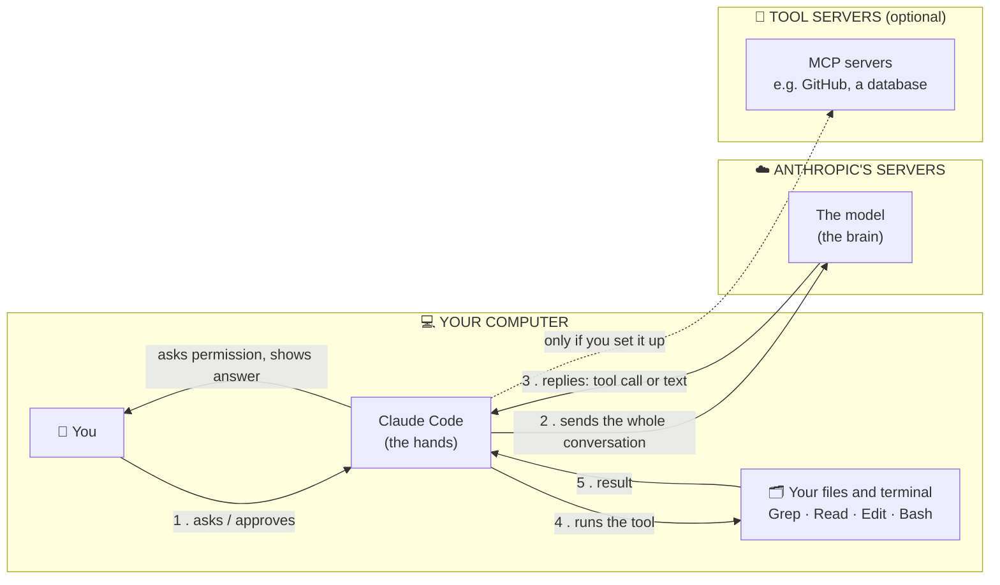
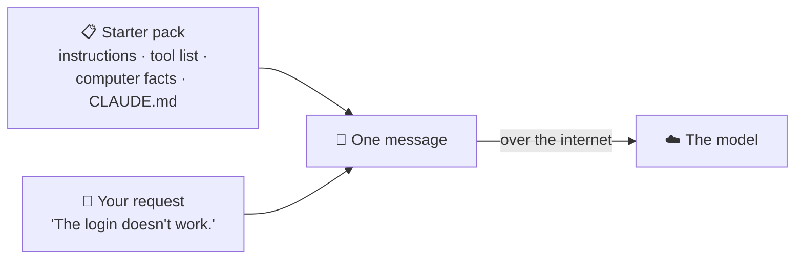
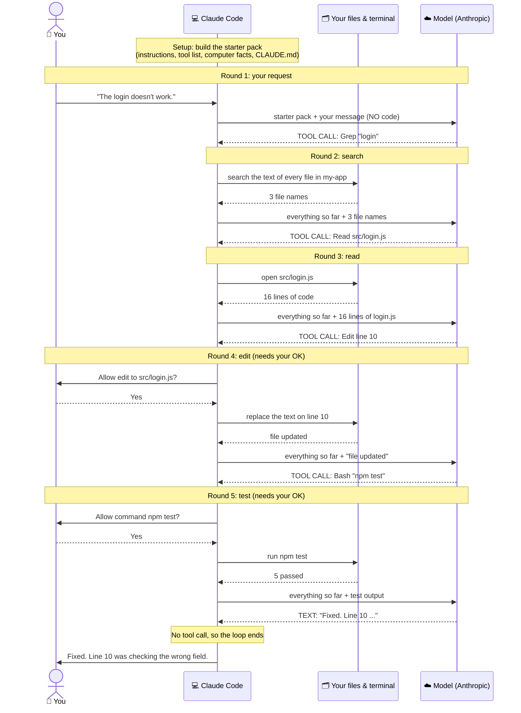
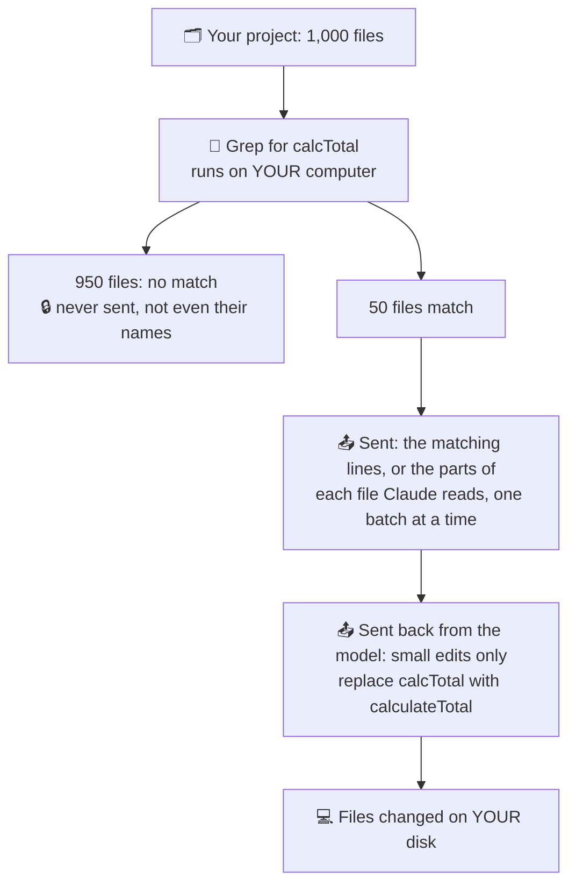

# Lesson 2 — How Claude Code works

**Course:** [Claude Code 101](https://academy.claude.com/courses/claude-code-101) &nbsp;·&nbsp; **Chapter 1:** What is Claude Code? &nbsp;·&nbsp; **Completed:** October 17, 2026

| Previous | Course | Next |
|:---|:---:|---:|
| [← What is Claude Code?](01-what-is-claude-code.md) | [📚 Course index](README.md) | [Installing Claude Code →](03-installing-claude-code.md) |

---

**On this page**

| # | Section |
|:---:|:---|
| 1 | [In one sentence](#in-one-sentence) |
| 2 | [The four parts](#the-four-parts) |
| 3 | [1. The loop: look, do, check, repeat](#1-the-loop-look-do-check-repeat) |
| 4 | [2. The context window: what Claude can remember right now](#2-the-context-window-what-claude-can-remember-right-now) |
| 5 | [3. Tools: how Claude actually does things](#3-tools-how-claude-actually-does-things) |
| 6 | [4. Permissions: what Claude can do without asking](#4-permissions-what-claude-can-do-without-asking) |
| 7 | [5. Behind the scenes: your computer vs. Anthropic's servers](#5-behind-the-scenes-your-computer-vs-anthropics-servers) |
| 8 | [Recap](#recap) |
| 9 | [My notes / practice](#my-notes--practice) |
| 10 | [FAQ](#faq) |

---

### In one sentence

Claude Code works like a helper who doesn't give up after one try. It **looks** at your code, **makes a change**, **checks** if the change worked, and **tries again** if it didn't.

### The four parts

| Part | What it means in plain words |
|---|---|
| **1. The loop** | It repeats *look → do → check* until the job is done. |
| **2. The context window** | What Claude can remember right now. |
| **3. Tools** | The things Claude can actually do, like open a file or run a command. |
| **4. Permissions** | What Claude is allowed to do without asking you first. |

Section 5 then shows how they fit together: what happens on your computer and what happens on Anthropic's servers.

We'll use one example through the whole lesson:

> **You:** "The login test is failing. Fix it."

---

### 1. The loop: look, do, check, repeat

Think of a mechanic fixing a strange noise in a car. They listen to the engine, replace a part, then start the car to hear if the noise is gone. If it's still there, they try something else. They keep going until the noise stops.

Claude Code works the same way. The course calls this the **agentic loop**.

**Step 1. You ask.**
"The login test is failing. Fix it."

**Step 2. Claude looks around.** (The course calls this *gathering context*.)
Claude doesn't know your code yet, so it explores first. It opens the test file, runs the test to see the error, and finds the login code.

**Step 3. Claude makes a change.** (The course calls this *taking action*.)
It edits the login code to fix the problem.

**Step 4. Claude checks its work.** (The course calls this *verifying results*.)
It runs the test again.

**Step 5. Done, or go round again.**
- The test passes → Claude stops and waits for your next request.
- The test still fails → Claude goes back to Step 2, reads the new error, and tries again.

Here's what that looks like in a real session:

```text
You:    The login test is failing. Fix it.

Claude: opens tests/login.test.js           ← look
        runs the test, reads the error       ← look
        opens src/login.js                   ← look
        edits src/login.js                   ← do
        runs the test again → still fails    ← check: not done yet, go round again
        reads the new error                  ← look
        edits src/login.js again             ← do
        runs the test again → passes ✅      ← check: done

Claude: Fixed. The password check was comparing the wrong field.
```


#### Who does the work: the brain and the hands

"Claude" is really two things working together:
- **The model** is the **brain**. It runs on Anthropic's servers. It thinks and decides, but it **can't touch your computer**.
- **Claude Code** is the **hands**. It's the program on your computer. It opens files, edits them, and runs commands.

When the brain wants to see a file, it asks the hands: *"please open `src/login.js`."* That request is called a **tool call**. The hands open the file and send the contents back.

Every reply from the model is one of two things:
- a **tool call**: "do this for me," so the loop keeps going
- **plain text**: "here's my answer," so the loop ends

👉 [Section 5](#5-behind-the-scenes-your-computer-vs-anthropics-servers) walks through this message by message.

#### You can jump in at any time

You don't have to wait for Claude to finish. While it's working, you can:

| You can... | Example |
|---|---|
| **Add information** | "The login settings are in `config/auth.json`." |
| **Stop it** | Claude is changing files you didn't expect. You stop it. |
| **Change its direction** | "Don't touch the database code. Only fix the test." |

#### Why this matters

A normal chatbot gives you one answer and hopes it works. It never finds out. Claude Code **checks its own work** and keeps going until it actually works. That's the big difference.

---

### 2. The context window: what Claude can remember right now

Think of a **whiteboard**. Everything from your session gets written on it:
- your messages
- Claude's replies
- the files Claude opened
- the output of commands it ran

Claude can only use what's on the whiteboard. The whiteboard is big, but it **has a fixed size**.

#### What happens when it fills up

When the whiteboard is full, Claude Code **compacts** it. This means it cleans it up so the session can keep going:
- It **erases** things that aren't needed anymore.
- It **replaces long parts with short summaries**.

For example, 500 lines of test output from an hour ago might become one line: *"Ran the tests. 2 failed, both in login."*

This happens **automatically**. You don't have to do anything.

**The downside:** a summary loses detail. If Claude needs something exact from much earlier, like a specific error message, it may not have it anymore. Just tell it again or ask it to look again.

---

### 3. Tools: how Claude actually does things

Imagine your car breaks down and you **phone a friend** who knows cars. They can tell you what to try, but they can't touch the car. You do all the work.

Now imagine that friend is **standing next to the car with a wrench**. They can do the work themselves.

- Most AI chat apps are the friend on the phone. Text goes in, text comes out. That's it.
- **Tools** turn Claude into the friend with the wrench.

A **tool** is one specific thing Claude is able to do:

| Tool | Example of what Claude does with it |
|---|---|
| Read a file | Opens `src/login.js` to see how login works. |
| Edit a file | Changes one line in `src/login.js` to fix the bug. |
| Run a command | Runs `npm test` to check if the tests pass. |
| Search the web | Looks up the current docs for a library you use. |

**Claude picks the right tool by itself.** It understands what you *mean* (the course calls this *semantic understanding*) and decides what it needs to do.

For example, you ask: *"Why does the login page crash?"*
You don't say "read the file" or "run the app." Claude works out on its own that it should open the login code and look at the error.

---

### 4. Permissions: what Claude can do without asking

Think of a **new assistant** on their first day. You decide which keys to give them. Maybe they can edit documents but have to ask before using the company credit card.

Permissions work the same way. They decide what Claude can do on its own and what it has to ask you about first.

By default, Claude **asks you before it edits a file or runs a command**. You see the exact action and choose to allow it or say no.

<!-- IMAGE: Claude Code asking for permission before running a bash command → images/02-permission-prompt.png -->

#### The four modes

You can switch between modes by pressing **Shift+Tab**.

| Mode | Edits files without asking? | Runs commands without asking? | Good for |
|---|---|---|---|
| **Manual** | ❌ Asks | ❌ Asks | Learning, or important code where you want to see every step |
| **Auto-accept** | ✅ Yes | ❌ Asks | Everyday work: let it edit, but check commands |
| **Plan mode** | ❌ Can't edit at all | Only looks, changes nothing | Big or unfamiliar changes: see the plan first |
| **Auto mode** | ✅ Yes | ✅ Yes, but a safety check watches | Long tasks where you don't want to keep clicking "allow" |

**Manual: Claude asks before every edit and every command.**
You approve each step one by one. It's slower, but you see everything.

**Auto-accept: edits happen on their own, but commands still need your OK.**
Why the difference? An edit is easy to see and undo afterward. A command can do things that are hard to undo, like deleting a folder or installing software. So commands still ask.

**Plan mode: Claude only looks. It doesn't change anything.**
It reads your code and writes a step-by-step plan. You read the plan and decide whether to go ahead.
*Example:* "Plan how to add a dark mode." Claude reads your files and replies with a list: which files to change, and what to change in each.

**Auto mode: Claude doesn't stop to ask, but a separate safety checker watches every action.**
The checker blocks actions that are dangerous:
- **can't be undone**, for example deleting a database
- **destroys things**, for example wiping a folder
- **reaches outside your project**, for example sending files to another website or changing a live server

If an action is blocked, Claude usually finds a safer way to do it, or asks you.

#### Good to know

- Which mode you **start** in depends on your Claude Code version and your settings.
- You can set all of this in your **settings file**.

#### ⚠️ Be careful about turning off the questions

When Claude asks first, you get a chance to say **"no, wait"** before a mistake happens. When it doesn't ask, the mistake happens first and you find out later.

*Example:* Claude misunderstands you and runs a command that deletes files you haven't saved to Git yet. In Manual mode, you would have seen the command and said no. With no questions asked, the files are already gone.

---

### 5. Behind the scenes: your computer vs. Anthropic's servers

This section puts the four parts together. It answers the question: **"When I type a request, what happens on my computer, and what happens on Anthropic's servers?"**

#### 🧠 Remember this

> **Brain on the server. Hands on your computer.**
> The model **asks**. Claude Code **does**. You **approve**.

#### Who's who

There are four players, plus one optional extra:

| Player | Where it lives | What it does | Example |
|---|---|---|---|
| 🧑 **You** (the human) | In front of your computer | Ask for things. Approve or reject actions. | Type "The login doesn't work." Click **Yes** to allow an edit. |
| 💻 **Claude Code** (the hands) | **Your computer**, a program you installed | Carries messages between you and the model. Runs tools. Asks your permission. Keeps the conversation history. | Sends your request to the model. Opens `login.js` when the model asks for it. |
| 🗂️ **Your files and terminal** | **Your computer** | Where the tools actually run: your disk, your project folder, your terminal. | `src/login.js` gets read and edited here. `npm test` runs here. |
| ☁️ **The model** (the brain) | **Anthropic's servers**, over the internet | Reads what Claude Code sends. Decides the next step. **Can't touch your computer.** Forgets everything after each reply. | Decides "search for login," then "read login.js," then "fix line 10." |
| 🔌 **Tool servers** (optional) | **Other computers**, run by other companies or your team | Extra tools you can connect, such as GitHub or a database. This is called **MCP**, covered in lesson 11. | "Create a GitHub issue." Not used in this example. |

The model and your computer never share a screen or a disk. They only talk by **sending messages over the internet**, and Claude Code is the only one who talks to the model.

#### The map



Read it like this: **you** talk only to **Claude Code**. **Claude Code** talks to the **model**, and also runs tools on **your files and terminal**. The **model** never reaches your files directly.

#### The example project

Say this is your project folder on your computer:

```text
C:\projects\my-app\
├── .env                    ← secret keys (ignored by Git)
├── package.json
├── node_modules\           ← thousands of library files (ignored by Git)
├── src\
│   ├── login.js            ← the bug is in here
│   ├── crypto.js
│   ├── users.js
│   └── routes\
│       └── auth.js
└── tests\
    └── login.test.js
```

And this is `src/login.js`. Look at **line 10**. It checks the password against the user's **email** instead of their **password hash** (the scrambled, safely stored version of the password). So every login fails.

```js
 1  // src/login.js
 2  const users = require('./users');
 3  const { checkPassword } = require('./crypto');
 4
 5  function login(email, password) {
 6    const user = users.findByEmail(email);
 7    if (!user) {
 8      return { ok: false, error: 'No such user' };
 9    }
10    if (!checkPassword(password, user.email)) {      // ❌ BUG: should be user.passwordHash
11      return { ok: false, error: 'Wrong password' };
12    }
13    return { ok: true, user };
14  }
15
16  module.exports = { login };
```

Now follow the example step by step. There's one setup step, then five rounds. Each round has three parts:
- **💻 Claude Code does:** what actually happens on your computer
- **📤 Sent to the server:** the exact text that goes over the internet to the model
- **☁️ The model thinks:** what the model decides, and the reply it sends back

---

#### Before you type: Claude Code prepares a "starter pack"

You open a terminal in `C:\projects\my-app` and type `claude` to start Claude Code. **You haven't asked for anything yet.** Nothing has been sent to the model yet.

But Claude Code already knows something important: the model on Anthropic's servers **knows nothing**. It doesn't know it's a coding helper, which tools it can use, or which computer it's working on. So before you type, Claude Code gets a block of background text ready. It will put this block at the **top of every message** it sends to the model. (Let's call it the **starter pack**. The technical name for the instructions part is the **system prompt**.)

**Everyday comparison:** it's like the cover sheet a front desk staples to every job ticket before passing it to a repair expert. The cover sheet says what the expert's job is, which tools are in the van, and the customer's address. The customer only writes the problem at the bottom.

**💻 Claude Code does:** builds the starter pack from four sources:

| Piece | What it tells the model | Where Claude Code gets it | Can you open it? |
|---|---|---|---|
| **Instructions** | "You are Claude Code. Help with coding. Ask before risky actions…" | Written by Anthropic, **built into the Claude Code program** (`claude.exe`) | No. It's inside the program, not a file. |
| **Tool list** | "Here are the tools you can ask for, and what each one does." | Also built into Claude Code (plus any MCP tools you added) | No. You can ask Claude "What tools do you have?" |
| **Facts about this computer** | Which folder, which operating system, the Git status, today's date | Claude Code **checks your computer** when it starts | You already know these facts. |
| **Your project rules** | Anything you wrote in `CLAUDE.md` (lesson 8) | **Copied from the file** `C:\projects\my-app\CLAUDE.md`, if it exists | Yes. It's a normal text file. |

This is roughly what the starter pack looks like. It's shortened and in plain English. The real one is much longer.

```text
=== INSTRUCTIONS (written by Anthropic, built into Claude Code) ===
You are Claude Code, a tool that helps people with coding tasks.
Use the tools below to look at and change the user's files.
Ask the user before doing anything risky.
...many more lines...

=== TOOLS YOU CAN ASK FOR (built into Claude Code) ===
Grep   Search the text inside files.   You give it: a word to look for.
Glob   Find files by name.             You give it: a name pattern, e.g. *.js
Read   Open a file.                    You give it: a file path.
Edit   Change part of a file.          You give it: the old text and the new text.
Bash   Run a terminal command.         You give it: the command.
...and a few more...

=== FACTS ABOUT THIS COMPUTER (Claude Code checked these at startup) ===
Working folder:    C:\projects\my-app
Operating system:  Windows
Git:               on branch "main", no changed files
Today's date:      2026-10-17

=== PROJECT RULES (copied from C:\projects\my-app\CLAUDE.md) ===
Use JavaScript, not TypeScript.
Run npm test after every change.
```

Things to notice:
- **You didn't write most of this.** Anthropic wrote the instructions and the tool list. Claude Code looked up the computer facts. Only `CLAUDE.md` is yours.
- **None of your code is in it.** Not a single file, and not even a list of your file names. The model only knows the folder name and the short Git status.
- **It's sent again every round.** The model forgets everything after each reply, so Claude Code puts the starter pack at the top of every message, not just the first one.
- **The tool list is why the model can ask for things.** Without the tool list, the model wouldn't know it *can* search or open files. With it, the model knows it can reply "Grep for login" and Claude Code will do it.

---

#### Round 1: You type your request

You type:

> **You:** "The login doesn't work."

**💻 Claude Code does:** adds your words to the **bottom** of the starter pack, then sends the whole thing to Anthropic's servers as one message.



**📤 Sent to the server:**

```text
=== INSTRUCTIONS ===        ...
=== TOOLS YOU CAN ASK FOR === ...
=== FACTS ABOUT THIS COMPUTER === ...
=== PROJECT RULES ===        ...
     (all of the starter pack above)

=== THE USER'S MESSAGE ===
The login doesn't work.
```

**☁️ The model thinks:** *"I don't know this code yet. Let me find where login is handled."* It picks a tool from the tool list and replies with a tool call:

```text
TOOL CALL
  tool:     Grep              (search the text inside files)
  pattern:  "login"
```

---

#### Round 2: Search

**💻 Claude Code does:**
1. Looks inside **every file** in `C:\projects\my-app` and all its subfolders for the word `login`.
2. **Skips** files your `.gitignore` tells Git to ignore, such as `node_modules\` and `.env`.
3. Finds the word in 3 files.

All of this happens on **your** computer, using **your** disk. Nothing has been sent yet.

**📤 Sent to the server:** everything from round 1, plus this result:

```text
RESULT of Grep "login"
  src/login.js
  src/routes/auth.js
  tests/login.test.js
```

Only the **file names** are sent. The contents of those files are still only on your computer.

**☁️ The model thinks:** *"`src/login.js` is the most likely place."* It replies:

```text
TOOL CALL
  tool:       Read            (open a file)
  file_path:  src/login.js
```

---

#### Round 3: Read the file

**💻 Claude Code does:** opens `src/login.js` from your disk and reads all 16 lines.

**📤 Sent to the server:** everything from rounds 1–2, plus the **full contents** of the file:

```text
RESULT of Read src/login.js
   1  // src/login.js
   2  const users = require('./users');
   3  const { checkPassword } = require('./crypto');
   ...
  10    if (!checkPassword(password, user.email)) {
   ...
  16  module.exports = { login };
```

This is the first time any of your **code** leaves your computer. Only this one file has gone. `users.js`, `crypto.js`, `auth.js`, and `.env` are still only on your computer.

**☁️ The model thinks:** *"Line 10 checks the password against `user.email`. That's wrong. It should be `user.passwordHash`."* It replies:

```text
TOOL CALL
  tool:        Edit           (change part of a file)
  file_path:   src/login.js
  old_string:  checkPassword(password, user.email)
  new_string:  checkPassword(password, user.passwordHash)
```

Notice that the model doesn't send a whole new file. It sends **the exact text to find** and **the text to replace it with**.

---

#### Round 4: Edit the file

**💻 Claude Code does:**
1. **Asks you first:** *"Allow edit to src/login.js?"* and shows you the change. You click **Yes**.
2. Finds `checkPassword(password, user.email)` in the file and replaces it with `checkPassword(password, user.passwordHash)`.
3. Saves the file **on your disk**.

If you had clicked **No**, the file would stay unchanged, and Claude Code would tell the model "the user said no."

**📤 Sent to the server:** everything from rounds 1–3, plus:

```text
RESULT of Edit
  The file src/login.js has been updated.
```

**☁️ The model thinks:** *"I changed it. Now I need to check it actually works."* It replies:

```text
TOOL CALL
  tool:     Bash              (run a terminal command)
  command:  npm test
```

---

#### Round 5: Run the tests

**💻 Claude Code does:**
1. **Asks you first:** *"Allow command `npm test`?"* You click **Yes**.
2. Runs `npm test` in your terminal, on **your** computer. Your processor runs the tests against your real files.
3. Captures whatever the command prints.

**📤 Sent to the server:** everything from rounds 1–4, plus the test output:

```text
RESULT of Bash "npm test"
  PASS  tests/login.test.js
    ✓ logs in with the correct password
    ✓ rejects a wrong password
    ✓ rejects an unknown email
    ✓ returns the user on success
    ✓ returns an error message on failure
  Tests: 5 passed, 5 total
```

**☁️ The model thinks:** *"All 5 tests pass. The job is done."* This time it replies with **plain text and no tool call**:

```text
TEXT
  Fixed. In src/login.js, line 10 was checking the password against
  user.email instead of user.passwordHash. All 5 login tests now pass.
```

---

#### The end

**💻 Claude Code:** the reply has **no tool call**, so there's nothing left to do. Claude Code shows you the message and waits for your next request.

**☁️ The model:** has already forgotten all of it. If you ask a follow-up, Claude Code sends the whole conversation again.

---

#### The whole conversation as a timeline

Read top to bottom. Each column is one player. Each arrow is one thing being sent from one player to another.



Things to notice in the timeline:
- **You** only ever talk to **Claude Code**: your request, and the two "Yes" clicks.
- The **model** column only ever talks to **Claude Code**. It never has an arrow to your files.
- Every arrow into **your files & terminal** comes from **Claude Code**. That's the only player that touches your computer.
- The arrows to the **model** get bigger every round ("everything so far + ...").

#### How the message grows each round

The model forgets everything after each reply, so **every message repeats everything before it**:

| Message | What's in it |
|:---:|---|
| **1** | Starter pack (instructions + tool list + computer facts + `CLAUDE.md`) + "The login doesn't work." |
| **2** | All of message 1 + model's Grep request + **3 file names** |
| **3** | All of message 2 + model's Read request + **16 lines of `login.js`** |
| **4** | All of message 3 + model's Edit request + "file updated" |
| **5** | All of message 4 + model's Bash request + **the test output** |

This growing message **is the context window** from section 2. When it gets too big, Claude Code **compacts** it by summarizing the older parts.

#### What went to the server, and what never left your computer

| 📤 Sent to Anthropic's servers | 🔒 Never left your computer |
|---|---|
| Your message: "The login doesn't work." | `src/users.js`, `src/crypto.js`, `src/routes/auth.js` (only their names, never their contents) |
| Folder path, system, Git summary | `tests/login.test.js` contents (only its name and the test results) |
| 3 file names from the search | `.env` and its secret keys |
| All 16 lines of `src/login.js` | `node_modules\` |
| "file updated" | Everything else on your computer |
| The `npm test` output | |

> **Note:** The tool calls above are simplified so they're easy to read. Behind the scenes they're sent as structured data (JSON), but the information is the same. In a real session, Claude often reads a few more files (for example, `crypto.js` to see how `checkPassword` works) before making a change. Each extra file it reads is sent to the server the same way.

#### What about a big task that touches 50 files?

> **Claude sends what it *reads*, not what it *touches*.**
> Files it never opens stay on your computer. Files it opens, even 50 of them, do go to the server, often as just the parts it needs.

**Example:** your project has **1,000 files**. You ask:

> **You:** "Rename the function `calcTotal` to `calculateTotal` everywhere."

`calcTotal` is used in **50 files**. Here's what happens:



| | Sent to the server? |
|---|---|
| The **950 files** with no match | ❌ Never. Not even their names. |
| The **search result** | Only the **file names**, or just the **matching lines**, such as `src/cart.js:42: return calcTotal(items);` |
| The **50 files** Claude reads so it can change them | ✅ Yes. **Whatever it reads** gets sent. That could be a whole file or just the section around each match. |
| The **changes** | Only small snippets: "replace this text with that text." The whole file is **not** sent again. |

**Four things that keep it smaller than "50 whole files at once":**

1. **Claude often reads only part of a file.** A search can return just the matching lines. The Read tool can open only a section, such as lines 30–60 of a 2,000-line file. For a simple rename, the few lines around each match are often enough.
2. **It reads as it goes, not all at once.** It doesn't upload 50 files in one bundle. It reads a few files, changes them, then moves on to the next few. You see each read happen in your session.
3. **The context window has a limit.** 50 big files might not fit on the "whiteboard." When it fills up, Claude Code **compacts** it: older file contents become short summaries. Claude can re-read a file later if it needs it.
   ⚠️ Compacting only changes what is sent **from then on**. A file that was already sent was still sent.
4. **Helpers can do the reading separately.** For big jobs, Claude can hand parts of the work to a helper called a **subagent** (lesson 9). The helper reads files in its own separate session and reports back a short summary, so your main conversation stays small. But the helper is also a model on Anthropic's servers, so **what it reads is still sent**.

**One more detail: files already read get re-sent every round.**
The model forgets after every reply, so Claude Code resends the whole conversation each round. A file read in round 3 rides along again in rounds 4, 5, 6, and so on, until compacting removes it. The servers recognize content they've already seen (*prompt caching*), so this is faster and cheaper than it sounds. But the same content does travel more than once.

**How to keep big tasks under control:**

| Do this | Why it helps | Example |
|---|---|---|
| **Be specific** | Claude reads less when it knows where to look. | "Rename `calcTotal` in `src/cart/`" instead of "clean up the cart code." |
| **Use Plan mode first** | Claude lists the files it plans to change before it changes anything. | "Plan the rename. Don't edit yet." |
| **Keep secrets out of reach** | Searches skip files your `.gitignore` ignores, and permission settings can block reading sensitive files. | Keep API keys in `.env`, not in `config.js`. |
| **Split huge jobs** | Smaller tasks mean smaller conversations, with less compacting and less lost detail. | Do `src/cart/` first, then `src/checkout/`. |

#### Four facts that clear up the confusion

**1. The model forgets everything after each reply.**
It has no memory between messages. That's why Claude Code **sends the whole conversation every time**. Claude Code holds the memory; the model just reads it fresh each round.

**2. The model only sees what Claude Code sends it.**
It doesn't have your hard drive. It saw `login.js` only because it asked to read that file. Your other files never left your computer.
⚠️ But a file that **was** read **did** go to the server. Don't let Claude read files with passwords or secret keys unless you mean to.

**3. All the real work happens on your computer.**
Searching, reading, editing, and running tests all happen on your machine, using your files, your tools, and your processor. The model only sends instructions ("run `npm test`") and gets the output back as text. So if your tests need a database running on your laptop, that works fine. Your laptop is the one running them.

**4. Permissions are checked on your computer, before anything runs.**
The model can **ask** for anything, even something dangerous. Claude Code decides whether to do it, and checks your permission mode first. The model has no other way to act, so it can't get around your permissions.

#### Common mix-ups

| ❌ Wrong idea | ✅ What really happens |
|---|---|
| "The model only gets the words I type." | Claude Code puts a starter pack on top of every message: Anthropic's instructions, the tool list, facts about your computer, and your `CLAUDE.md`. |
| "Anthropic's instructions are a file in my project I can open." | They're built into the Claude Code program. The part you can see and edit is `CLAUDE.md`. |
| "The model reads my whole codebase." | It only sees the files it asked to read. |
| "If a task touches 50 files, it uploads all 50 in one go." | It reads them a few at a time, often only the parts it needs. Whatever it reads is sent, but files it never opens aren't. |
| "My tests run in the cloud." | They run on your computer. The model only sees the output. |
| "The model remembers what we did." | It forgets after every reply. Claude Code resends the history each time. |
| "The model could delete my files directly." | It can't touch your files. It can only ask Claude Code, and Claude Code checks your permissions first. |
| "Permissions are controlled by Anthropic's servers." | They're checked by Claude Code, on your computer. |

> **Note:** If you use Claude Code **on the web** or in a **cloud environment** (lesson 3), "your computer" is a remote machine that runs your code instead of your laptop. The split is the same: the brain on Anthropic's model servers, and the hands on the machine where your code lives.

#### Test yourself

<details>
<summary>1. You ask Claude to fix a bug. Where does the file actually get changed?</summary>

On your computer. The model only sends the instruction "edit this line." Claude Code makes the change on your disk, after checking your permission.
</details>

<details>
<summary>2. How does Claude Code know the job is finished?</summary>

The model replies with plain text instead of a tool call. No tool call means there's nothing left to do, so the loop ends.
</details>

<details>
<summary>3. Why does each message get bigger as the task goes on?</summary>

The model forgets everything after each reply, so Claude Code resends the whole conversation every time, plus the newest result. That growing message is the context window.
</details>

<details>
<summary>4. Does the model see a file Claude never opened?</summary>

No. Only what Claude Code sends gets to the server. Files that were never read stay on your computer.
</details>

<details>
<summary>5. You type only "The login doesn't work." What else goes to the model with it, and who adds it?</summary>

The starter pack, which Claude Code prepared when it started: Anthropic's instructions (built into the program), the tool list, facts about your computer (folder, system, Git, date), and your `CLAUDE.md`. Claude Code puts your words at the bottom and sends it all as one message. No code is included yet.
</details>

<details>
<summary>6. Your project has 1,000 files. A rename touches 50 of them. What gets sent?</summary>

The search result (file names or matching lines), plus whatever Claude reads from the 50 files, often just the parts around each match. The edits go back as small "replace this with that" snippets. The other 950 files are never sent.
</details>

---

### Recap

- **The loop:** Claude looks, makes a change, checks if it worked, and repeats until it does. You can add information, stop it, or redirect it at any time.
- **The context window:** what Claude can remember right now. When it fills up, Claude Code automatically summarizes old parts to make room. Some detail gets lost.
- **Tools:** what let Claude actually *do* things (read files, edit files, run commands, search the web) instead of only talking. Claude picks the right tool itself.
- **Permissions:** you decide what Claude can do without asking. Switch modes with Shift+Tab: Manual, Auto-accept, Plan mode, or Auto mode.
- **Behind the scenes:** the brain (the model) is on Anthropic's servers. The hands (Claude Code) are on your computer. The model asks, Claude Code does, you approve. The model forgets after every reply, so Claude Code resends the whole conversation each time. The loop ends when the model replies with text instead of a tool call.

Together, these are why Claude Code can do the work and check it, and not just chat about it.

---

## My notes / practice

- [ ] Give Claude Code a small task and watch the loop. Spot when it looks, when it changes something, and when it checks.
- [ ] Stop it partway through a task and give it a new direction.
- [ ] Press Shift+Tab to cycle through the modes. Note which mode a new session starts in.
- [ ] Use Plan mode to get a plan for a change before letting Claude edit anything.
- [ ] Find the permission settings in my settings file.
- [ ] Ask Claude to fix something small. For each step, say out loud whether it happened on my computer or on the server.

---

## FAQ

**Q1. How does Claude Code work, in simple terms?**
It repeats a loop: look at the code, make a change, check if it worked. If it didn't work, it goes round again. If it did, it stops and waits for you.

**Q2. What does "gather context" mean?**
It means looking around before acting. Claude opens files, runs commands, and reads errors so it understands the problem before changing anything.

**Q3. What is a tool call?**
A request from the model to Claude Code, such as "open this file" or "run this command." The model can't touch your computer itself, so it asks Claude Code to do it. Claude Code does it and sends back the result.

**Q4. Why is checking its own work so important?**
A chatbot gives one answer and never finds out if it worked. Claude Code runs the test (or checks some other way) and keeps trying until it actually works.

**Q5. Can I change what Claude is doing while it works?**
Yes. You can add information ("the settings are in `config/auth.json`"), stop it, or change its direction ("only fix the test").

**Q6. What is the context window?**
Everything Claude can remember right now: your messages, its replies, files it opened, and command output. Think of it as a whiteboard with a fixed size.

**Q7. What happens when the context window is full?**
Claude Code **compacts** it automatically. It erases what isn't needed and summarizes the rest so the session can keep going. Some detail is lost, so if Claude needs something exact from much earlier, tell it again.

**Q8. Why are tools so important?**
Without tools, an AI can only talk. It can tell you how to fix something, but it can't do it. Tools let Claude read files, edit files, run commands, and search the web, so it does the work itself.

**Q9. Do I have to tell Claude which tool to use?**
No. It understands what you mean and picks the tool itself. If you ask "why does the login page crash?", it decides on its own to open the login code and look at the error.

**Q10. What are the four permission modes?**
- **Manual:** asks before every edit and every command.
- **Auto-accept:** edits without asking, but asks before commands.
- **Plan mode:** only looks and writes a plan. Changes nothing.
- **Auto mode:** doesn't ask, but a safety checker blocks dangerous actions.

Switch between them with **Shift+Tab**.

**Q11. Why does auto-accept still ask before running commands?**
An edit is easy to see and undo. A command can do things that are hard to undo, like deleting files or installing software. So commands still need your OK.

**Q12. In auto mode, what does the safety checker block?**
Actions that can't be undone (like deleting a database), that destroy things (like wiping a folder), or that reach outside your project (like sending files to another website). If something is blocked, Claude tries a safer way or asks you.

**Q13. What runs on my computer, and what runs on Anthropic's servers?**
- **Your computer:** Claude Code, the hands. It searches, reads, and edits files, runs commands, asks your permission, and keeps the conversation history.
- **Anthropic's servers:** the model, the brain. It reads the messages Claude Code sends and decides the next step.

**Q14. Does the model see my whole codebase?**
No. It only sees what Claude Code sends: your messages, plus the results of the tools it asked for, such as the files it read. Files that were never read stay on your computer.

**Q15. What's in the very first message, before Claude has looked at anything?**
Your request, with a **starter pack** on top. Claude Code builds the starter pack when it starts, before you type anything:
- **Instructions** written by Anthropic (the *system prompt*): "You are Claude Code, help with coding, ask before risky actions…"
- **Tool list:** Grep, Glob, Read, Edit, Bash, and what each one does.
- **Facts about your computer:** folder path, operating system, a short Git summary, the date.
- **Your `CLAUDE.md`**, if you have one.

**No code, and not even a list of your file names.** You only type the request. Claude Code adds the starter pack automatically, and sends it again at the top of every message.

**Q16. Where are Anthropic's instructions (the system prompt) on my computer? Can I read them?**
They're built into the Claude Code program itself (on Windows, usually `C:\Users\<you>\.local\bin\claude.exe`). They aren't a separate file, so you can't open and read them. What you can do:
- Run `/context` to see how much space they take up.
- Add your own instructions on top with `CLAUDE.md` (a normal file you can open and edit) or `claude --append-system-prompt "..."`.

**Q17. When Claude searches for "login", what actually gets sent to the server?**
Claude Code searches the text inside the files in your project folder **on your computer**, skipping anything your `.gitignore` ignores. Only the result goes to the server, which by default is the **names** of the matching files, such as `src/login.js`. The files' contents are sent only if the model then asks to **Read** a file.

**Q18. The model forgets everything after each reply. So how does it follow a long task?**
Claude Code sends the **whole conversation** with every message: your request, every tool call, every file read, every result. The model reads it all fresh each time. That growing message is the context window.

**Q19. Isn't sending the whole conversation every time slow and wasteful?**
Less than it sounds. Anthropic's servers can reuse the parts of a message they've already seen (this is called *prompt caching*), so repeating the history is faster and cheaper than processing it from scratch.

**Q20. When Claude "runs the tests," where do they run?**
On your computer. Claude Code runs the command using your files and your tools. The model only sends the instruction and reads the output that comes back.

**Q21. How does Claude Code know the loop is finished?**
The model replies with plain text instead of a tool call. No tool call means there's nothing left to do.

**Q22. Could the model delete my files directly?**
No. It can't touch your computer. It can only *ask* Claude Code, and Claude Code checks your permission mode before doing anything.

**Q23. If my task touches 50 files, does Claude send all 50 files to the server?**
It sends **what it reads**, not what it touches. If it reads all 50 files, their contents are sent, often only the parts around each change, and a few files at a time rather than all at once. Files it never opens, and files with no search match, are never sent. Edits go back as small "replace this with that" snippets, not whole files.

**Q24. If the context window gets compacted, is a file I already sent "unsent"?**
No. Compacting only changes what goes in **later** messages. Anything already sent was sent.

**Q25. Do subagents keep my files from being sent?**
No. A subagent reads files in its own separate session, which keeps your **main** conversation small. But it's also a model on Anthropic's servers, so what it reads is still sent.

**Q26. (Exam angle) How should a team choose a permission mode?**
Give Claude less freedom when mistakes would be costly:
- **Plan mode** for big or risky changes, so a person approves the plan first.
- **Manual** or **auto-accept** for everyday work, so a person still approves commands.
- **Auto mode** only where its safety checks are good enough for that project.

Put the choice in the settings file so the whole team works the same way, instead of each person deciding. This fits the **Governance, Safety & Risk** exam domain.

**Q27. (Exam angle) Why is turning off permission questions risky, and how do you reduce the risk?**
Without the questions, a mistake happens before anyone can stop it. To reduce the risk:
- Keep a person approving anything that can't be undone.
- Use Plan mode to agree on the approach first.
- Run Claude in a separate test environment, so a bad command can't harm real systems.
- Use tests to catch mistakes after changes are made.

**Q28. (Exam angle) A security team asks, "What data leaves our machines when developers use Claude Code?" How do you answer?**
- **What leaves:** the messages Claude Code sends to the model. That means the developer's requests, plus the results of any tools Claude used: the contents of files it read, command output, search results.
- **What stays:** everything Claude never read or ran. The code runs, the files change, and commands execute on the developer's machine.
- **On big tasks:** the amount sent grows with how much Claude **reads**, not with the size of the project. A 1,000-file project where Claude reads 50 files sends those 50 (or parts of them), not 1,000.
- **How to control it:** limit what Claude can read and run with permission settings, keep secrets out of files Claude is likely to open, and set these rules centrally for the team.

This fits the **Governance, Safety & Risk** exam domain.

---

| Previous | Course | Next |
|:---|:---:|---:|
| [← What is Claude Code?](01-what-is-claude-code.md) | [📚 Course index](README.md) | [Installing Claude Code →](03-installing-claude-code.md) |
