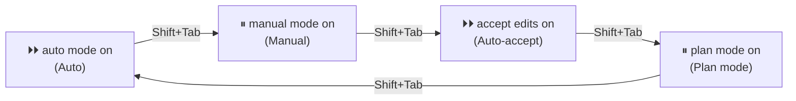
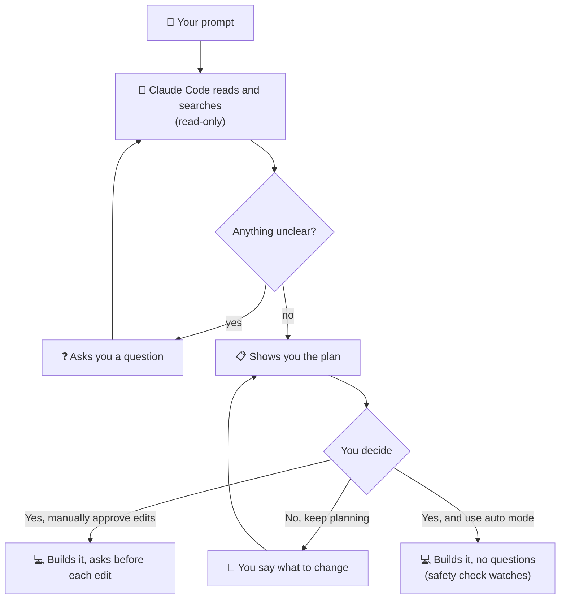
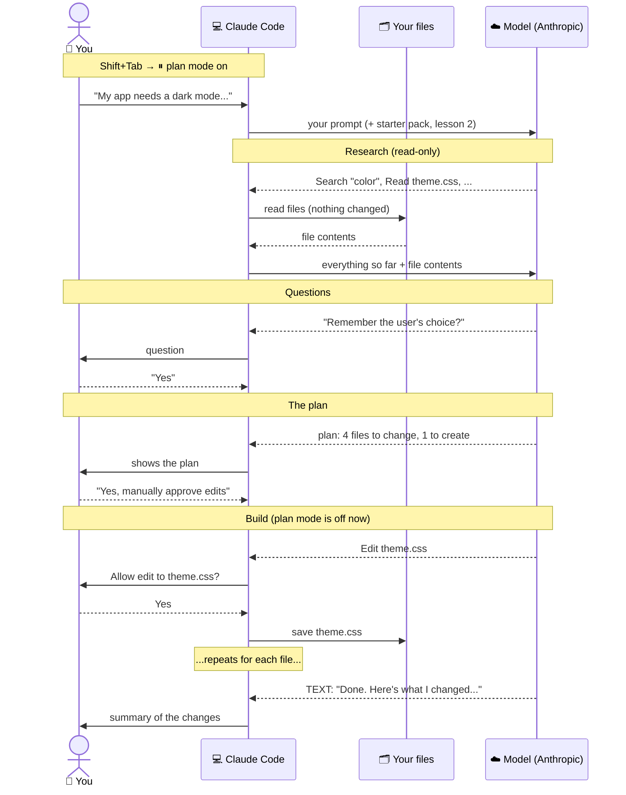

# Lesson 4 — Your first prompt

**Course:** [Claude Code 101](https://academy.claude.com/courses/claude-code-101) &nbsp;·&nbsp; **Chapter 2:** Your first prompt &nbsp;·&nbsp; **Completed:** October 17, 2026

| Previous | Course | Next |
|:---|:---:|---:|
| [← Installing Claude Code](03-installing-claude-code.md) | [📚 Course index](README.md) | [The explore → plan → code → commit workflow →](05-explore-plan-code-commit.md) |

---

**On this page**

| # | Section |
|:---:|:---|
| 1 | [In one sentence](#in-one-sentence) |
| 2 | [The three parts](#the-three-parts) |
| 3 | [1. Choose a permission mode](#1-choose-a-permission-mode) |
| 4 | [2. Plan mode: look and plan, change nothing](#2-plan-mode-look-and-plan-change-nothing) |
| 5 | [3. Example: add a dark mode toggle](#3-example-add-a-dark-mode-toggle) |
| 6 | [4. Write a descriptive prompt](#4-write-a-descriptive-prompt) |
| 7 | [5. Putting it together](#5-putting-it-together) |
| 8 | [Recap](#recap) |
| 9 | [My notes / practice](#my-notes--practice) |
| 10 | [FAQ](#faq) |

---

### In one sentence

You talk to Claude Code in plain words, like any AI assistant, but before you hit Enter you choose **how much it should ask you first**, and for big jobs you let it **make a plan before it changes anything**.

### The three parts

| Part | What it means in plain words |
|---|---|
| **1. Permission mode** | How often Claude Code stops to ask "Can I do this?" You switch with **Shift+Tab**. |
| **2. Plan mode** | Claude Code only reads and thinks. It hands you a plan. Nothing changes until you say yes. |
| **3. A descriptive prompt** | The clearer you say what you want, the better the plan and the result. |

A **prompt** is the message you type to Claude Code: your request, in your own words.

We'll use the course's example through the whole lesson:

> **You:** "My app needs a dark mode implemented across the entire app. Can you create a toggle switch on the header that allows a user to toggle between light mode and dark mode? I need you to find a good contrast color that works based on my existing light theme."

---

### 1. Choose a permission mode

Lesson 2 introduced the modes. This lesson is about **picking one before you start a task**.

#### Everyday comparison: a builder in your house

You hire a builder to work on your kitchen. You decide how much freedom they get:

- **Manual:** they ask you before every single job. "Can I paint this wall? Can I use the drill?"
- **Auto-accept:** they paint and fix things on their own, but still ask before using power tools. Paint is easy to redo. A hole in the wall is not.
- **Auto:** they work on their own all day. A site supervisor watches and stops anything dangerous, like knocking down a wall.

Claude Code works the same way. File edits are like paint: easy to see and undo. Commands are like power tools: they can do things that are hard to undo, like deleting a folder.

#### The three modes

| Mode | Edits files without asking? | Runs commands without asking? | What it feels like |
|---|---|---|---|
| **Manual** | ❌ Asks every time | ❌ Asks every time | You approve each step. Slow, but you see everything. |
| **Auto-accept** | ✅ Yes | ❌ Asks (most commands) | Claude edits freely. You check each command. |
| **Auto** | ✅ Yes | ✅ Yes | No questions. A **background safety check** looks at every action first. |

In **Auto** mode, the safety check is a second AI model that reviews each action before it runs (the docs call it the *classifier*). If it blocks something, Claude usually finds a safer way, or asks you.

> The course says it plainly: **there's no right or wrong mode.** Pick whatever you're comfortable with.

<!-- IMAGE: Claude Code in auto-accept mode, reading files and working through a task → images/04-auto-accept-mode.png -->

#### How to switch: Shift+Tab

Press **Shift+Tab** in Claude Code. Each press moves to the next mode. The **status bar** (the line under the box where you type) shows which mode you're in:



Things to notice:
- **Plan mode is in the same Shift+Tab cycle.** That's why the course says plan mode is "within the Shift+Tab menu." It's section 2.
- **Auto mode only shows up if it's available to you.** Your company can turn it off. Then the cycle is just Manual → Auto-accept → Plan mode.
- **Which mode you start in** depends on your version and settings. In recent versions of Claude Code, new terminal sessions start in Auto mode by default. Always glance at the status bar before you type.

#### Which one should I pick?

| Pick this | When | Example |
|---|---|---|
| **Manual** | You're learning, or the code is important and you want to see every step. | Your first week with Claude Code. Changing payment code. |
| **Auto-accept** | Everyday work. You trust the edits but want to check commands. | Fixing a bug in a project you know well. |
| **Auto** | Long tasks where clicking "allow" over and over slows you down. | "Add tests for every file in `src/utils/`." |
| **Plan mode** | Big, multi-step, or unfamiliar changes. Or a safe code review. | "Add dark mode across the whole app." |

#### ⚠️ Auto-accept doesn't ask about *every* command

The course says auto-accept "still requires your permission" for commands. That's true for most commands. But the docs say auto-accept also runs a few simple **file commands** without asking, as long as they stay inside your project folder: `mkdir` (make a folder), `touch` (make an empty file), `mv` (move), `cp` (copy), `rm` and `rmdir` (delete), and `sed` (edit text).

*Why it matters:* `rm` deletes files. In auto-accept mode, Claude could delete a file inside your project without asking. If the file was never saved to Git, it's gone. If that worries you, use Manual mode, or commit your work before you start.

---

### 2. Plan mode: look and plan, change nothing

#### Everyday comparison: an architect before the builders

Before builders touch your house, an architect walks through it, measures the rooms, asks what you want, and draws a plan. You read the plan and say "yes" or "change this." Only then do the builders start.

Plan mode is the architect. Claude Code **looks around, asks questions, and writes a plan**. It doesn't change your code until you approve.

#### What plan mode does

1. **Takes your prompt.**
2. **Researches using read-only tools.** It opens files, searches your code, and looks at how things are built today. (**Read-only** means it can look but not change anything.)
3. **Asks you questions** when something isn't clear.
4. **Gives you a detailed plan**: which files it will change, what it will change in each, and in what order.
5. **Waits for you.** Nothing is edited until you approve.

| In plan mode, Claude Code... | Can it? |
|---|---|
| Read your files | ✅ Yes |
| Search your code | ✅ Yes |
| Run commands to explore, like listing files or checking versions | ✅ Yes, but each one is checked first (by the safety check if Auto mode is available, otherwise by asking you) |
| Ask you questions | ✅ Yes |
| Edit or create your source files | ❌ No, not until you approve the plan |

#### How to turn it on

| Way | How |
|---|---|
| **During a session** | Press **Shift+Tab** until the status bar shows `⏸ plan mode on`. |
| **For one prompt only** | Start your prompt with `/plan`, for example `/plan add a dark mode toggle`. |
| **From the start** | Start Claude Code with `claude --permission-mode plan`. |

To **leave** plan mode without approving anything, press **Shift+Tab** again.

<!-- IMAGE: Claude Code with plan mode on, showing the status bar indicator → images/04-plan-mode-indicator.png -->

#### What happens when the plan is ready

Claude Code shows the plan and asks how to go on. You get these choices (from the official docs):

| Choice | What happens next |
|---|---|
| **Yes, and use auto mode** | Approves the plan and switches to Auto mode. Claude builds it without asking. (If Auto mode isn't available, this says **Yes, auto-accept edits**.) |
| **Yes, manually approve edits** | Approves the plan and switches to Manual mode. Claude asks before each edit. |
| **No, keep planning** | Stays in plan mode. You say what to change, and Claude updates the plan. |

You can also press **Ctrl+G** to open the plan in your text editor and change it yourself before Claude starts.



#### When plan mode is worth it

| Use plan mode for... | Why |
|---|---|
| **Multi-step features** | The course says this is where plan mode "excels." A feature like dark mode touches many files. A plan shows you all of them before anything changes. |
| **Unfamiliar code** | Claude explores first, so you both understand the code before changing it. |
| **A safe code review** | You can ask "Review this code and list problems." Plan mode can't edit, so nothing changes by accident. |
| **Anything expensive to get wrong** | Fixing a bad plan costs one sentence. Fixing bad code across 10 files costs much more. |

For a one-line fix, like a typo, you don't need plan mode. Just ask.

---

### 3. Example: add a dark mode toggle

This follows the course's example, step by step. The project files, Claude's questions, and the plan below are **made up to show what happens**. Your real session will look different, but the steps are the same.

#### The project

Say this is your app:

```text
C:\projects\recipe-app\
├── index.html
├── package.json
└── src\
    ├── app.js
    ├── components\
    │   └── header.js          ← where the toggle should go
    └── styles\
        ├── theme.css          ← the light theme colors
        ├── cards.css
        └── footer.css
```

And this is `src/styles/theme.css`. It holds the light theme's colors as **CSS variables** (named colors that the rest of the app reuses):

```css
1  /* src/styles/theme.css */
2  :root {
3    --color-background: #ffffff;
4    --color-surface:    #f5f7fa;
5    --color-text:       #1f2933;
6    --color-primary:    #2563eb;
7    --color-border:     #e4e7eb;
8  }
```

#### Step 1: Open the project and start Claude Code

```bash
cd C:\projects\recipe-app
claude
```

Start in the **root** of the project (the top folder). Claude Code can only see that folder and everything inside it (lesson 3).

#### Step 2: Switch to plan mode

Press **Shift+Tab** a couple of times until the status bar shows:

```text
⏸ plan mode on
```

#### Step 3: Type the prompt

```text
My app needs a dark mode implemented across the entire app. Can you create
a toggle switch on the header that allows a user to toggle between light
mode and dark mode? I need you to find a good contrast color that works
based on my existing light theme.
```

<!-- IMAGE: Entering the dark mode prompt in Claude Code with plan mode enabled → images/04-dark-mode-prompt.png -->

#### Step 4: Claude Code researches (read-only)

You'll see Claude Code look around. For example:

```text
Search  "color"            → finds theme.css, cards.css, footer.css
Read    src/styles/theme.css
Read    src/styles/cards.css
Read    src/styles/footer.css
Read    src/components/header.js
Read    src/app.js
```

Nothing is changed. Remember from lesson 2: every file Claude **reads** is sent to the model on Anthropic's servers.

#### Step 5: Claude Code asks questions

Plan mode asks when your prompt leaves something open. For example:

```text
1. Should the app remember the user's choice the next time they visit?
   → Yes, remember it
     No, always start in light mode

2. On a user's first visit, should the app follow their computer's
   light/dark setting?
   → Yes
     No, start in light mode
```

You pick an answer, and Claude keeps planning.

#### Step 6: Claude Code shows the plan

```text
Plan: Add dark mode with a toggle in the header

What I found
- The light theme lives in src/styles/theme.css as 5 color variables.
- 2 files skip the variables and use fixed colors:
    src/styles/cards.css   line 4: background: #fff;
    src/styles/footer.css  line 7: color: #333;
  These would stay light in dark mode, so they need fixing.
- The header is built in src/components/header.js.

Steps
1. theme.css: add a dark version of the 5 colors, used when
   <html data-theme="dark">:
     background #121417   surface #1c1f24   text #e4e7eb
     primary    #60a5fa   border  #2d3239
   (primary is a lighter blue, so it still stands out on a dark background)
2. cards.css, footer.css: replace the fixed colors with the variables.
3. header.js: add a 🌙 / ☀️ toggle switch on the right of the header.
4. New file src/theme-toggle.js: switches the theme, saves the choice,
   and follows the computer's setting on the first visit.
5. Check that every text color has enough contrast against its
   background (at least 4.5 : 1).

Files to change: theme.css, cards.css, footer.css, header.js
File to create:  src/theme-toggle.js
```

Things to notice:
- **The plan caught something you might have missed.** `cards.css` and `footer.css` use fixed colors. Without the plan, dark mode would have had white cards on a dark page.
- **"A good contrast color" became real numbers.** Claude based the dark colors on your light ones, as you asked. The **4.5 : 1** target is the common accessibility rule (WCAG AA) for normal-size text: the text must be at least 4.5 times "brighter" or "darker" than its background so people can read it easily.
- **You see every file before anything changes.** Four files changed, one new.

#### Step 7: Approve the plan

```text
❯ Yes, and use auto mode
  Yes, manually approve edits
  No, keep planning
```

- Happy with it? Pick a **Yes**.
- Want a change? Pick **No, keep planning** and say, for example, "Put the toggle on the left of the header."

#### Step 8: Claude Code builds it

Plan mode ends and Claude starts editing. How often it checks in with you depends on which **Yes** you picked:

| You picked | Asks before edits? | Asks before commands? |
|---|---|---|
| **Yes, manually approve edits** | ✅ Each one | ✅ Each one |
| **Yes, and use auto mode** | ❌ No | ❌ No (the safety check watches) |

#### Step 9: See what Claude did

When it's done, Claude Code tells you what it changed and why: which files, which colors, and how it chose them. The course says: "you can see exactly what Claude did and how it reached its conclusions." Open the app, click the toggle, and check the result yourself.

#### The whole example as a timeline



---

### 4. Write a descriptive prompt

The course's main advice: **be as descriptive as possible.** Claude Code can only act on what you tell it, plus what it finds in your code.

#### Everyday comparison: ordering from a carpenter

"Make me a table" gets you *a* table. "A round oak table, 120 cm wide, seats four, same color as my chairs" gets you *your* table. The carpenter is just as skilled both times. The difference is what you told them.

#### What makes the course's prompt good

| Part of the prompt | What it tells Claude Code |
|---|---|
| "dark mode implemented across **the entire app**" | **How far** to go: every page, not just one. |
| "a **toggle switch** on the **header**" | **What** to build and **where** to put it. |
| "toggle between light mode and dark mode" | **How it should behave.** |
| "a good contrast color … based on **my existing light theme**" | **A rule to follow**: match the colors you already have. |

#### Vague vs. descriptive

| ❌ Vague | ✅ Descriptive | Why the second is better |
|---|---|---|
| "Add dark mode." | The course's prompt above. | Says where the toggle goes, how far to go, and how to pick colors. |
| "Fix the login." | "Login fails with 'Wrong password' even when the password is right. The test in `tests/login.test.js` shows it." | Gives the error and where to look. |
| "Make it faster." | "The recipe search page takes 5 seconds to load. Find out why and suggest fixes. Don't change the database." | Says what's slow, what you want, and what not to touch. |

#### What you could add to make it even clearer

- **What "done" looks like:** "The toggle works on every page, and all tests pass."
- **What not to touch:** "Don't change the logo colors."
- **Extra behavior:** "Remember the user's choice." (Plan mode asked about this in step 5. Saying it up front saves a question.)

#### Stay in the loop as much as you want

You don't have to give up control. The course says: "If you want to stay in the loop at every step, you can." Use **Manual** mode to approve every step, **plan mode** to agree on the approach first, or both.

---

### 5. Putting it together

#### 🧠 Remember this

> **Shift+Tab sets the leash. Plan mode draws the map. A clear prompt picks the destination.**

#### Common mix-ups

| ❌ Wrong idea | ✅ What really happens |
|---|---|
| "Auto-accept means Claude does everything without asking." | Auto-accept skips questions for **file edits**. Most **commands** still ask. |
| "Auto-accept asks before *every* command." | A few simple file commands inside your project (`mkdir`, `mv`, `cp`, `rm`, …) run without asking. |
| "Auto mode means no safety at all." | A background safety check reviews each action and blocks dangerous ones. |
| "Plan mode is a separate tool I have to install." | It's one of the modes in the Shift+Tab cycle. |
| "Plan mode makes changes and shows me afterward." | It changes **nothing** until you approve the plan. |
| "In plan mode, nothing is sent to Anthropic." | Files Claude reads while planning are still sent to the model, the same as always. |
| "Once I approve the plan, I can't stop Claude." | You can still stop it or redirect it at any time (lesson 2). |
| "There's a correct mode everyone should use." | The course says there's no right or wrong mode. It depends on the task and your comfort. |

#### Test yourself

<details>
<summary>1. You're in auto-accept mode. Claude Code wants to edit a file and then run <code>npm test</code>. Which one asks you first?</summary>

`npm test`. In auto-accept mode, file edits happen without asking, but most commands still need your OK. A command can do things that are hard to undo; an edit is easy to see and undo.
</details>

<details>
<summary>2. How do you switch to plan mode during a session?</summary>

Press **Shift+Tab** until the status bar shows `⏸ plan mode on`. You can also start one prompt with `/plan`, or start Claude Code with `claude --permission-mode plan`.
</details>

<details>
<summary>3. In plan mode, can Claude Code edit your files?</summary>

No. It can read and search, and run checked commands to explore, but it doesn't edit your source files until you approve the plan.
</details>

<details>
<summary>4. Claude Code shows you a plan, but you want the toggle on the left, not the right. What do you pick?</summary>

**No, keep planning.** Then tell Claude what to change. It updates the plan and shows it again. (Or press **Ctrl+G** to edit the plan yourself.)
</details>

<details>
<summary>5. Why is "Add dark mode" a weaker prompt than the course's version?</summary>

It doesn't say how far to go (the whole app?), where the toggle goes (the header?), or how to pick colors (based on the current light theme?). Claude Code has to guess, or ask.
</details>

---

### Recap

- **Talk to Claude Code in plain words**, like any AI assistant.
- **Choose a permission mode with Shift+Tab.** Manual asks about everything. Auto-accept edits files freely but asks before most commands. Auto asks nothing, but a background safety check screens each action. No mode is right or wrong.
- **Plan mode is in the same Shift+Tab menu.** Claude Code reads your code, asks questions, and writes a detailed plan. Nothing changes until you approve.
- **After the plan:** approve with auto mode, approve with manual edits, or keep planning. Your permission mode decides how often Claude checks in while it builds.
- **Be descriptive.** Say what to build, where, how far to go, and any rules to follow.

---

## My notes / practice

- [ ] Start `claude` in a test project. Press Shift+Tab and write down the status bar text for each mode, in order.
- [ ] Check which mode a new session starts in.
- [ ] In auto-accept mode, ask Claude to create a file and then run a command. Note which one asks.
- [ ] Switch to plan mode and ask for a small feature. Read the plan before approving.
- [ ] Pick **No, keep planning** once and change something in the plan.
- [ ] Try `/plan` at the start of a single prompt.
- [ ] Press Ctrl+G on a plan to open it in my editor.
- [ ] Write the same request two ways, vague and descriptive, and compare the plans.

---

## FAQ

In these answers, **Claude Code** means the program on your computer. **The model** means the AI on Anthropic's servers.

**Q1. How do I talk to Claude Code?**
In plain words, the same way you'd talk to any AI assistant. Type your request (your *prompt*) and press Enter.

**Q2. What does "permission mode" mean?**
It's a setting that decides how often Claude Code stops to ask "Can I do this?" before it edits a file or runs a command.

**Q3. How do I switch permission modes?**
Press **Shift+Tab**. Each press moves to the next mode. The status bar under the prompt box shows the current mode, for example `⏵⏵ accept edits on`.

**Q4. What are the permission modes in this lesson?**
- **Manual:** asks before every edit and every command.
- **Auto-accept:** edits files without asking, but asks before most commands.
- **Auto:** asks nothing, but a background safety check screens each action.

Plan mode is in the same Shift+Tab cycle and is covered below.

**Q5. In auto-accept mode, why does Claude Code still ask before commands?**
A file edit is easy to see and undo. A command can do things that are hard to undo, like deleting a folder or installing software. So most commands still need your OK.

**Q6. Does auto-accept mode ask before every command?**
Not quite. A few simple file commands inside your project folder, like `mkdir`, `mv`, `cp`, and `rm`, run without asking. Other commands still ask.

**Q7. In auto mode, what does the safety check do?**
It's a second AI model that reviews each action before it runs. It blocks dangerous actions, like deleting things that can't be recovered or sending data outside your project. When something is blocked, Claude Code usually finds a safer way, or asks you.

**Q8. Which permission mode should I use?**
Whichever you're comfortable with. The course says there's no right or wrong answer. Manual is good while you're learning. Auto-accept suits everyday work. Auto suits long tasks where approving every step slows you down.

**Q9. What does "plan mode" mean?**
A mode where Claude Code only reads and thinks. It looks through your code with read-only tools, asks you questions, and writes a detailed plan. It doesn't change your files until you approve.

**Q10. How do I turn on plan mode?**
- Press **Shift+Tab** until the status bar shows `⏸ plan mode on`.
- Or start a single prompt with `/plan`.
- Or start Claude Code with `claude --permission-mode plan`.

Press Shift+Tab again to leave plan mode.

**Q11. Can Claude Code change my files in plan mode?**
No. It can read files, search code, and run checked commands to explore. It doesn't edit your source files until you approve the plan.

**Q12. Why does plan mode ask me questions?**
Your prompt may leave things open, like "Should the app remember the user's choice?" Asking first is cheaper than guessing wrong and redoing the work.

**Q13. What can I do when the plan is ready?**
- **Yes, and use auto mode:** approve and let Claude Code build it without asking.
- **Yes, manually approve edits:** approve, but Claude Code asks before each edit.
- **No, keep planning:** tell Claude Code what to change in the plan.

You can also press **Ctrl+G** to edit the plan yourself in your text editor.

**Q14. When should I use plan mode?**
For multi-step features, unfamiliar code, safe code reviews, and anything that would be costly to get wrong. For a tiny fix like a typo, just ask.

**Q15. Why is plan mode good for code reviews?**
It can't edit your files, so it can look through your code and list problems without changing anything by accident.

**Q16. After I approve a plan, does Claude Code ask before each change?**
It depends on which option you picked. "Yes, manually approve edits" asks before each edit. "Yes, and use auto mode" doesn't ask, and the safety check watches instead.

**Q17. In plan mode, are my files still sent to the model?**
Yes. Every file Claude Code reads while planning is sent to the model on Anthropic's servers, the same as in any other mode. Plan mode stops edits, not reading.

**Q18. Why should I write a descriptive prompt?**
Claude Code only knows what you tell it and what it finds in your code. A clear prompt says what to build, where to put it, how far to go, and any rules to follow. That gives you a better plan and fewer surprises.

**Q19. What makes the course's dark mode prompt a good one?**
It says how far to go (the entire app), what to build and where (a toggle switch in the header), how it behaves (switch between light and dark), and a rule to follow (pick colors based on the existing light theme).

**Q20. What does "good contrast color" mean in the dark mode example?**
A color that's easy to read against its background. A common rule (WCAG AA) is that normal-size text should have a contrast of at least 4.5 : 1 with its background.

**Q21. Can I stay in control of every step?**
Yes. Use Manual mode to approve every edit and command, plan mode to agree on the approach first, or both.

**Q22. (Exam angle) Your team keeps getting large changes that touch the wrong files. What process change would you suggest?**
Make plan mode the first step for multi-step changes. The developer reviews which files Claude Code will change before any edit happens, and a bad plan is fixed with one sentence instead of a cleanup. To make it the default for a project's terminal sessions, set `defaultMode` to `plan` in the project's `.claude/settings.json`. This fits the **Developer Productivity & Operational Enablement** exam domain.

**Q23. (Exam angle) A manager wants all developers in Auto mode to go faster. How do you answer?**
Auto mode removes the questions, but a background safety check still blocks dangerous actions. Whether that's enough depends on the code:
- For everyday work in a test environment, Auto mode can be fine.
- For important or sensitive code, keep a person approving commands (Manual or auto-accept), or agree on a plan first.
- Admins can turn Auto mode off for the whole company in managed settings if it isn't allowed.

This fits the **Governance, Safety & Risk** exam domain.

**Q24. (Exam angle) A security team asks: "If we use plan mode to review code, is that completely safe?" How do you answer?**
Mostly, with two points to know:
- **It doesn't edit files.** Source files stay unchanged until someone approves a plan.
- **It still reads and can run checked commands.** Files it reads are sent to the model on Anthropic's servers. Commands it runs to explore are checked first, by the safety check or by asking the user.

So plan mode prevents accidental changes, but it doesn't stop data from being read. Keep secrets out of files Claude Code is likely to open, and use permission settings to block sensitive files. This fits the **Governance, Safety & Risk** exam domain.

---

| Previous | Course | Next |
|:---|:---:|---:|
| [← Installing Claude Code](03-installing-claude-code.md) | [📚 Course index](README.md) | [The explore → plan → code → commit workflow →](05-explore-plan-code-commit.md) |
