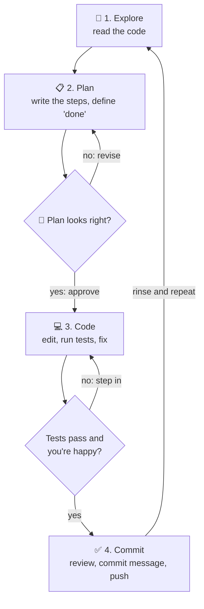
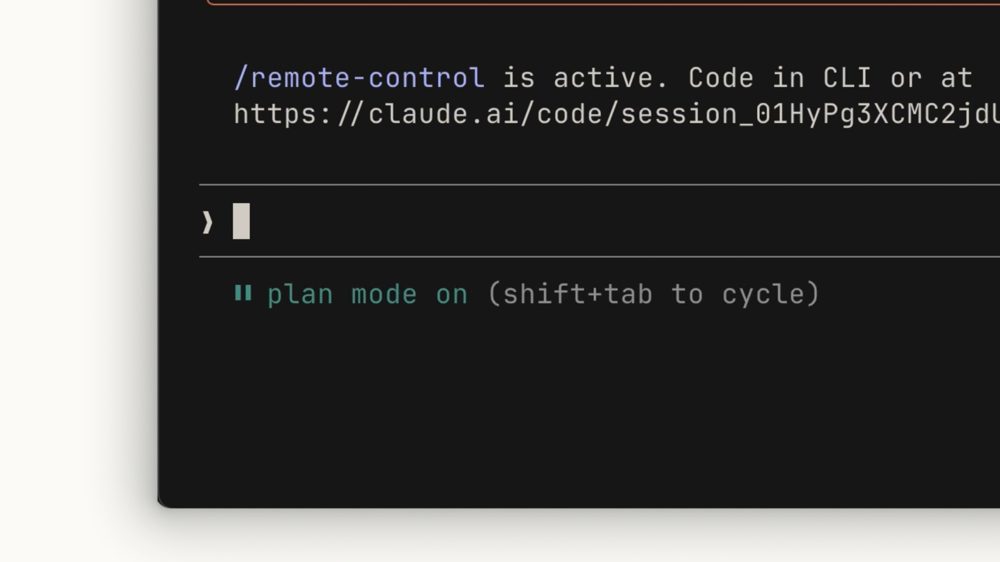
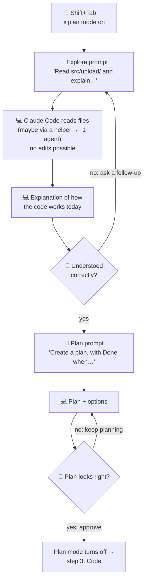
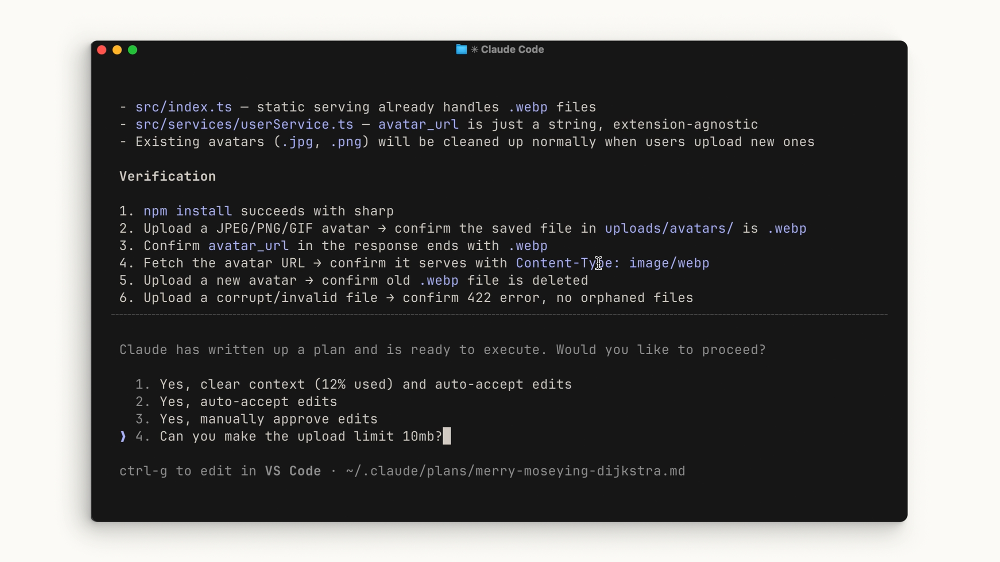
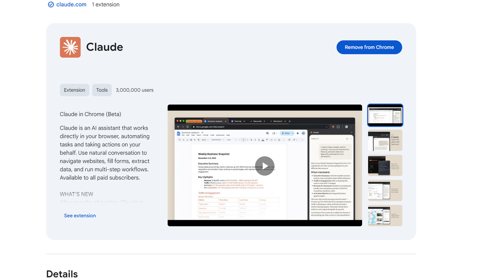
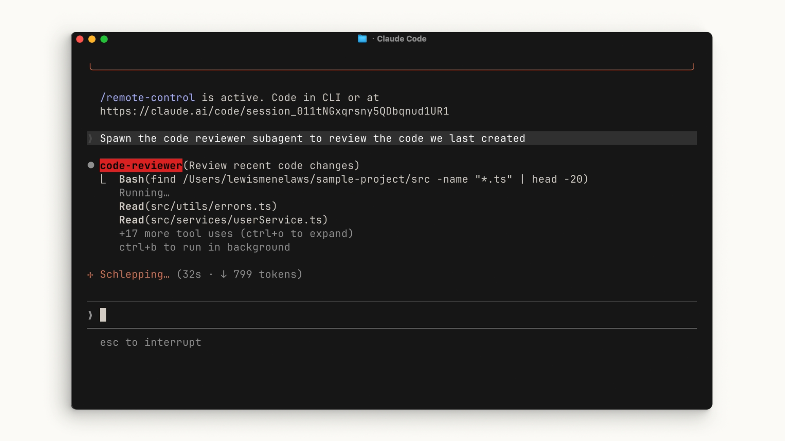
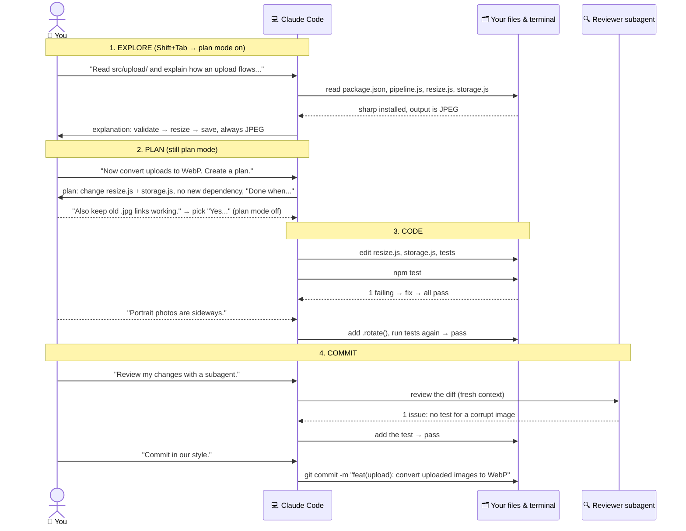

# Lesson 5 — The explore → plan → code → commit workflow

**Course:** [Claude Code 101](https://academy.claude.com/courses/claude-code-101) &nbsp;·&nbsp; **Chapter 3:** Daily workflows &nbsp;·&nbsp; **Completed:** October 17, 2026

| Previous | Course | Next |
|:---|:---:|---:|
| [← Your first prompt](04-your-first-prompt.md) | [📚 Course index](README.md) | [Context management →](06-context-management.md) |

---

**On this page**

| # | Section |
|:---:|:---|
| 1 | [In one sentence](#in-one-sentence) |
| 2 | [The four steps](#the-four-steps) |
| 3 | [1. Explore and plan: research before any code](#1-explore-and-plan-research-before-any-code) |
| 4 | [2. Code: build it and check it](#2-code-build-it-and-check-it) |
| 5 | [3. Commit: review, then save your work](#3-commit-review-then-save-your-work) |
| 6 | [4. Putting it together](#4-putting-it-together) |
| 7 | [Recap](#recap) |
| 8 | [My notes / practice](#my-notes--practice) |
| 9 | [FAQ](#faq) |

---

### In one sentence

Don't ask Claude Code to write code straight away: first let it **look around**, then agree on a **plan**, then let it **build and check**, and only then **review and save** your work.

The course says: *"If you take one thing away from Claude Code, let it be this workflow."*

### The four steps

| Step | What happens, in plain words | Who leads |
|---|---|---|
| **1. Explore** | Claude Code reads your code to understand how things work today. | Claude Code, read-only |
| **2. Plan** | Claude Code writes a step-by-step plan. You check it and fix it. | You and Claude Code together |
| **3. Code** | Claude Code makes the changes and tests them. You step in when needed. | Claude Code, with you watching |
| **4. Commit** | You test it yourself, get a review, and save the changes to Git. | You |

**Commit** means saving a snapshot of your changes in **Git**, the tool that keeps the history of your code. Each commit has a short message saying what changed.

#### How to do each step: the cheat sheet

None of the four steps is a button or a command. **Each step is a prompt you type**, sent in the right **mode**. The mode is shown in the status bar under the text box. You change it with **Shift+Tab**.

| Step | Mode (status bar) | What you press | What you type (WebP example) | What you get back |
|---|---|---|---|---|
| **1. Explore** | `⏸ plan mode on` | **Shift+Tab** until plan mode is on | "Read src/upload/ and package.json. Explain how an uploaded image flows through the pipeline. Don't plan anything yet." | An explanation of how the code works today. No files changed. |
| **2. Plan** | `⏸ plan mode on` (still) | Nothing, stay in plan mode | "Now I want to convert uploads to WebP. Where should it happen? Do we need new dependencies? Create a plan, with a 'Done when' list." | A plan, then a list of options: approve, or type a change |
| **3. Code** | Changes when you approve, e.g. `⏵⏵ accept edits on` | Pick a **"Yes…"** option on the plan | Nothing more, or "Implement the plan. Run `npm test` and fix any failures." | Edits, test runs, fixes. You step in if something looks wrong. |
| **4. Commit** | Any mode except plan | Nothing | First test it yourself. Then: "Run /code-review on my changes." Then: "Commit these changes with a message in the same style as our recent commits." | A review, then a Git commit |

Things to notice:
- **Steps 1 and 2 both happen in plan mode.** Plan mode is the safety switch: Claude Code can read and look around, but can't edit your code. The only difference between the two steps is what you ask for: an explanation, then a plan.
- **Approving the plan is how you leave plan mode.** Claude Code switches to the mode the "Yes…" option names, and starts coding.
- **The commit step is mostly you:** you test, you ask for a review, you ask for the commit.

#### Everyday comparison: building a house extension

1. **Explore:** the builder walks through your house, checks the walls and the pipes.
2. **Plan:** an architect draws the plan. You say "move the window." It's just a pencil change.
3. **Code:** the builders build it, checking each part as they go.
4. **Commit:** an inspector who didn't build it checks the work. Then you sign off.

Changing the drawing costs a pencil stroke. Changing a built wall costs a hammer and a week. That's why steps 1 and 2 come first.

#### Why not just jump to code?

The course says most people jump straight to "write the code," which means **more course-correcting later**. **Course-correcting** means stopping Claude and steering it in a new direction.

| When you spot a mistake | What fixing it costs |
|---|---|
| **In the plan** | One sentence: "Do it in the resize step, not the upload step." |
| **After the code is written** | Claude has to undo changes across several files, then redo them. |
| **After it's committed and shipped** | Users see the bug. You debug, fix, and release again. |

#### The workflow as a loop



#### The running example

We'll follow the course's example the whole way through:

> **You:** "I need to add WebP conversion to our image upload pipeline. Figure out where in the pipeline it should happen, whether we need new dependencies, and how to approach it."

The course does Explore and Plan with that one prompt. In section 1 we'll also split it into **two prompts**, one to explore and one to plan, so you can see each step clearly.

Some words in that prompt:
- **WebP** is an image format made by Google. WebP files are usually smaller than JPEG files of similar quality, so pages load faster.
- An **image upload pipeline** is the chain of steps an uploaded picture goes through: check it, shrink it, save it.
- A **dependency** is an outside library your code relies on, like `sharp` for image processing.

Here's the made-up project we'll use. The files and plan are examples to show the steps; a real session will look different.

```text
C:\projects\photo-share\
├── package.json              ← lists dependencies, including "sharp"
├── src\
│   └── upload\
│       ├── pipeline.js       ← runs the 3 steps in order
│       ├── validate.js       ← step 1: check file type and size
│       ├── resize.js         ← step 2: shrink the image (uses sharp)
│       └── storage.js        ← step 3: save the file to uploads/
└── tests\
    └── upload.test.js
```

`src/upload/resize.js` today:

```js
1  // src/upload/resize.js
2  const sharp = require('sharp');
3
4  module.exports = async function resize(file) {
5    return sharp(file.buffer)
6      .resize({ width: 1600, withoutEnlargement: true })
7      .jpeg({ quality: 80 })            // every upload is saved as JPEG
8      .toBuffer();
9  };
```

---

### 1. Explore and plan: research before any code

#### Plan mode in 30 seconds

The course says the fastest way to do steps 1 and 2 is **plan mode** (lesson 4). **Plan mode** is a permission mode where Claude Code can look but not touch. It can read files, search, and run commands that only look around (like `git log`). It **can't edit your code** until you approve a plan.

*Everyday comparison:* a builder walking through your house with their hands in their pockets. They can open doors and look at the pipes, but they can't pick up a hammer until you sign the drawing.

**Why use plan mode for exploring?** You could just ask "don't change anything" in a normal mode. But that's only a request. Plan mode actually **blocks** the edits, so a misunderstood prompt can't change your code.

| To… | Do this |
|---|---|
| Turn plan mode on | Press **Shift+Tab** until the status bar shows `⏸ plan mode on` |
| Use plan mode for one prompt only | Start the prompt with `/plan`, for example `/plan how does the upload pipeline work?` |
| Start Claude Code already in plan mode | `claude --permission-mode plan` |
| Leave plan mode by approving the plan | Pick one of the **"Yes…"** options under the plan |
| Stay in plan mode and change the plan | Pick **"No, keep planning"** (or type in the last option) and say what to change |
| Leave plan mode without a plan | Press **Shift+Tab** again |



<!-- IMAGE: status bar showing "plan mode on (shift+tab to cycle) · esc to interrupt · ← 1 agent" → images/05-plan-mode-one-agent.png -->

**What does "← 1 agent" mean in the status bar?** While you're in plan mode, Claude Code may hand the reading to a built-in helper called the **Plan subagent**. "1 agent" means one helper is working right now. The helper reads the files in its own separate conversation and sends back what it found, so all that reading doesn't fill up your main conversation. You don't need to start it yourself. (More on subagents below and in lesson 9.)

#### How to explore: step by step

Exploring is not a button or a command. **It's just your first prompt: you ask Claude Code to read and explain, not to plan yet.**

1. Open a terminal in your project and start Claude Code: `cd C:\projects\photo-share`, then `claude`.
2. Press **Shift+Tab** until you see `⏸ plan mode on`.
3. Type an **explore prompt**. Name the area to read and the question you want answered:

   ```text
   Read src/upload/ and package.json. Explain how an uploaded image
   flows through the pipeline and which image library we use.
   Don't make a plan yet.
   ```

4. Claude Code reads files (you see each tool call on screen, or a "← 1 agent" helper doing it):

   ```text
   Read     package.json                 → sharp is already installed
   Read     src/upload/pipeline.js       → steps run: validate → resize → save
   Read     src/upload/resize.js         → output is always JPEG (line 7)
   Read     src/upload/storage.js        → saves files as <id>.jpg
   Read     tests/upload.test.js
   ```

5. Claude Code answers with an explanation, something like:

   ```text
   An upload goes through 3 steps, run by pipeline.js:
   1. validate.js checks the file type and size.
   2. resize.js shrinks it to 1600px wide with sharp and always
      saves it as JPEG (line 7).
   3. storage.js saves it to uploads/ as <id>.jpg.
   sharp is already in package.json.
   ```

6. **Check it understood correctly.** If something is unclear, ask a follow-up, still in plan mode: "Where is the `.jpg` file extension decided?" Keep going until you'd be happy explaining the code yourself.

Two kinds of research can happen:
- **Reading your files**, to see how the pipeline works today.
- **Searching the web**, to check how a library works or what's current, like "sharp webp output options."

Neither one changes anything. (Remember from lesson 2: files Claude Code reads are sent to the model.)

#### How to plan: the second prompt

Stay in plan mode. Now ask for the plan, and say what "done" means:

```text
Now I want to convert uploads to WebP. Where in the pipeline should it
happen? Do we need new dependencies? Create a plan, with a "Done when" list.
```

Claude Code doesn't need to read everything again. The explanation from the explore step is already in the conversation.

#### Shortcut: explore and plan in one prompt

The course's single prompt ("Figure out where… whether we need new dependencies, and how to approach it") does both steps at once. Claude Code explores first, then writes the plan.

| | One prompt | Two prompts |
|---|---|---|
| **Good for** | Code you know, smaller tasks | Code that's new to you, bigger tasks |
| **Upside** | Faster | You check Claude Code understood the code **before** it plans. A wrong understanding leads to a wrong plan. |

#### Explore and plan as a flow



#### What the plan looks like

```text
Plan: Convert uploaded images to WebP

Where it should happen
- In resize.js (step 2). The image is already decoded there, so
  converting costs almost nothing extra.

New dependencies?
- None. sharp, which you already use, can write WebP.

Steps
1. resize.js: replace .jpeg({ quality: 80 }) with .webp({ quality: 80 }).
2. storage.js: save files as <id>.webp and set the type to image/webp.
3. Old .jpg files already saved stay as they are, so old links keep working.
4. tests/upload.test.js: add tests (see "Done when").

Done when
- All existing tests pass.
- A new test uploads a JPEG and checks that the saved file really is
  WebP (the file starts with "RIFF....WEBP").
- A new test checks the WebP file is smaller than the original.
```

Things to notice:
- **It answers all three questions** you asked: where, which dependencies, and how.
- **It has a "Done when" list.** That's the **success criteria** (section 2). It tells Claude Code how to know it's finished.
- **It found something you didn't ask about:** old `.jpg` links. A plan is the cheap place to discover that.

#### Review the plan: the best place to course-correct

Read the plan and ask: *does this meet my criteria?* If not, ask Claude Code to change specific parts. For example:

- "Keep the original JPEG as well, in case a browser can't show WebP."
- "Use quality 75, not 80."
- "Also accept WebP files as uploads in `validate.js`."

The course calls this **the best place to course-correct**, because no code has been written yet.



Things to notice in the course's screenshot:
- **The plan has a "Verification" list.** Six checks, like "Upload a JPEG/PNG/GIF avatar → confirm the saved file … is .webp" and "Upload a corrupt/invalid file → confirm 422 error." That's the success criteria, written into the plan.
- **Three ways to say yes:** "Yes, clear context (12% used) and auto-accept edits," "Yes, auto-accept edits," and "Yes, manually approve edits." The first one empties the conversation before building, so the build starts fresh with only the plan. (The exact list depends on your version and settings.)
- **Option 4 is a text box.** Here the user typed "Can you make the upload limit 10mb?" That's how you revise a plan: type the change instead of approving.
- **The plan is saved as a file:** `~/.claude/plans/merry-moseying-dijkstra.md`. Press **Ctrl+G** to open it in your editor (here, VS Code) and edit it yourself.

#### Exploring without plan mode: the Explore subagent

Sometimes you just want to **understand** a codebase, with no plan to change anything. For that, the course says you can use the **Explore subagent** without plan mode.

A **subagent** is a helper that Claude Code starts for a side task. It works in its **own separate conversation** (its own context window) and reports back a short summary. (Subagents are lesson 9.)

The **Explore** subagent is built into Claude Code. According to the docs, it's a fast, **read-only** helper for finding files and searching code. It can't write or edit.

You can ask for it in plain words:

```text
Use the Explore subagent to give me a summary of how this codebase is
organized and how an image upload flows through it.
```

| | Plan mode | Explore subagent |
|---|---|---|
| **Goal** | Make a plan to change something | Understand the code, no change planned |
| **What you get** | A step-by-step plan to approve | A summary |
| **Where the reading happens** | In your main conversation, or handed to the Plan subagent ("← 1 agent") | In the helper's own conversation; only the summary comes back |
| **Can it edit?** | Not until you approve the plan | No, never |

**Why the separate conversation matters:** exploring can mean reading dozens of files. If that happens in your main conversation, all those files fill up the context window (lesson 2). The Explore subagent reads them in its own space and hands you only the summary.

#### Four things with "Explore" or "Plan" in the name

The names overlap, which is confusing. Here's what each one is:

| Name | What it is | Who starts it | Can it edit your code? |
|---|---|---|---|
| **Explore step** | Step 1 of the workflow: a prompt asking Claude Code to read and explain | You, by typing the prompt | No (in plan mode) |
| **Plan mode** | A permission mode: the "look, don't touch" switch | You, with **Shift+Tab** or `/plan` | No, until you approve a plan |
| **Plan subagent** | A built-in helper that does the reading **while you're in plan mode** | Claude Code, on its own ("← 1 agent") | No, read-only |
| **Explore subagent** | A built-in helper that does read-only searching **outside** plan mode | Claude Code on its own, or you by asking for it | No, read-only |

So: you do the **Explore step** in **plan mode**, and Claude Code may use a **subagent** behind the scenes to do the reading.

#### When can I skip the plan?

The official docs say planning adds some overhead. Skip it for small, clear changes, like fixing a typo or renaming a variable. Their rule of thumb: **if you could describe the change in one sentence, skip the plan.** Plan when you're unsure of the approach, when many files change, or when the code is new to you.

---

### 2. Code: build it and check it

#### How to do it: step by step

1. **Approve the plan.** Under the plan, pick one of the **"Yes…"** options (use the arrow keys and Enter, or type the option's number). That turns plan mode off. Claude Code switches to the mode the option names and starts coding right away. You don't have to type anything else.
2. **Watch it work.** You see each edit and command on screen. Depending on the mode you picked, Claude Code may stop and ask you before some of them.
3. **Step in if needed.** Press **Esc** to stop Claude Code mid-action, then type what to change. Your conversation is kept, so it carries on from there.
4. **Wait for the finish.** Claude Code says it's done when the plan's "Done when" list is met, for example "All 9 tests pass."

**Left plan mode without approving?** (For example, you pressed Shift+Tab.) Then ask for the build yourself:

```text
Implement the plan. Run npm test and fix any failures.
```

#### Which "Yes" to pick

The option you pick sets the **permission mode** (lesson 4) for the build:

| You choose | What Claude Code does |
|---|---|
| **Yes, manually approve edits** (Manual) | Asks before every edit and command. Pick this for risky changes or code you don't know. |
| **Yes, auto-accept edits** | Edits freely, asks before most commands. |
| **Yes, and use auto mode** | Asks nothing. A background safety check screens each action. |
| **Yes, clear context and…** (if shown) | Empties the conversation first, so the build starts fresh with only the plan. |

The exact names depend on your version and settings.

#### Claude troubleshoots, and sometimes you step in

Claude Code tries to fix problems itself before it calls the plan "finished." For example, it runs the tests, sees one fail, reads the error, and fixes it (the loop from lesson 2).

But sometimes you'll need to step in. Say the tests pass, but you open the app and see **portrait photos lying sideways**. You tell Claude Code. Because the session started in plan mode, Claude Code still has the whole story in its conversation: what it read, the plan, and every change. So it can reason about the new problem quickly.

> **Why are the photos sideways?** Phones store "which way is up" as a hidden note inside the photo (called *EXIF orientation*). When `sharp` writes a new file, it drops those notes by default. Adding `.rotate()` with no arguments tells `sharp` to turn the image the right way first.

#### Tip 1: Define the success criteria

**Success criteria** is a clear description of what "correct" looks like. Claude Code can only be confident it's done if it knows what "done" means. Put it in the plan.

| ❌ Vague | ✅ Clear success criteria |
|---|---|
| "Make uploads use WebP." | "Done when: all tests pass, a JPEG upload is saved as a real WebP file, the WebP is smaller than the original, and old `.jpg` links still work." |

The plan in section 1 already has this, in its "Done when" list.

#### Tip 2: Add tools so Claude Code can check its own work

Every check you have to do by hand is a round of back and forth. Give Claude Code tools so it can check things itself.

The course's example: if you build **web pages**, install the **Claude in Chrome** extension. Then Claude Code can open a browser tab, click around your page, and see if it works before saying it's finished.



What the docs say about it:
- It works with **Google Chrome** and **Microsoft Edge** (and other Chromium browsers like Brave).
- It needs a **paid Claude plan** (Pro, Max, Team, or Enterprise), and you must sign in with `/login`. It doesn't work with an API key.
- Start Claude Code with `claude --chrome`, or run `/chrome` to connect it and check its status.
- It can open pages, fill in forms, read **console errors** (error messages the browser prints), and take screenshots.

For our example, a prompt could be:

```text
Open localhost:3000, upload tests/fixtures/portrait.jpg, and check that
the image on the page shows the right way up and is a .webp file.
```

#### Tip 3: Include a test suite

A **test suite** is a set of automated checks that run your code and say "pass" or "fail." Claude Code can run it again and again while it works (*continuously validate*). Claude Code can even write the tests for you.

**⚠️ Make sure the tests are right before you trust them.** The course warns about **false positives**: a test that passes even though the code is wrong.

*Example:* a test only checks that "a file was saved." It passes even if the file is still a JPEG. Claude Code sees green and says "done," but WebP doesn't work. The real check is "the saved file **is** WebP."

So, before you hand off, check that the tests truly describe what you want. Then they're a **source of truth** for you, your team, and Claude Code.

#### Tip 4: Save repeated fixes to CLAUDE.md

If Claude Code keeps running into the **same problem**, ask it to save the solution to its **`CLAUDE.md`** file. `CLAUDE.md` is a text file in your project that Claude Code reads at the start of every session (lesson 8). So the fix is remembered next time.

```text
Add a note to CLAUDE.md: when using sharp, always call .rotate()
before resizing so phone photos keep the right orientation.
```

#### Do / Why / Example

| Do | Why | Example |
|---|---|---|
| **Define "done"** | Claude Code knows when to stop. | "Done when the saved file is WebP and all tests pass." |
| **Add tools** | Claude Code checks its own work, less back and forth. | Claude in Chrome for web pages. |
| **Have a trusted test suite** | Claude Code can keep checking as it goes. | `npm test` with a test that really checks the file format. |
| **Save repeat fixes in CLAUDE.md** | The same mistake doesn't come back next session. | "Always call `.rotate()` with sharp." |

---

### 3. Commit: review, then save your work

#### How to do it: the short version

Stay in the same session, in any mode except plan mode (plan mode would block the commit). Then:

| # | You do | You type |
|:---:|---|---|
| 1 | Try the change yourself | Nothing. Run the app and upload a few photos. |
| 2 | Get a review | `/code-review` |
| 3 | Fix what matters | "Fix issue 1. Ignore the style suggestions." |
| 4 | Commit | "Commit these changes with a message in the same style as our recent commits." |
| 5 | Push (optional) | "Push to GitHub." Or run `git push` yourself. |

Each step is explained below.

#### Step 1: Test it yourself

Before you commit, **try the change yourself**. Upload a few photos. Look at them. The course says commit only once you've tested it and you're happy.

#### Step 2: Get a fresh pair of eyes: a code-reviewer subagent

Before committing, the course suggests asking a **code-reviewer subagent** to look at your changes.

**Why a subagent and not the main Claude Code session?** The main session built the code. It "knows" why every line is there, so it tends to see what it meant to write, not what it actually wrote. A subagent starts with a **fresh, empty conversation**. It sees only the code, not the reasoning. The course says it "doesn't carry the bias the main agent might have from the session."

*Everyday comparison:* proofreading your own essay vs. asking a friend. You read what you *meant*. Your friend reads what's *there*.



Things to notice in the course's screenshot:
- **The prompt is plain English:** "Spawn the code reviewer subagent to review the code we last created."
- **The subagent shows up by name:** `code-reviewer(Review recent code changes)`. Under it you see its own tool calls: a `Bash` search for `.ts` files, then `Read` on two files, plus "+17 more tool uses."
- **It does its reading in its own space.** Those 20 tool uses happen in the subagent's context, not your main conversation. Press **Ctrl+O** to see them all, or **Ctrl+B** to let it run in the background while you keep working.

Ways to do it (from the docs):

| Way | How |
|---|---|
| **Built-in code review** | Run `/code-review`. It reviews your current changes for bugs in a fresh subagent and reports back. |
| **Ask in plain words** | "Use a subagent to review my changes to `src/upload/` for bugs and edge cases." |
| **Your own reviewer** | Save a file like `.claude/agents/code-reviewer.md` with the reviewer's instructions, then say "Have the code-reviewer subagent look at my recent changes." (Lesson 9.) |

⚠️ The docs add a warning: a reviewer asked to find problems will **usually find some**, even when the code is fine. Ask it to report only problems that affect correctness or your requirements, and treat the rest as optional.

#### Step 3: Let Claude Code write the commit message in your style

Ask:

```text
Commit these changes with a message in the same style as our recent commits.
```

Claude Code can look at your recent commit history (`git log`) to copy the style. For example, if your history looks like this:

```text
feat(upload): limit file size to 10 MB
fix(storage): handle missing uploads folder
```

it might write:

```text
feat(upload): convert uploaded images to WebP

- Output WebP from the resize step (quality 80)
- Save new files as .webp; existing .jpg files are unchanged
- Auto-rotate images so phone photos keep their orientation
- Add tests for WebP output and file size
```

Then **push** (send your commits to the shared copy, like GitHub) and start the next feature. **Rinse and repeat.**

---

### 4. Putting it together

#### The whole example as a timeline



#### 🧠 Remember this

> **Look, plan, build, check, save.**
> Fix ideas in the plan, where it costs a sentence, not in the code, where it costs an afternoon.

#### Common mix-ups

| ❌ Wrong idea | ✅ What really happens |
|---|---|
| "Planning slows me down. I'll just ask for the code." | Skipping the plan usually means more course-correcting later. Fixing a plan costs a sentence. |
| "Every task needs a plan." | Small, clear changes (a typo, a rename) don't. If you can describe the change in one sentence, skip it. |
| "There's an Explore button or command." | Each step is just a prompt. Exploring means asking Claude Code to read and explain, in plan mode. |
| "In plan mode, Claude Code can't do anything." | It can read, search, and run look-only commands. It just can't edit your code until you approve a plan. |
| "After approving the plan, I have to type 'now build it'." | Approving switches plan mode off and Claude Code starts coding right away. |
| "Explore means I have to be in plan mode." | You can use the Explore subagent without plan mode, to get a summary of the codebase. |
| "'← 1 agent' means something went wrong." | It means Claude Code has started a helper (a subagent) to do the reading. That's normal in plan mode. |
| "If the tests pass, the code is right." | Only if the tests check the right thing. A weak test can pass when the code is wrong (a false positive). |
| "The session that wrote the code is the best reviewer." | It's biased by what it meant to write. A subagent reviews with a fresh context. |
| "Claude Code will remember a fix next session on its own." | Save it to `CLAUDE.md` so it's loaded every session. |
| "Commit as soon as Claude Code says it's done." | Test it yourself first, then review, then commit. |

#### Test yourself

<details>
<summary>1. What are the four steps of the workflow, in order?</summary>

Explore, plan, code, commit. Look at the code, agree on a plan, build and test, then review and save.
</details>

<details>
<summary>2. How do you do the Explore step in Claude Code?</summary>

Press Shift+Tab until the status bar shows `⏸ plan mode on`. Then type a prompt asking Claude Code to read part of the code and explain how it works, without planning yet. For example: "Read src/upload/ and explain how an upload flows through the pipeline."
</details>

<details>
<summary>3. What are three ways to turn on plan mode?</summary>

Press Shift+Tab until `⏸ plan mode on` shows. Start a single prompt with `/plan`. Or start Claude Code with `claude --permission-mode plan`.
</details>

<details>
<summary>4. You approve the plan. What happens next?</summary>

Plan mode turns off. Claude Code switches to the mode named in the option you picked (for example, auto-accept edits) and starts coding right away.
</details>

<details>
<summary>5. Why is the plan the best place to course-correct?</summary>

No code has been written yet. Changing the plan costs one sentence. Changing code means undoing and redoing edits across files.
</details>

<details>
<summary>6. You only want a summary of how a codebase works. What can you use instead of plan mode?</summary>

The Explore subagent. It's a built-in, read-only helper that reads the code in its own separate conversation and sends back a summary.
</details>

<details>
<summary>7. A test checks only that "a file was saved." Why is that a problem for the WebP feature?</summary>

It would pass even if the file is still a JPEG. That's a false positive: the test is green, but the feature doesn't work. The test should check that the saved file really is WebP.
</details>

<details>
<summary>8. Why use a subagent to review code before committing?</summary>

The main session wrote the code, so it's biased toward it. A subagent starts with a fresh, empty context and sees only the code, so it's more likely to spot real mistakes.
</details>

---

### Recap

- **Every step is a prompt** sent in the right mode. Shift+Tab changes the mode. The status bar shows which mode you're in.
- **Explore:** turn on plan mode, then ask Claude Code to read the code and explain it. Ask follow-ups until it has understood correctly. Use the Explore subagent if you only want a summary.
- **Plan:** still in plan mode, ask for a plan, including what "done" looks like. Review it and revise it. This is the cheapest place to fix mistakes.
- **Code:** approve the plan with a "Yes…" option. That turns plan mode off and Claude Code starts building. The option you pick decides how often Claude Code asks. It tests and fixes on its own, and you step in when needed. Give it success criteria, tools like Claude in Chrome, and a trustworthy test suite. Save repeated fixes to `CLAUDE.md`.
- **Commit:** test it yourself, have a subagent review it with fresh eyes, let Claude Code write the commit message in your style, push, and start the next feature.

---

## My notes / practice

- [ ] Pick a small feature in a test project. Do all four steps on purpose, and notice where I course-correct.
- [ ] Press Shift+Tab a few times and watch the status bar cycle through the modes until `⏸ plan mode on`.
- [ ] Do the Explore step as its own prompt ("Read … and explain …, don't plan yet"), then ask for the plan in a second prompt.
- [ ] Try `/plan` in front of a single prompt instead of switching modes.
- [ ] Watch for "← 1 agent" in the status bar while Claude Code explores in plan mode.
- [ ] In plan mode, add a "Done when" list to my prompt and see if the plan uses it.
- [ ] Ask "Use the Explore subagent to summarize this codebase" without plan mode.
- [ ] Write one test that could give a false positive, then fix it so it checks the real result.
- [ ] Install Claude in Chrome, run `/chrome`, and ask Claude Code to test a local web page.
- [ ] Run `/code-review` on my changes before committing.
- [ ] Ask Claude Code to commit with a message in the style of my recent commits.
- [ ] Ask Claude Code to save one repeated fix to `CLAUDE.md`.
- [ ] Do the course's "Check your understanding" questions (4 questions, written feedback).

---

## FAQ

In these answers, **Claude Code** means the program on your computer. **The model** means the AI on Anthropic's servers.

**Q1. What is the explore, plan, code, commit workflow?**
A four-step way to work with Claude Code:
1. **Explore:** Claude Code reads the code to understand it.
2. **Plan:** Claude Code writes a plan, and you review it.
3. **Code:** Claude Code builds it and tests it, and you step in when needed.
4. **Commit:** you test it, get a review, and save it to Git.

**Q2. Why shouldn't I ask Claude Code to write code straight away?**
Because it may solve the wrong problem or pick the wrong approach. Then you spend more time course-correcting later. Exploring and planning first catches those mistakes when they're cheap to fix.

**Q3. What does "course-correct" mean?**
Stopping Claude Code and steering it in a new direction, like "Do it in the resize step instead."

**Q4. How do I do each of the four steps in Claude Code?**
Each step is a prompt you type, in the right mode:
1. **Explore:** press Shift+Tab until `⏸ plan mode on` shows. Type "Read src/upload/ and explain how it works. Don't plan yet."
2. **Plan:** stay in plan mode. Type "Now create a plan to add WebP, with a 'Done when' list."
3. **Code:** pick a "Yes…" option under the plan. Plan mode turns off and Claude Code starts building.
4. **Commit:** test it yourself, run `/code-review`, then type "Commit in the style of our recent commits."

**Q5. What does "plan mode" mean?**
A permission mode where Claude Code can look but not touch. It can read files, search, and run commands that only look around. It can't edit your code until you approve a plan.

**Q6. How do I turn plan mode on and off in Claude Code?**
- **On:** press **Shift+Tab** until the status bar shows `⏸ plan mode on`, or start Claude Code with `claude --permission-mode plan`.
- **Off:** approve the plan with a "Yes…" option, or press **Shift+Tab** again to leave without a plan.

**Q7. What does `/plan` do?**
It puts a single prompt in plan mode without switching modes yourself. For example: `/plan how does the upload pipeline work?`

**Q8. How do I do the Explore step?**
Turn on plan mode. Then ask Claude Code to read a part of the code and explain it, and say you don't want a plan yet. For example: "Read src/upload/ and package.json. Explain how an uploaded image flows through the pipeline. Don't make a plan yet." Ask follow-ups until the explanation is right.

**Q9. What does Claude Code do while it explores?**
It reads the files that matter for your request and may search the web, for example to check how a library works. It doesn't change anything.

**Q10. What does "← 1 agent" mean in the Claude Code status bar?**
Claude Code has started one helper (a subagent) that is working right now. In plan mode, that's usually the built-in Plan subagent doing the reading in its own separate conversation. It's normal; you don't need to do anything.

**Q11. Why explore and plan in two prompts instead of one?**
So you can check Claude Code understood the code before it plans. If its understanding is wrong, the plan will be wrong too. For code you already know, one prompt that asks for both is fine.

**Q12. What should I check when Claude Code shows me a plan?**
Whether it meets your criteria: is the approach right, are the right files changing, is anything missing, and does it say what "done" looks like? If not, ask Claude Code to revise those parts: type the change in the last option of the approval list (for example, "Can you make the upload limit 10mb?"), or press **Ctrl+G** to edit the plan file yourself.

**Q13. Why is the plan the best place to course-correct?**
No code exists yet. Changing a plan takes one sentence. Changing code means undoing and redoing edits.

**Q14. What does "Explore subagent" mean?**
A built-in helper in Claude Code that only reads. It searches and reads your code in its own separate conversation, then sends back a summary. It can't edit files.

**Q15. What does "Plan subagent" mean?**
A built-in, read-only helper that Claude Code uses while you're in plan mode. It reads the code in its own conversation and reports back, so your main conversation doesn't fill up with file contents. Claude Code starts it on its own.

**Q16. When should I use the Explore subagent instead of plan mode?**
When you only want to understand a codebase and don't plan to change anything yet. Ask: "Use the Explore subagent to summarize how this codebase is organized."

**Q17. Do I always need to make a plan?**
No. For small, clear changes like a typo or a rename, just ask. The docs' rule of thumb: if you can describe the change in one sentence, skip the plan.

**Q18. What happens after I approve the plan?**
Plan mode turns off and Claude Code starts working through the plan right away. You don't need to type "go." The option you picked decides how often it asks you:
- **Manually approve edits:** asks before every edit and command.
- **Auto-accept edits:** edits freely, asks before most commands.
- **Auto mode:** asks nothing; a background safety check screens each action.

**Q19. Why does starting in plan mode help when I need to step in later?**
The conversation already holds everything: the files Claude Code read, the plan, and every change. When something goes wrong, Claude Code can use that history to decide what to do next.

**Q20. What does "success criteria" mean?**
A clear description of what "correct" looks like, such as "all tests pass and the saved file is really WebP." Claude Code uses it to know when it's finished. Put it in your plan.

**Q21. Why should I give Claude Code extra tools?**
So it can check its own work instead of waiting for you. Each check it can do itself saves a round of back and forth.

**Q22. What does Claude in Chrome do for Claude Code?**
It lets Claude Code control a browser tab: open your web page, click, fill in forms, read console errors, and take screenshots. That way it can test a web page before calling the work done. It needs Chrome or Edge, a paid Claude plan, and you start it with `claude --chrome` or `/chrome`.

**Q23. What does "test suite" mean, and why does Claude Code need one?**
A set of automated checks that say "pass" or "fail." Claude Code can run them over and over while it works, so it knows right away if a change broke something.

**Q24. What does "false positive" mean for tests?**
A test that passes even though the code is wrong. For example, a test that only checks "a file was saved" passes even if the file is still a JPEG instead of WebP. Make sure your tests check the real result before you trust them.

**Q25. Can Claude Code write tests for me?**
Yes. But read them before trusting them, so they truly check what you want and don't give false positives.

**Q26. Claude Code keeps making the same mistake. What should I do?**
Ask it to save the fix to `CLAUDE.md`. Claude Code reads that file at the start of every session, so it remembers the fix next time.

**Q27. How do I do the Commit step?**
In the same session, in any mode except plan mode:
1. Test the change yourself, for example by uploading a few photos.
2. Run `/code-review`, and fix the issues that matter.
3. Type "Commit these changes with a message in the same style as our recent commits."
4. Push, if you want: "Push to GitHub," or run `git push` yourself.

**Q28. Why should a subagent review the code instead of the main session?**
The main session wrote the code, so it's biased toward it. A subagent starts with a fresh, empty conversation and sees only the code, like a friend proofreading your essay.

**Q29. How do I get a code review from a subagent?**
Run `/code-review`, or ask in plain words: "Use a subagent to review my changes for bugs." You can also save your own reviewer in `.claude/agents/code-reviewer.md`.

**Q30. How does Claude Code write a commit message in my style?**
Ask it to match your recent commits. It can read your commit history with `git log` and copy the format, like `feat(upload): ...`.

**Q31. (Exam angle) A team lead says their developers waste hours undoing Claude Code's changes. What workflow would you recommend?**
Explore, plan, code, commit:
- Start multi-step work in plan mode, so the approach is agreed before any edit.
- Put clear success criteria in every plan.
- Keep a trusted test suite so Claude Code can check its own work.
- Review with a subagent before committing.

This fits the **Developer Productivity & Operational Enablement** exam domain.

**Q32. (Exam angle) Claude Code says a feature is done and all tests pass, but it's broken in production. What went wrong, and how do you prevent it?**
Probably the tests gave a **false positive**: they passed without checking the real behavior. To prevent it:
- Review tests before trusting them, so they're a true source of truth.
- Define clear success criteria in the plan.
- Have a human test the change before committing.
- Add an independent subagent review, which isn't biased by having written the code.

This fits the **Governance, Safety & Risk** exam domain.

**Q33. (Exam angle) An architect asks why code review should use a separate subagent instead of the same Claude Code session. How do you answer?**
The session that wrote the code carries its own reasoning and assumptions in its context, so it tends to confirm its own work. A subagent starts with a fresh context and sees only the changes and the criteria you give it, so it judges the result on its own. It's the same idea as not letting authors approve their own pull requests. This fits the **Governance, Safety & Risk** exam domain.

---

| Previous | Course | Next |
|:---|:---:|---:|
| [← Your first prompt](04-your-first-prompt.md) | [📚 Course index](README.md) | [Context management →](06-context-management.md) |
