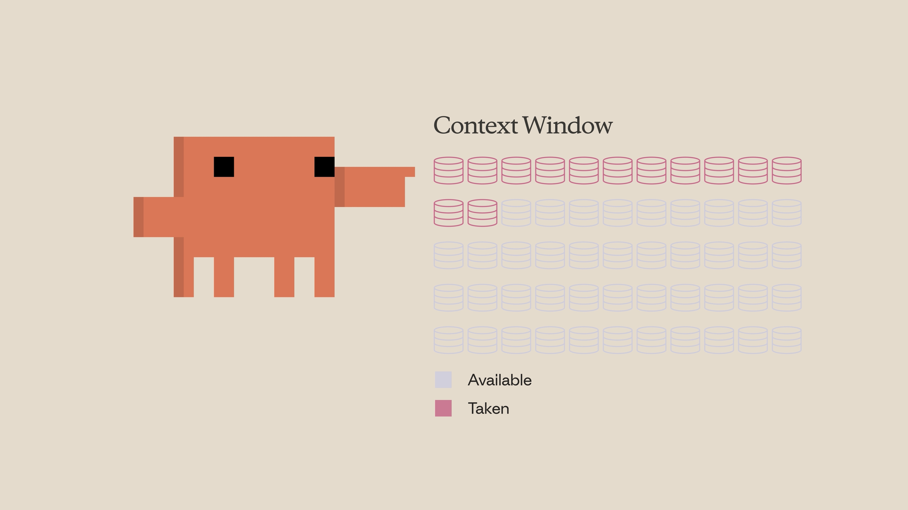
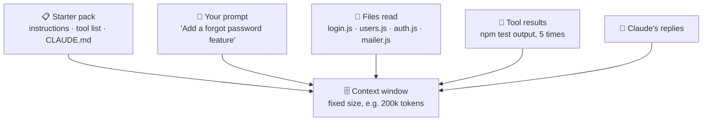
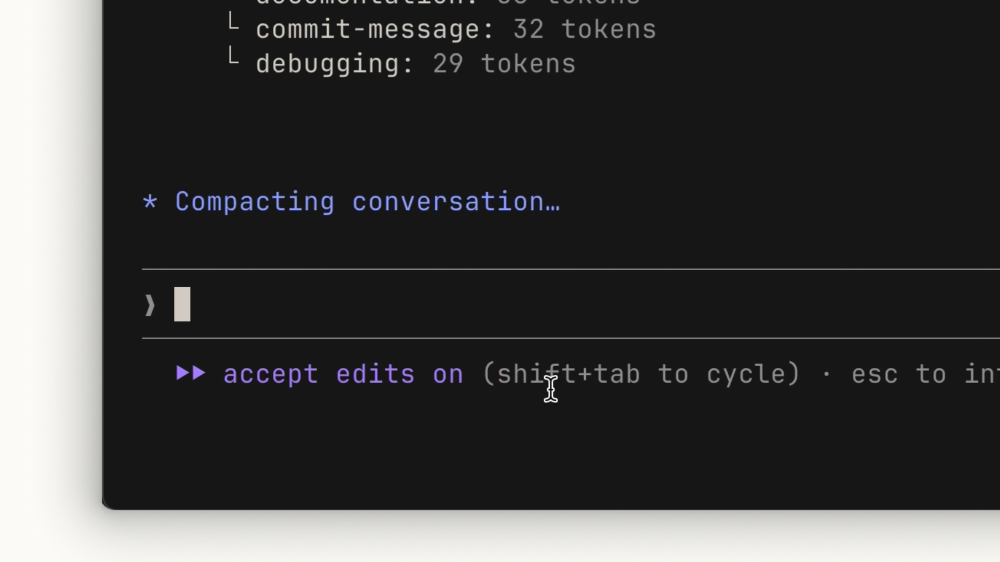
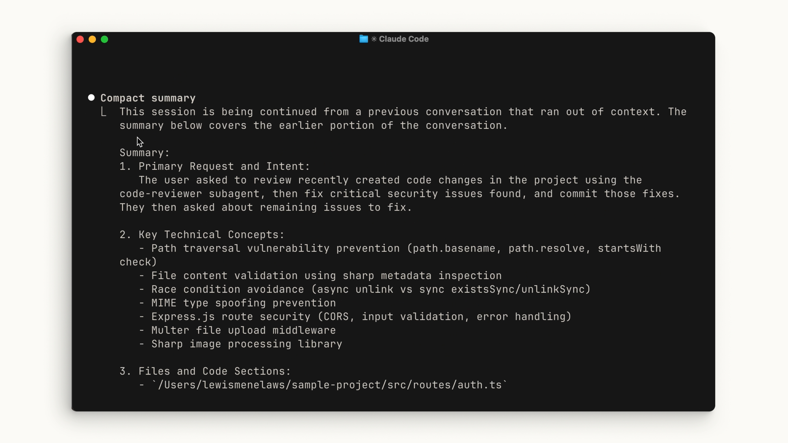
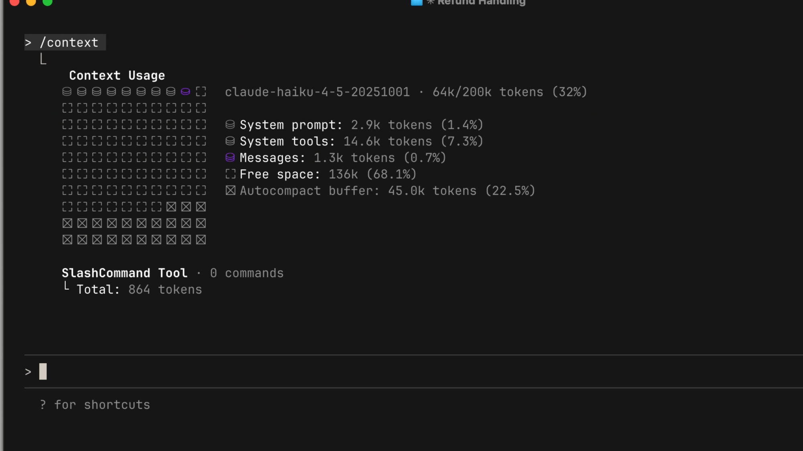
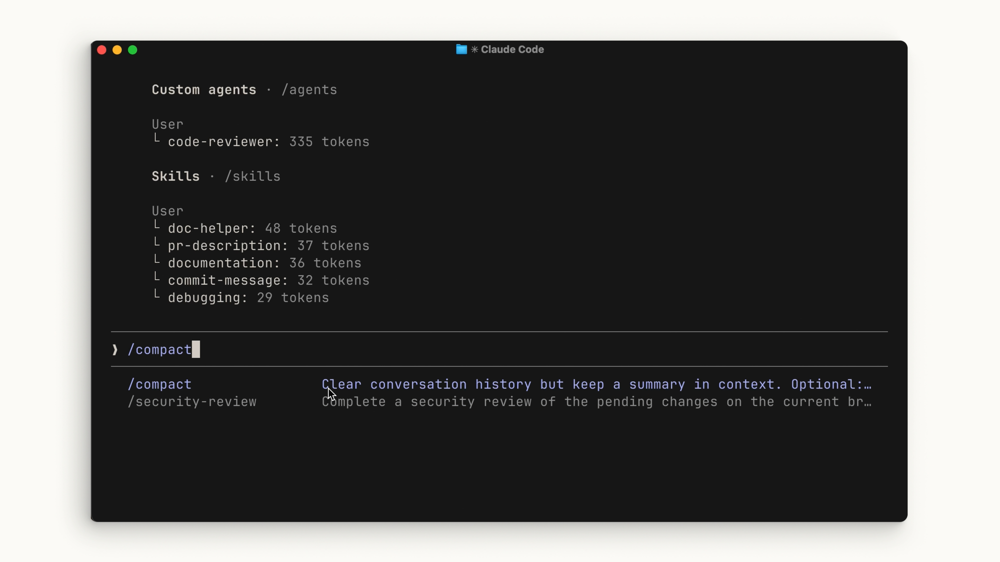
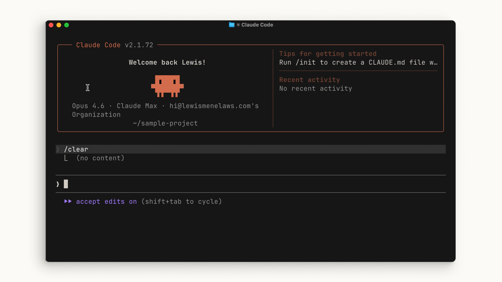
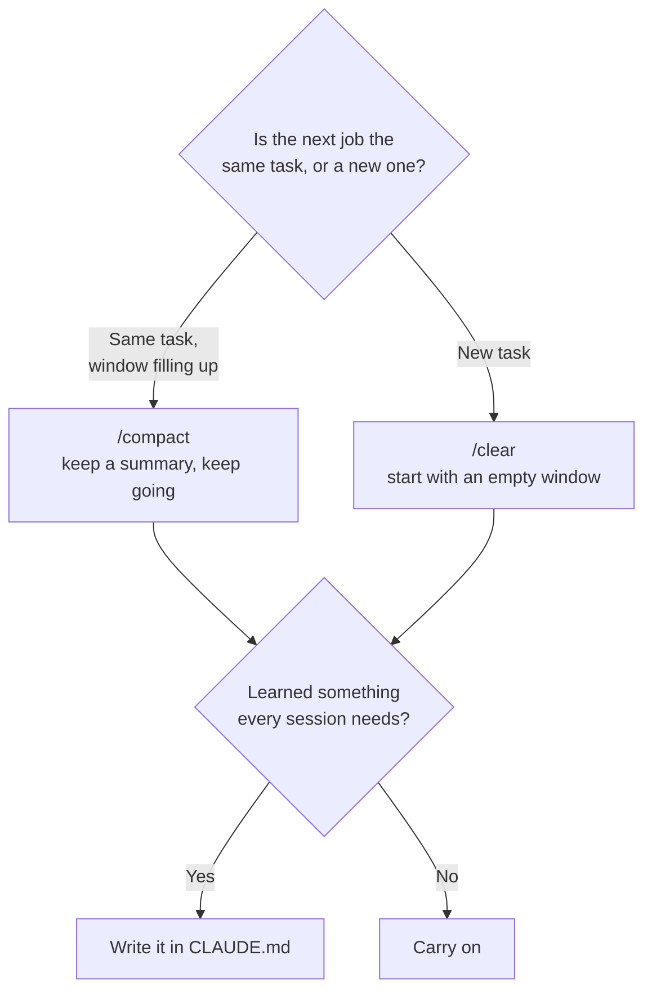
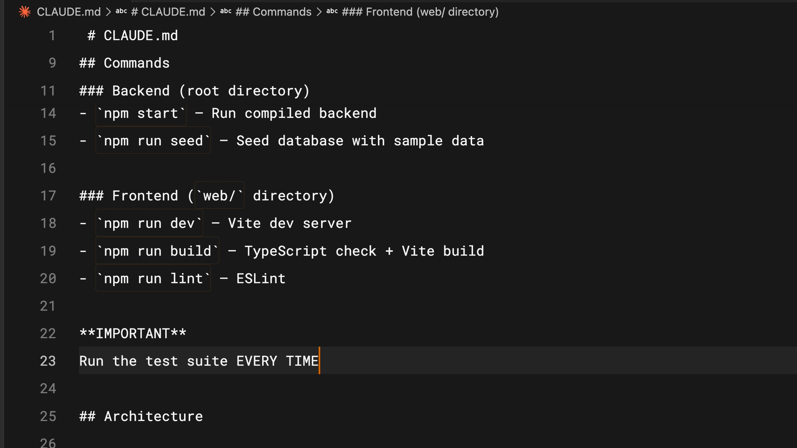
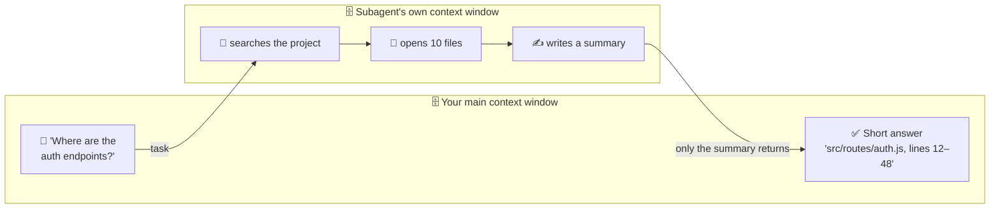

# Lesson 6 — Context management

**Course:** [Claude Code 101](https://academy.claude.com/courses/claude-code-101) &nbsp;·&nbsp; **Chapter 3:** Daily workflows &nbsp;·&nbsp; **Completed:** October 18, 2026

| Previous | Course | Next |
|:---|:---:|---:|
| [← The explore → plan → code → commit workflow](05-explore-plan-code-commit.md) | [📚 Course index](README.md) | [Code review →](07-code-review.md) |

---

**On this page**

| # | Section |
|:---:|:---|
| 1 | [In one sentence](#in-one-sentence) |
| 2 | [The five parts](#the-five-parts) |
| 3 | [1. The context window: Claude's working memory](#1-the-context-window-claudes-working-memory) |
| 4 | [2. When the window fills up: compaction](#2-when-the-window-fills-up-compaction) |
| 5 | [3. Three commands: /compact, /clear, /context](#3-three-commands-compact-clear-context) |
| 6 | [4. Compact or clear? Choosing the right one](#4-compact-or-clear-choosing-the-right-one) |
| 7 | [5. Three ways to save space](#5-three-ways-to-save-space) |
| 8 | [Recap](#recap) |
| 9 | [My notes / practice](#my-notes--practice) |
| 10 | [FAQ](#faq) |

---

### In one sentence

Claude Code has a **limited memory for each session**, and everything it reads or does fills that memory up, so you keep it useful by **checking** it (`/context`), **shrinking** it (`/compact`), **emptying** it (`/clear`), and **not filling it with junk** in the first place.

### The five parts

| Part | What it means in plain words |
|---|---|
| **1. The context window** | Claude's working memory for this session. It has a fixed size. |
| **2. Compaction** | When the memory gets nearly full, Claude Code replaces the old conversation with a short summary. |
| **3. Three commands** | `/context` shows what's in memory. `/compact` summarizes it. `/clear` empties it. |
| **4. Compact or clear?** | Same task, keep going → compact. New task → clear. Things to remember forever → `CLAUDE.md`. |
| **5. Saving space** | Be specific, switch off tools you don't need, and send side research to a helper. |

We'll use one example through the whole lesson. You're working in the `my-app` project from lesson 2:

> **You:** "Add a 'forgot password' feature: a reset link sent by email."

It's a big job. Claude Code will read a lot of files and run a lot of tests. Later you'll move on to a **new** feature, dark mode.

---

### 1. The context window: Claude's working memory

Think of a **desk**. While you work, you spread papers on it: the task notes, files you opened, printouts of test results. You can only work with what's on the desk. And the desk has a fixed size. When it's covered, you have to tidy up before anything new fits.

The **context window** is that desk. It's everything the model can see right now, in this session. (Lesson 2 compared it to a whiteboard. Same idea.)

#### What goes on the desk

Everything below adds to the context window:

| What | Example from the "forgot password" task |
|---|---|
| **Your prompts** | "Add a 'forgot password' feature…" |
| **Files Claude Code reads** | All of `src/login.js`, `src/users.js`, `src/routes/auth.js` |
| **Tool calls** (requests from the model asking Claude Code to do something) | "Read `src/users.js`", "Run `npm test`" |
| **Tool call results** (what comes back) | 200 lines of test output |
| **Claude's own replies** | "I've added a `resetPassword` function…" |

And before you type anything, some things are **already** on the desk: Anthropic's instructions (the *system prompt*), the list of tools, and your `CLAUDE.md`. Lesson 2 called this the "starter pack."

#### How it's measured: tokens

Space in the context window is counted in **tokens**. A **token** is a small piece of text, usually a short word or part of a word. As a rough guide, 100 tokens is about 75 English words.

The window in the screenshots for this lesson holds **200,000 tokens** (200k). Some newer models can hold up to 1 million. Either way, it's a fixed limit.



The picture above shows the idea: each stack of coins is a chunk of space. Pink stacks are **taken**. Grey stacks are still **available**. Every prompt, file read, and tool result turns another grey stack pink.

#### How the desk fills up during one task



Things to notice:
- **Nothing leaves the desk by itself.** A file read an hour ago is still there, taking space, even if it's no longer useful.
- **Tool results are often the biggest items.** One run of a test suite can print hundreds of lines.

#### Why it matters

1. **Space runs out.** On a long task, the window fills up.
2. **Junk gets in the way.** Old, unrelated material sits next to what matters now. The model has more to read through, and it may get distracted by it.
3. **Every message costs more.** Lesson 2 showed that Claude Code sends the **whole conversation** to the model every round. A bigger context window means a bigger message every time, which uses more of your plan or budget.

> 🧠 **Remember this:** the context window is a desk, not a filing cabinet. Keep only what you need for the current job on it.

---

### 2. When the window fills up: compaction

When the context window gets close to full, Claude Code **compacts** it automatically. **Compacting** means replacing the long conversation with a short summary, so there's room to keep working.

Back to the desk: you sweep all the papers into the bin, but first you write a **one-page summary** of what's been done. Then you carry on, with the summary on the desk.

#### What you see

While it's working, Claude Code shows:



Then the old conversation is replaced by a **compact summary**:



Notice how the summary is organized:
1. **Primary Request and Intent:** what you asked for.
2. **Key Technical Concepts:** the important ideas and libraries.
3. **Files and Code Sections:** which files were involved.

So the model still knows *what* you were doing. It just doesn't have every line of every file and every test run.

#### What compaction keeps and what it drops

For the "forgot password" task, after compaction:

| ✅ Kept (in the summary or reloaded) | ❌ Dropped |
|---|---|
| "The user wants a forgot-password feature with an email link." | The full 200 lines of output from each test run |
| "We added `resetPassword()` in `src/users.js`." | The full contents of every file read early on |
| "Tests for the reset link are still failing." | The exact wording of an error from an hour ago |
| Your `CLAUDE.md` (re-read from disk) | Small details that didn't make it into the summary |

**Notes:**
- After compacting, Claude Code **re-reads your project's `CLAUDE.md`** from disk. So your project rules always survive.
- It also re-reads **up to five** of the files it recently read or edited, so it can carry on without searching again.

#### ⚠️ The downside: details can get lost

A summary is shorter than the original. Something you needed might not be in it.

*Example:* an hour ago a test failed with `Error: SMTP_HOST is not set`. You fixed it, but the same error comes back after compaction. The summary only says "fixed an email config error," so Claude Code has to find the cause again. Just paste the error again, or tell it where to look.

---

### 3. Three commands: /compact, /clear, /context

You don't have to wait for the automatic clean-up. Three commands give you control. A **command** here is a word starting with `/` that you type in the Claude Code prompt.

| Command | What it does | Desk comparison | Memory of past work? |
|---|---|---|---|
| `/context` | Shows how full the context window is, and what's using the space | Looking at the desk | Not changed |
| `/compact` | Summarizes the conversation now, to free space | Write a summary, bin the papers | ✅ Yes, as a summary |
| `/clear` | Starts a new conversation with an empty context window | Clear the whole desk | ❌ No |

#### `/context`: see what's using space

Run `/context` to see:
- how big the context window is, and how much is used
- which **categories** use the most space
- a **grid** that shows it as a picture



Here's how to read this screenshot, line by line:

| Line | What it means |
|---|---|
| `claude-haiku-4-5-20251001 · 64k/200k tokens (32%)` | The model in use, and how full the window is: 64,000 of 200,000 tokens. |
| `System prompt: 2.9k tokens (1.4%)` | Anthropic's instructions. Always there. |
| `System tools: 14.6k tokens (7.3%)` | The list of tools Claude Code can use. Always there. |
| `Messages: 1.3k tokens (0.7%)` | The actual conversation so far: your prompts, replies, tool results. Small here, because the session just started. |
| `Free space: 136k (68.1%)` | Room left to work. |
| `Autocompact buffer: 45.0k tokens (22.5%)` | Space **kept free on purpose** so automatic compaction has room to run. |

Things to notice:
- The 64k "used" is **2.9k + 14.6k + 1.3k + the 45k buffer**. So most of that 64k isn't your conversation at all.
- **Before you type anything, ~17.5k tokens are already used** by instructions and tools.
- The `/context` output can also list items like **custom agents** (subagents) and **skills** with their token sizes (you can see this at the top of the `/compact` screenshot below). That helps you spot what's taking space.

#### `/compact`: summarize now

Type `/compact` to compact the conversation right away, instead of waiting for the automatic pass.



The menu's own description says it well: *"Clear conversation history but keep a summary in context."*

**Extra (from the docs, not the course):** you can tell `/compact` what to focus on. Add instructions after the command:

```text
/compact Focus on the password reset flow and the failing email tests
```

The summary then keeps what *you* choose, instead of what Claude Code guesses is important.

#### `/clear`: start from scratch

Type `/clear` to start a new conversation with an **empty** context window. Claude Code has no memory of what you just did.



Things to notice:
- After `/clear`, you're back at the welcome screen, as if you just started `claude`.
- Your **files are not touched.** `/clear` only empties the conversation. Any code Claude Code wrote is still on your disk.
- Your **`CLAUDE.md` still loads** in the new conversation. It's part of the starter pack, not the conversation.

**Extra (from the docs):** the old conversation isn't deleted. You can go back to it with `/resume`. And `/clear` has two other names that do the same thing: `/reset` and `/new`.

---

### 4. Compact or clear? Choosing the right one

The course gives a simple rule of thumb:

| Situation | Use | Why |
|---|---|---|
| You're in the **middle of one feature**, the window is filling up, and you need to keep going | `/compact` | You want to keep the memory that's **relevant to this feature**. |
| You've **finished** a feature and are starting a **new** one | `/clear` | Old conversation would **bias** the new work. |
| Something should be remembered in **every** session | Put it in **`CLAUDE.md`** | Claude Code doesn't have to rediscover it from scratch each time. |



#### In the running example

1. **Mid-feature:** you're halfway through the "forgot password" feature. `/context` shows the window is 80% full, mostly old test output. You run `/compact Focus on the reset flow and failing tests`. The summary keeps the plan and the open problems. You keep going.
2. **Feature done:** the reset link works, tests pass, you've committed. Now you want dark mode. You run `/clear`. Dark mode has nothing to do with email or passwords, so the old conversation would just be noise.
3. **Something worth keeping:** during the work you found out the email tests need `npm run test:mail`, not `npm test`. That's true for every future session, so you add it to `CLAUDE.md`.

#### What does "bias" mean here?

**Bias** means the old conversation pulls the new work in the wrong direction.

*Example:* you don't clear, and ask for dark mode. Claude Code still "sees" an hour of password-reset work. It might copy a pattern from the email code that doesn't fit, or decide to "also fix" the reset page while it's there. A clear desk means it starts the new job fresh, with only what's needed.

#### `CLAUDE.md`: memory that survives `/clear`

`CLAUDE.md` is a text file in your project that Claude Code reads at the start of **every** session. (Lesson 8 covers it fully.)



The example in the screenshot has:
- **Commands:** how to start the backend, seed the database, run the frontend dev server, build, and lint.
- **An important rule:** "Run the test suite EVERY TIME."
- **Architecture:** how the project is laid out.

These are things Claude Code would otherwise have to work out again by reading files, every single session. Writing them down once saves that space and time.

**Extra (from the docs):** you can also put compaction instructions in `CLAUDE.md`, so every automatic compaction keeps what you care about:

```markdown
# Compact instructions

When you are using compact, please focus on test output and code changes
```

> 🧠 **Remember this:** **Same job → compact. New job → clear. Forever → `CLAUDE.md`.**

---

### 5. Three ways to save space

Compacting and clearing tidy the desk **after** it's messy. These three tips keep it from getting messy in the first place.

| Do this | Why it helps | Example |
|---|---|---|
| **Be specific** | Claude Code reads fewer files to find what you mean. | "Add a reset link to `src/routes/auth.js`" instead of "add password reset." |
| **Turn off MCP servers you don't need** | Each connected server takes some space, even if it's never used. | Switch off the Jira server while working on a project that doesn't use Jira. |
| **Use subagents for "just the answer" questions** | The helper's research stays in **its** context window. Only a short answer comes back. | "Use a subagent to find where the auth endpoints are." |

#### Tip 1: Be specific

It feels like a short prompt saves space. It doesn't.

A vague prompt makes Claude Code **explore** your project to work out what you mean. Every file it opens and every search it runs goes into the context window. One or two extra sentences in your prompt cost far less than that exploring.

Here's a rough picture. The numbers are made up to show the idea:

| | Vague prompt | Specific prompt |
|---|---|---|
| **You type** | "Add password reset." | "Add a 'forgot password' route to `src/routes/auth.js`. Use the `sendEmail()` function in `src/mailer.js`. Add tests to `tests/auth.test.js`." |
| **Prompt size** | ~5 tokens | ~50 tokens |
| **What Claude Code does next** | Searches the project, opens 10 files to find routes, users, and email code | Opens the 3 files you named |
| **Context used** | ~25,000 tokens | ~6,000 tokens |

The course calls this the irony of short prompts: **the smaller prompt uses more context in the long run.**

#### Tip 2: Manage your MCP servers

An **MCP server** is an add-on that gives Claude Code extra tools, such as reading GitHub issues or querying a database. (Lesson 11 covers MCP.)

How much space does a connected MCP server take? Per the written course and the docs:
- **At the start,** only each tool's **name** and the server's short **instructions** go into the context window.
- **When Claude Code actually needs a tool,** it loads that tool's **full details** then.

So a server costs only a little space. But a little per server adds up. If you have servers for things this project doesn't use, turn them off.

**Extra (from the docs):** run `/mcp` to see your servers and disable the ones you don't need. For services that have a command-line tool, such as `gh` for GitHub, using that tool directly takes even less space than an MCP server, because it adds nothing to the tool list.

#### Tip 3: Use subagents

A **subagent** is a helper that Claude Code starts for a side task. It works **alongside** your main session (the course says "in parallel"), but it has its **own, completely separate** context window. (Lesson 9 covers subagents.)

The trick: some questions only need the **answer**, not the **journey**.

*Example:* "Where are the authentication endpoints?" To answer, someone has to search and open maybe 10 files. You don't need those 10 files on **your** desk. You only need: "They're in `src/routes/auth.js`, lines 12–48."



Things to notice:
- The 10 files fill the **subagent's** context window, not yours.
- Your main context window gets **one short answer**.
- ⚠️ The subagent still uses the model on Anthropic's servers, so its work **still uses your plan or budget**. Subagents keep your main context **clean**. They don't make the work free.

#### Extra: skills (from the video and the docs)

The **video** also suggested **skills** as a lighter option than MCP servers. A **skill** is a packaged set of instructions Claude Code can load for a specific job. (Lesson 10 covers skills.) Only a one-line description of each skill sits in the context window. The full instructions load only when the skill is used. The written course leaves this tip out, but the docs back it up: moving rarely-used instructions out of `CLAUDE.md` and into a skill keeps every session's starting context smaller.

#### Common mix-ups

| ❌ Wrong idea | ✅ What really happens |
|---|---|
| "A shorter prompt uses less context." | A vague prompt makes Claude Code explore, which usually uses **much more** context. |
| "Compacting keeps everything, just smaller." | It keeps a **summary**. Details can be lost. |
| "`/clear` deletes my code changes." | It only empties the **conversation**. Your files stay as they are. |
| "`/clear` deletes the old conversation forever." | You can go back to it with `/resume`. |
| "After `/clear`, Claude Code forgets my project rules." | `CLAUDE.md` loads at the start of every conversation, including after `/clear`. |
| "Every MCP server loads all its tools into the context window." | Only tool **names** and server **instructions** load at first. Full tool details load when needed. (The video said otherwise; the written course and docs say this.) |
| "Subagents are free because they don't use my context." | They don't use your **main** context window, but they still use the model, so they still use your plan or budget. |
| "The `/context` 'used' number is all my conversation." | Much of it is instructions, the tool list, and the autocompact buffer. |

#### Test yourself

<details>
<summary>1. You're halfway through a feature and the context window is 85% full. Which command should you run?</summary>

`/compact`. You're on the same task, so you want to keep a summary of what's been done. Even better: add focus instructions, like `/compact Focus on the open test failures`.
</details>

<details>
<summary>2. You've just finished and committed a feature. Your next task is unrelated. Which command should you run?</summary>

`/clear`. The old conversation would only add noise and could bias the new work.
</details>

<details>
<summary>3. Why can a one-line vague prompt use more context than a three-line specific one?</summary>

With a vague prompt, Claude Code has to search and open files to work out what you mean. Each file read goes into the context window. A specific prompt points it straight at the right files.
</details>

<details>
<summary>4. What does a subagent send back to your main session?</summary>

Only its final answer, a short summary. All the files it read stay in its own separate context window.
</details>

<details>
<summary>5. After compaction, Claude Code makes the same mistake you corrected an hour ago. Why, and what should you do?</summary>

The correction was probably lost in the summary. Tell Claude Code again. If it's a rule for every session, add it to `CLAUDE.md`, which is re-read after compaction.
</details>

---

### Recap

- **The context window** is Claude's working memory for a session. Prompts, file reads, tool calls, results, and replies all fill it. It has a fixed size, measured in tokens.
- **Compaction** happens automatically when it's nearly full: the conversation is replaced by a summary. It frees space, but some detail can be lost.
- **Three commands:** `/context` shows what's using space. `/compact` summarizes now (optionally with focus instructions). `/clear` starts a new, empty conversation.
- **Compact or clear:** same feature → `/compact`. New feature → `/clear`, to avoid bias. Things every session needs → `CLAUDE.md`.
- **Save space:** be specific so Claude Code explores less, turn off MCP servers you don't need, and send "just the answer" research to subagents.

---

## My notes / practice

- [ ] Start a new session and run `/context` before typing anything. Note how many tokens the instructions and tools already use.
- [ ] Do a small task, then run `/context` again. Which category grew the most?
- [ ] Run `/compact` with focus instructions, then read the summary. What was kept? What was lost?
- [ ] Run `/clear`, then `/resume` to find the old conversation again.
- [ ] Try the same request twice: once vague, once specific. Compare `/context` after each.
- [ ] Run `/mcp` and switch off any server this project doesn't need.
- [ ] Ask Claude Code to "use a subagent to find where X is defined" and see what comes back to the main session.

---

## FAQ

In these answers, **Claude Code** means the program on your computer. **The model** means the AI on Anthropic's servers.

**Q1. What does "context window" mean?**
It's everything the model can see right now in your session: your prompts, the files Claude Code read, the tool calls and their results, and the replies. Think of it as a desk with a fixed size. When it's covered, something has to go before new things fit.

**Q2. What fills up the context window?**
- Your prompts
- Files Claude Code reads
- Tool calls and their results, such as test output
- The model's replies
- Things loaded before you type: Anthropic's instructions, the tool list, and your `CLAUDE.md`

**Q3. What does "token" mean?**
A token is a small piece of text, usually a short word or part of a word. The context window's size is counted in tokens. As a rough guide, 100 tokens is about 75 English words.

**Q4. How big is the context window?**
It depends on the model. The example in this lesson holds 200,000 tokens. Some newer models can hold up to 1 million. Run `/context` to see yours.

**Q5. Why does a full context window cause problems?**
- **No room:** a long task can run out of space.
- **Distraction:** old, unrelated material sits next to what matters now.
- **Cost:** Claude Code sends the whole conversation every round, so a bigger window means bigger messages and more usage.

**Q6. What does "compaction" mean?**
Replacing the long conversation with a short summary, to free space. It happens automatically when the window is nearly full. You can also do it yourself with `/compact`.

**Q7. What do I lose when the conversation is compacted?**
Details that didn't make it into the summary, such as the exact text of an old error message or the full output of a test run. The main request, key decisions, and files involved are usually kept. If something important is lost, tell Claude Code again.

**Q8. Does my `CLAUDE.md` survive compaction?**
Yes. Claude Code re-reads your project's `CLAUDE.md` from disk after compacting. It also re-reads up to five files it recently read or edited.

**Q9. What does the `/context` command show?**
How full the context window is (for example, `64k/200k tokens (32%)`), which categories use the most space (instructions, tools, messages, free space, autocompact buffer), and a grid that shows it as a picture.

**Q10. What does "autocompact buffer" mean in the `/context` output?**
Space that Claude Code keeps free on purpose, so automatic compaction has room to run before the window is completely full. It counts as "used" in the total, even though nothing is in it.

**Q11. What does the `/compact` command do?**
It summarizes the conversation right now and frees space, while keeping a memory of what you worked on. You can add focus instructions, for example `/compact Focus on the failing email tests`, so the summary keeps what you care about.

**Q12. What does the `/clear` command do?**
It starts a new conversation with an empty context window. Claude Code has no memory of the previous conversation. Your files are not changed, and `CLAUDE.md` still loads.

**Q13. Can I get a conversation back after running `/clear`?**
Yes. The old conversation is saved. Run `/resume` and pick it from the list.

**Q14. When should I use `/compact` instead of `/clear`?**
- Use **`/compact`** when you're in the middle of one feature, the window is filling up, and you need to keep going.
- Use **`/clear`** when you've finished and are starting something new.

**Q15. Why should I clear before starting a new feature?**
So the old conversation doesn't **bias** the new work. For example, after an hour on password reset, Claude Code might copy a pattern from the email code into your dark mode work, or "also fix" something you didn't ask about. A clear start means only what's needed is on the desk.

**Q16. How do I make Claude Code remember something in every session?**
Write it in your project's `CLAUDE.md` file. Claude Code reads it at the start of every session, after `/clear`, and after compaction. Good things to put there: build and test commands, important rules, and how the project is laid out.

**Q17. Doesn't a short prompt save context?**
No, usually the opposite. A vague prompt makes Claude Code search and open files to work out what you mean, and all of that goes into the context window. One or two extra sentences, such as naming the file to change, cost far less.

**Q18. How much context does a connected MCP server use?**
At first, only its tool names and short instructions. Claude Code loads a tool's full details only when it needs that tool. Each server still takes some space, so turn off servers this project doesn't use. Run `/mcp` to manage them.

**Q19. What does "subagent" mean, and how does a subagent save context?**
A subagent is a helper that Claude Code starts for a side task. It has its own separate context window. It does the searching and reading there, then sends back only a short answer. So your main context window stays clean.

**Q20. Do subagents make work free?**
No. A subagent still uses the model on Anthropic's servers, so it still uses your plan or budget. It saves space in your **main** context window, not usage.

**Q21. What kind of task is a good fit for a subagent?**
A question where you need the answer but not the journey. For example: "Where are the authentication endpoints?" The subagent opens the files; you just get "`src/routes/auth.js`, lines 12–48."

**Q22. (Exam angle) A developer complains that Claude Code "gets worse" late in long sessions and starts mixing up earlier tasks. What do you recommend?**
The context window is full of old, unrelated material. Recommend:
- `/clear` between unrelated tasks, so old work can't bias new work.
- `/compact` with focus instructions during a long single task.
- Rules that every session needs go in `CLAUDE.md`, so they survive both.
- Research-heavy side questions go to subagents.

This fits the **Developer Productivity & Operational Enablement** exam domain.

**Q23. (Exam angle) A team lead sees high Claude Code usage costs across the team. Which context habits would you roll out first?**
- **Clear between unrelated tasks.** Every message resends the whole conversation, so stale context costs tokens every round.
- **Write specific prompts,** so Claude Code reads fewer files.
- **Turn off unused MCP servers** in shared settings.
- **Keep `CLAUDE.md` short** and move specialist instructions into skills, which load only when used.
- **Send verbose work** (long logs, test runs, research) to subagents, ideally on a smaller model.

This fits the **Developer Productivity & Operational Enablement** exam domain.

**Q24. (Exam angle) A security reviewer asks: "If Claude Code compacts the conversation, is the code it read earlier taken back from Anthropic's servers?" How do you answer?**
No. Compaction only changes what Claude Code sends **from now on**. Anything already sent was already sent. To control what reaches the servers, limit what Claude Code can read (permission settings, keeping secrets out of files it's likely to open), not how often it compacts. This fits the **Governance, Safety & Risk** exam domain.

---

| Previous | Course | Next |
|:---|:---:|---:|
| [← The explore → plan → code → commit workflow](05-explore-plan-code-commit.md) | [📚 Course index](README.md) | [Code review →](07-code-review.md) |
