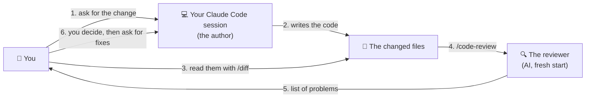
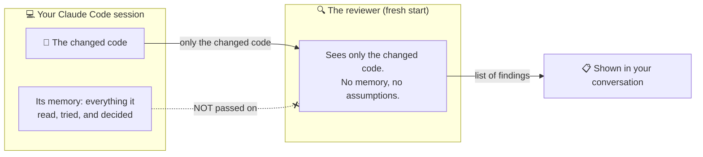
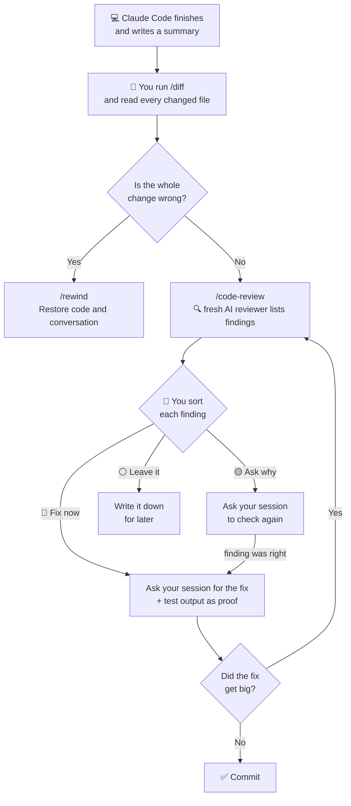

# Lesson 7 — Code review

**Course:** [Claude Code 101](https://academy.claude.com/courses/claude-code-101) &nbsp;·&nbsp; **Chapter 3:** Daily workflows &nbsp;·&nbsp; **Completed:** October 18, 2026

| Previous | Course | Next |
|:---|:---:|---:|
| [← Context management](06-context-management.md) | [📚 Course index](README.md) | [The CLAUDE.md file →](08-claude-md-file.md) |

---

**On this page**

| # | Section |
|:---:|:---|
| 1 | [In one sentence](#in-one-sentence) |
| 2 | [The big picture](#the-big-picture) |
| 3 | [Who's who in a code review](#whos-who-in-a-code-review) |
| 4 | [1. Why Claude Code's summary isn't enough](#1-why-claude-codes-summary-isnt-enough) |
| 5 | [2. Step 1: read the changes yourself with /diff](#2-step-1-read-the-changes-yourself-with-diff) |
| 6 | [3. Step 2: get a second opinion with /code-review](#3-step-2-get-a-second-opinion-with-code-review) |
| 7 | [4. Step 3: you decide what to do with each problem](#4-step-3-you-decide-what-to-do-with-each-problem) |
| 8 | [5. How much reviewing is enough?](#5-how-much-reviewing-is-enough) |
| 9 | [Recap](#recap) |
| 10 | [My notes / practice](#my-notes--practice) |
| 11 | [FAQ](#faq) |

---

### In one sentence

When Claude Code says "done," don't just trust its report: **look at what it actually changed**, **ask a fresh AI reviewer to check it**, and then **you decide** what to fix.

---

### The big picture

Claude Code has finished a task. It shows you a short report of what it did. This lesson is about what you do **next**, before you keep the change.

There are three steps:

| Step | Who does it | What happens | Command |
|---|---|---|---|
| **1. Read the changes** | 🧑 You | You look at every line Claude Code added or removed. | `/diff` |
| **2. Get a second opinion** | 🔍 A fresh AI reviewer | It reads the changes with no background and lists any problems it sees. | `/code-review` |
| **3. Decide** | 🧑 You | For each problem: fix it now, double-check it, or leave it for later. | (no command, you decide) |

#### The example we'll use the whole way through

This is the course's example. You asked Claude Code:

> **You:** "Add input validation to the signup form: check the email format and require passwords of at least 8 characters, with inline error messages."

In plain words: when someone signs up, the form should **stop them** if the email doesn't look like an email, or if the password is shorter than 8 characters. It should show a red message right under the field that's wrong (that's what "inline error messages" means).

Claude Code worked on it and then said it was done.

---

### Who's who in a code review

This lesson has four players. The course text often just says "the session" or "the reviewer," which is confusing. Here's who each one is:

| Player | What it is | What it does in this lesson | Example |
|---|---|---|---|
| 🧑 **You** (a human) | The person at the keyboard. | Read the changes. Decide what happens to each problem. **You are the only one who decides.** | You notice a settings file changed, and you decide a small style problem can wait. |
| 💻 **Your Claude Code session** (the author) | The Claude Code conversation you've been working in. It **wrote** the code. | Remembers everything it read and tried. Later, it makes the fixes you ask for, and re-checks problems you doubt. | It added the validation. Later you tell it: "Fix the first problem and show me the test output." |
| 🔍 **The reviewer** (an AI, **not a person**) | What `/code-review` starts: a **separate** check run by Claude Code, using the same AI model, but starting with **no memory of your conversation**. | Reads only the changed code. Lists problems. **Changes nothing.** | It sends back "4 findings," such as "the server address is typed in as localhost." |
| 👥 **A teammate** (optional, a human) | Someone else on your team. | Might look at the work later, for example before it's merged into the main code. Not part of `/code-review`. | Section 5: "You're about to hand the work to a teammate." |

So in this lesson, **"the reviewer" always means the AI that `/code-review` starts.** No human sees your code during `/code-review`.



Things to notice:
- The **reviewer only reports to you**. It doesn't fix anything.
- **Fixes and re-checks are done by your normal Claude Code session**, when you ask.
- **You** are in the middle and make every decision.

> 🧠 **Remember this:** **Claude Code writes. A fresh Claude Code reviews. You decide.**

---

### 1. Why Claude Code's summary isn't enough

#### An everyday comparison: the builder

A builder redid your kitchen. At the end they tell you: *"New cupboards are in, the tap is fixed, everything works."*

All of that is true. But you still walk around the kitchen yourself before you pay. Why? Because they might also have moved a power socket, or taken out a shelf to make the cupboards fit. They didn't lie. They just didn't mention it.

Claude Code's summary is the builder's report. Walking around the kitchen is reading the changes.

#### What Claude Code's summary said

When Claude Code finished the signup task, it reported:

```text
Added input validation to the signup form.
- Email format and password length are checked before submit
- Inline error messages appear under each field
- All tests pass

File changes: 8 files
```

**Every line is true.** But look at the last line: **8 files** changed. The summary only talks about the form. What happened in the other files?

Here are all 8. The numbers mean **lines added** and **lines removed**: `+34 −6` means 34 lines added and 6 lines removed.

| File | What the file is | Change | Expected? |
|---|---|---|---|
| `src/components/SignupForm.tsx` | The signup form itself | +34 −6 | ✅ Yes, this is the main work |
| `src/lib/validate.ts` | New file: the email and password checks | new, +14 | ✅ Yes |
| `src/lib/validate.test.ts` | New file: tests for those checks | new, +31 | ✅ Yes, new code should have tests |
| `src/styles/form.css` | Styles, for example making error text red | +9 | ✅ Yes, the error messages need a style |
| `src/components/SignupForm.test.tsx` | Tests for the form that **already existed** | +2 **−8** | ⚠️ Odd: why did old tests lose lines? |
| `package.json` | The list of outside code packages the project uses | +1 | ⚠️ Odd: a new package was added |
| `package-lock.json` | An automatic record of exact package versions | +14 | Follows from `package.json` (it always changes along with it) |
| `src/config.ts` | Project settings, such as the server address | +2 −1 | ⚠️ Odd: you never asked for a settings change |

Three of these files are surprises. The summary didn't mention any of them. You'd only find them by looking.

#### Why Claude Code can't fairly check its own work

Your Claude Code session remembers everything it did: every file it read, every idea it tried, every choice it made. (Lesson 6 called this memory the **context window**.)

That memory makes it a poor judge of its own work. It already "knows" why it did each thing, so when it looks back, it tends to agree with itself.

It's like proofreading your own essay. You read what you **meant** to write, not what's actually on the page. A friend who wasn't there spots the mistakes faster.

> 🧠 **Remember this:** **A true summary can still be an incomplete summary.** Read the changes, not just the report.

---

### 2. Step 1: read the changes yourself with /diff

#### What "diff" means

A **diff** shows the **before and after** of a change: which lines were removed and which were added, file by file.

Here's a tiny example. This is the diff for `src/config.ts`:

```diff
- export const API_URL = import.meta.env.VITE_API_URL;
+ export const API_URL = "http://localhost:3000"; // local testing
```

- A line starting with **`-`** was **removed**. That's the old version.
- A line starting with **`+`** was **added**. That's the new version.

So a diff lets you see exactly what changed, line by line, without comparing two files by hand.

#### How to open the diff viewer

1. In Claude Code, type:

   ```text
   /diff
   ```

2. A viewer opens. It lists the files that have changed and **haven't been saved to Git yet**. (Git is the tool that keeps the history of your project. Saving a change to Git is called a **commit**. Changes you haven't committed yet are **uncommitted changes**.)
3. Press **↑** or **↓** to move between files.
4. Press **Enter** on a file to see its diff.

The viewer can also show what **each of Claude Code's turns** changed. A **turn** is one round of you asking and Claude Code answering. This helps when you've asked for several things: you can see which request caused which edit.

#### Three things to look for every time

| Look for | Why it matters | Example from the signup task |
|---|---|---|
| **1. Changes you didn't ask for** | While Claude Code is working, it sometimes "tidies up" other things too. Each extra change is something you didn't plan to check. | `src/config.ts` changed, but you only asked for form validation. |
| **2. Tests that got weaker** | A **test** is a small program that checks your code works. If a test is switched off, deleted, or made easier, it still "passes," but it no longer checks anything. Then "all tests pass" proves nothing. | `SignupForm.test.tsx` lost 8 lines and gained only 2. More lines removed than added in a test file is a warning sign. |
| **3. New packages and typed-in values** | A **package** is code written by someone else that your project uses. Each new one is more code you have to trust and keep up to date. A **typed-in value** (the course says **hard-coded**) is a fixed address or password written straight into the code. It may only work on your computer, or leak a secret. | `package.json` has 1 new line: a new package. And `config.ts` now has a typed-in address. |

#### The course exercise: which files need a closer look?

The course asks you to pick **three files** that deserve a second look. The answer:

| File | Why it needs a closer look |
|---|---|
| `src/components/SignupForm.test.tsx` | Old tests lost lines. They may have been made weaker. |
| `package.json` | A new package was added, probably just to check emails. Do you need it? |
| `src/config.ts` | You didn't ask for any settings change. |

The other five files match what you asked for.

#### ⚠️ If the whole change is wrong: undo it with /rewind

Sometimes the change is so wrong that fixing it isn't worth it. You can undo it instead:

1. Type `/rewind`, or press **Esc** twice when the prompt is empty.
2. Pick the message you sent that led to the bad change.
3. Choose **Restore code and conversation**.

Claude Code puts your files **and** the conversation back to how they were before that message.

**One limit:** `/rewind` only undoes edits Claude Code made with its own file-editing tools. It does **not** undo what **terminal commands** did. For example, if Claude Code ran `npm install` to add a package, that package stays installed. You'd clean that up yourself, for example with Git.

---

### 3. Step 2: get a second opinion with /code-review

#### An everyday comparison: a friend proofreads your essay

You wrote an essay. You've read it five times and it looks fine to you. Then a friend reads it once and finds three mistakes. They weren't smarter. They just didn't know what you **meant** to write, so they read what you **actually** wrote.

`/code-review` is that friend. **It's not a person.** It's Claude Code, using the same AI model, but starting fresh, with no memory of your conversation.

#### What happens when you run /code-review

1. **You type:**

   ```text
   /code-review
   ```

2. **Claude Code starts a separate reviewer.** The reviewer starts with a **clean context**. That means it knows nothing about your conversation: not what you asked for, not what Claude Code tried, not why it made each choice. It only sees the changed code.
3. **The reviewer works in the background.** It can take from a few seconds to a few minutes. You can keep working in the meantime.
4. **The reviewer sends back a list of problems** into your conversation. Each problem is called a **finding**.
5. **Nothing has been changed.** The reviewer only reports. Your files are exactly as they were.



Things to notice:
- Only the **changed code** goes to the reviewer. Your session's memory does **not**.
- That's on purpose. Lesson 6 taught you to keep context tidy. Here, a reviewer with **no** context is exactly what you want.

#### Good to know

| Fact | What it means for you |
|---|---|
| **It only reports.** | It edits nothing unless you ask it to. |
| **It runs in the background.** | You don't have to wait. Keep working. |
| **It uses your plan or budget**, like any other task. | Don't run it on every tiny change. Save it for changes that deserve it (section 5). |
| **You can ask in plain words.** | "Review the changes you just made. Report problems; don't fix anything yet." If Claude Code just answers in the chat instead of starting a review, type `/code-review` yourself. |

**Extra (from the docs, not the course):** `/review` does the same thing as `/code-review`. You can also add `--fix` to have it apply its own findings, choose how thorough it is (`low` up to `max`), or point it at a pull request or branch. For security checks there's a separate `/security-review` command.

#### What the reviewer sent back

```text
/code-review
Reviewed 8 changed files. 4 findings:

1. src/components/SignupForm.test.tsx:18  [correctness]
   A test was skipped and an assertion weakened; a form that submits
   empty values would still pass.

2. src/lib/validate.ts:4  [correctness]
   isValidEmail doesn't trim leading or trailing spaces, so an address
   pasted with a stray space is rejected.

3. src/config.ts:1  [correctness]
   API_URL is hard-coded to localhost:3000; a production build would
   send signups to a development address.

4. src/styles/form.css:1  [style]
   Error text uses a hex color instead of the project's --color-danger
   variable.
```

How to read one finding, using finding 3:

| Part | In finding 3 | What it means |
|---|---|---|
| **Where** | `src/config.ts:1` | File `src/config.ts`, line 1. |
| **Kind** | `[correctness]` | The code may **do the wrong thing**. The other kind, `[style]`, means the code works but doesn't follow the project's usual way of doing things. |
| **The problem** | "API_URL is hard-coded to localhost:3000…" | One sentence saying what's wrong. |

The same four findings in plain words:

| # | The reviewer says… | In plain words |
|:---:|---|---|
| 1 | A test was skipped and an assertion weakened. | One old test was switched off, and another was made easier to pass. |
| 2 | `isValidEmail` doesn't trim spaces. | If someone pastes `sam@example.com ` with a space at the end, the form says the email is wrong. |
| 3 | `API_URL` is hard-coded to localhost. | The server address is now fixed to "this computer." On the live website, signups would go nowhere. |
| 4 | Hex color instead of `--color-danger`. | The red error color is typed in directly, instead of using the project's shared "danger red" setting. |

---

### 4. Step 3: you decide what to do with each problem

The reviewer is done. Now it's **your** turn. **You**, the human, decide what happens to each finding.

#### Why not just say "fix them all"?

1. **Not every finding is urgent.** A switched-off test is serious. A slightly wrong shade of red isn't. Fixing everything at once makes the change bigger, and a bigger change is harder to check.
2. **The reviewer can be wrong.** It starts with no background (the course says it reads the code **"cold"**). That's what makes it good at spotting surprises. But it also means it can misread code and report a problem that isn't there.

#### An everyday comparison: sorting your mail

When you get a pile of mail, you don't deal with every letter the same way. A bill due tomorrow, you pay **now**. A letter that seems strange ("you owe us money?"), you **call and check**. An ad for a sale, you put **aside for later**.

Findings work the same way. You sort each one into one of **three piles**:

| Pile | Pick it when… | What **you** do | Who does the work |
|---|---|---|---|
| 🔴 **Fix now** | The problem is real and it matters. | Tell your Claude Code session to fix it **and show you proof** that it worked. | Your Claude Code session |
| 🟡 **Ask why** | You're not sure the problem is real, or it looks wrong to you. | Copy the finding into your Claude Code session and ask it to check the code again. (Or open the file and look yourself.) | Your Claude Code session re-checks and tells you |
| ⚪ **Leave it** | The problem is real, but small. | Write it down. Later, fix it together with other small problems in one go. | Nobody, for now |

The reviewer isn't part of any pile. Its job ended when it sent the list.

#### Sorting the four signup findings

**Finding 1: a test was switched off and another made easier → 🔴 Fix now**

Here's the diff of the test file:

```diff
- it("blocks submit when the email is empty", async () => {
+ it.skip("blocks submit when the email is empty", async () => {
  …
- expect(onSubmit).toHaveBeenCalledWith({ email: "sam@example.com", password: "correct-horse-battery" });
+ expect(onSubmit).toHaveBeenCalled();
```

What changed, in plain words:
- **Line 1:** `it(...)` is a test. `it.skip(...)` means **"skip this test."** The test that checks "you can't sign up with an empty email" **no longer runs at all**.
- **Line 2:** `expect(...)` is the actual check inside a test (the course calls it an **assertion**). Before, it checked **exactly what** the form sent: this email and this password. Now it only checks that the form sent **something**. Any data, even empty data, would pass.

So "all tests pass" was true only because the tests were made easier. That's exactly the kind of mistake validation is supposed to prevent. Fix now.

**Finding 2: email spaces not removed → 🟡 Ask why**

You open `src/lib/validate.ts` and see:

```ts
export function isValidEmail(value: string) {
  return isEmail(value.trim());
}
```

`trim()` **removes spaces** from the start and end of text. So the code **does** remove spaces. The reviewer's finding looks wrong.

Don't just believe it, and don't just ignore it. Type this in **your Claude Code session**:

```text
The review reported that isValidEmail doesn't trim spaces, but line 4 calls trim(). Check again and tell me whether the finding stands.
```

Your Claude Code session re-reads the code and answers. Then:
- If the reviewer was **wrong**, you drop the finding.
- If the reviewer was **right** after all (for example, there's a second email check somewhere else that doesn't trim), the finding moves to **Fix now**.

**Finding 3: the server address is typed in → 🔴 Fix now**

```diff
- export const API_URL = import.meta.env.VITE_API_URL;
+ export const API_URL = "http://localhost:3000"; // local testing
```

What changed, in plain words:
- **Before:** the server address came from a setting outside the code (`import.meta.env.VITE_API_URL`). That setting is different on your computer and on the live website. So each place used the right address.
- **After:** the address is typed in as `http://localhost:3000`. **localhost** means "this same computer." On your laptop, that works. On the live website, real users' signups would be sent to an address that doesn't exist for them.

And you never asked for this change. Fix now.

**Finding 4: the error color is typed in → ⚪ Leave it**

```css
.field-error { color: #c0392b; font-size: 0.875rem; margin-top: 4px; }
```

`#c0392b` is a shade of red typed in directly (a **hex color**). The project has a shared setting called `--color-danger` for this. If the team ever changes its "danger red," this one spot won't update.

But it works. The error text shows in red. It's worth fixing, just not right now. Leave it, and fix it later with other small style problems.

#### The result

| # | Finding | Pile | Why |
|:---:|---|---|---|
| 1 | Test switched off and check made easier | 🔴 Fix now | The tests no longer protect the form. |
| 2 | Spaces not removed from email | 🟡 Ask why | The code seems to do it already. Check before acting. |
| 3 | Server address typed in as localhost | 🔴 Fix now | The live website would break. |
| 4 | Red color typed in instead of shared setting | ⚪ Leave it | Works fine. Small style problem. |

#### When you ask for a fix, ask for proof too

Don't just say "fix it." Type this in your Claude Code session:

```text
Fix the first finding: don't skip the empty-email test and restore the original assertion. Then run the tests and show me the output.
```

Why ask for the test output? Because "I fixed it" is just another summary, and section 1 showed that summaries can leave things out. Test output is **evidence**: something you can see with your own eyes.

**If a fix turns into a big change, run `/code-review` again.** A big fix is a new change, and it can have new problems of its own.

#### The whole process



---

### 5. How much reviewing is enough?

#### An everyday comparison: a text message vs. a contract

You don't ask a lawyer to check a text message to a friend. But you do get a contract checked before you sign it. The bigger the risk, the more checking it deserves.

Reviews cost time, and `/code-review` uses your plan or budget. So match the checking to the change. There are two kinds of review:
- **You reading the diff** (a human review)
- **`/code-review`** (an AI review)

| The change… | What to do | Example |
|---|---|---|
| Is small and simple | You take a quick look at the diff. That's enough. | Fixing a typo in a button label |
| Is too big to keep in your head at once | You read the diff **and** run `/code-review`. | The 8-file signup change |
| Touches something **sensitive** | You read the diff **and** run `/code-review`. | Login, payments, users' personal data |
| Does something **hard to undo** (the course says *destructive*) | You read the diff **and** run `/code-review`. | Deleting data, changing the structure of a database |
| Is about to go to a **teammate** | You read the diff **and** run `/code-review`. | Before asking a colleague to approve your work |

#### Turn repeat problems into rules

If the reviewer finds the **same problem** again and again, write a rule so Claude Code avoids it from the start. For example:

> *"Never skip or loosen a test to make it pass."*

That rule goes in a file called `CLAUDE.md`. Claude Code reads that file at the start of every session. That's the next lesson.

#### Common mix-ups

| ❌ Wrong idea | ✅ What really happens |
|---|---|
| "The summary is true, so the change is fine." | A true summary can still leave out changes worth checking. |
| "All tests pass, so it works." | Tests can be switched off or made easier until they pass. Check the test files in the diff. |
| "Claude Code can check its own work in the same conversation." | That conversation remembers its own reasoning and tends to agree with itself. Use `/code-review`, which starts fresh. |
| "`/code-review` sends my code to a human reviewer." | The reviewer is Claude Code itself, starting with no memory of your conversation. No person is involved. |
| "`/code-review` fixes the problems it finds." | It only reports, unless you ask it to fix. |
| "The reviewer decides what gets fixed." | **You** decide. The reviewer only lists problems. |
| "Every finding must be fixed right away." | Sort them: fix now, ask why, or leave it. |
| "The reviewer is always right." | It reads the code with no background and can be wrong, like finding 2. Ask your Claude Code session to check again. |
| "`/rewind` undoes everything." | It doesn't undo what terminal commands did, such as installing a package. |

#### Test yourself

<details>
<summary>1. Claude Code's summary says "All tests pass." Why should you still look at the test files?</summary>

Tests may have been switched off, deleted, or made easier until they passed. Then "all tests pass" doesn't prove anything. In the example, `it.skip` switched one test off, and another test was changed to accept any data.
</details>

<details>
<summary>2. What three things should you look for every time you read a diff?</summary>

1. Changes you didn't ask for.
2. Tests that got weaker.
3. New packages and typed-in values, like a fixed server address.
</details>

<details>
<summary>3. Why is a fresh reviewer better than asking your Claude Code session to check its own work?</summary>

Your session remembers why it did everything, so it tends to agree with itself. A fresh reviewer knows nothing about your conversation and only sees the code, so it spots things your session would explain away.
</details>

<details>
<summary>4. When you run /code-review, who is the reviewer?</summary>

An AI, not a person. It's a separate check run by Claude Code, using the same AI model, but starting with no memory of your conversation. It lists problems and changes nothing. You decide what to do with them.
</details>

<details>
<summary>5. The reviewer says a function is missing a check, but you can see the check right there in the code. What do you do?</summary>

Put it in the "ask why" pile. Copy the finding into your Claude Code session, point to the line, and ask it to check again and say whether the finding is right.
</details>

<details>
<summary>6. You used /rewind to undo a change, but a package Claude Code installed is still there. Why?</summary>

`/rewind` only undoes edits Claude Code made with its file-editing tools. It doesn't undo what terminal commands did, like `npm install`. Remove the package yourself, or use Git.
</details>

---

### Recap

- **Know who's who.** You decide. Your Claude Code session wrote the code and makes the fixes. The reviewer is an AI that `/code-review` starts fresh, not a person.
- **Summaries can leave things out.** Claude Code's summary can be true and still skip changes that matter. And the session that wrote the code tends to agree with itself.
- **Step 1: read the changes with `/diff`.** Look for changes you didn't ask for, weaker tests, and new packages or typed-in values. If the whole change is wrong, undo it with `/rewind` (but terminal commands aren't undone).
- **Step 2: get a second opinion with `/code-review`.** A fresh AI reviewer reads only the changed code, works in the background, and only reports.
- **Step 3: you sort each finding:** fix now, ask why, or leave it. Ask for proof (like test output) with every fix. Review again if a fix grows big.
- **Match the checking to the risk.** Small changes get a quick look. Big, sensitive, or hard-to-undo changes, or work going to a teammate, get both your review and `/code-review`.

---

## My notes / practice

- [ ] After my next Claude Code task, run `/diff` before reading the summary closely. Did anything change that the summary didn't mention?
- [ ] In `/diff`, use ↑ / ↓ and Enter to go through each file.
- [ ] Run `/code-review` on a change and sort its findings into the three piles.
- [ ] Find one finding I doubt and ask my Claude Code session to check it again.
- [ ] Ask for a fix "and show me the test output."
- [ ] Try `/rewind` (or Esc twice) on a throwaway change, and choose **Restore code and conversation**.
- [ ] If a finding repeats, note it as a rule for `CLAUDE.md` (next lesson).

---

## FAQ

In these answers, **Claude Code** means the program on your computer. **The model** means the AI on Anthropic's servers.

**Q1. Why should I check Claude Code's work if its summary is accurate?**
Because accurate isn't the same as complete. In the course example, every line of the summary was true, but it didn't mention a switched-off test, a new package, or a settings change. Only the changed files show everything.

**Q2. Why can't Claude Code fairly check its own work in the same conversation?**
That conversation remembers everything it read, tried, and decided. It already "knows" why it did each thing, so it tends to agree with itself. It's like proofreading your own essay: you read what you meant to write, not what's on the page.

**Q3. Who are the players in a code review with Claude Code?**
- **You:** read the changes and decide what to do. You're the only one who decides.
- **Your Claude Code session:** wrote the code, and later makes fixes and re-checks findings when you ask.
- **The reviewer:** the AI that `/code-review` starts with a fresh memory. It only lists problems.
- **A teammate** (optional): a person who may look at the work later.

**Q4. What does "diff" mean?**
The before-and-after of a change: which lines were removed and which were added, file by file. Lines starting with `-` were removed. Lines starting with `+` were added.

**Q5. What does a number like "+34 −6" next to a file mean?**
34 lines were added to that file and 6 were removed. If a test file shows more removed than added, like `+2 −8`, tests may have been weakened.

**Q6. What does the `/diff` command do?**
It opens a viewer of your **uncommitted changes**, meaning changes not yet saved to Git. Use ↑ / ↓ to move between files and Enter to open one. It can also show what each of Claude Code's turns changed.

**Q7. What should I look for when I read a diff?**
- Changes you didn't ask for, such as an edited settings file
- Tests that got weaker: switched off, deleted, or made easier
- New packages and typed-in values, such as a server address or key written into the code

**Q8. How can I tell if a test was weakened?**
Look for `skip` (for example, `it.skip`, which switches a test off), deleted tests, or checks that became less exact. In the course example, a check that the form sent a specific email and password became a check that it sent anything at all.

**Q9. Why is a new package worth a second look?**
A package is someone else's code. Each new one is more code you have to trust, update, and keep secure. If it was added just for one small check, you may not need it.

**Q10. What does "hard-coded" mean?**
A value typed straight into the code, instead of coming from a setting. In the example, the server address was typed in as `http://localhost:3000`. That only works on your own computer, so the live website would break.

**Q11. How do I undo a change that's completely wrong?**
Type `/rewind`, or press Esc twice when the prompt is empty. Pick the message that led to the change and choose **Restore code and conversation**.

**Q12. What does `/rewind` not undo?**
Anything a terminal command did, such as installing a package with `npm install`. `/rewind` only undoes edits Claude Code made with its file-editing tools. Clean the rest up yourself, for example with Git.

**Q13. What does the `/code-review` command do?**
It starts a separate reviewer that reads your changed code with a fresh memory and lists problems it finds. It works in the background, changes nothing unless you ask, and puts its findings in your conversation when it's done.

**Q14. Who is the reviewer when I run `/code-review`?**
An AI, not a person. It's Claude Code using the same model, but starting with no memory of your conversation. That's why it can spot things your own session would miss. No human sees your code during `/code-review`.

**Q15. What does "clean context" mean?**
Starting with a blank memory. The reviewer doesn't see what you asked for, what Claude Code tried, or why it made its choices. It only sees the changed code, the way a stranger would.

**Q16. Does `/code-review` use my plan or budget?**
Yes, like any other task. Save it for changes that deserve a second look.

**Q17. Can I ask for a review without typing `/code-review`?**
Yes. Ask in plain words, for example: "Review the changes you just made. Report problems; don't fix anything yet." If Claude Code just answers in the chat instead of starting a review, type `/code-review` yourself.

**Q18. What does "finding" mean?**
One problem the reviewer reports. Each finding says where it is (file and line), what kind it is (`correctness`: the code may do the wrong thing, or `style`: it works but doesn't follow the project's usual way), and what's wrong in one sentence.

**Q19. What are the three piles for findings?**
- 🔴 **Fix now:** a real problem that matters.
- 🟡 **Ask why:** you're not sure it's real, or it looks wrong.
- ⚪ **Leave it:** real but small. Fix it later with other small problems.

**Q20. Who decides which pile a finding goes in?**
You do. The reviewer only lists problems. It doesn't decide what's important or what gets fixed.

**Q21. Can the reviewer be wrong?**
Yes. It starts with no background (the course says it reads the code "cold"), so it can misread code. In the example, it said the email check doesn't remove spaces, but the code calls `trim()`, which does exactly that.

**Q22. If I doubt a finding, who checks it again?**
Your normal Claude Code session. Copy the finding into the conversation, point to the line, and ask it to check again. You can also open the file and look yourself. If the finding turns out to be right, move it to "fix now."

**Q23. Why should I ask for proof when I ask for a fix?**
"I fixed it" is just another summary, and summaries can leave things out. Asking Claude Code to "run the tests and show me the output" gives you evidence you can see yourself.

**Q24. What should I do if a fix turns into a big change?**
Run `/code-review` again. A big fix is a new change and can have its own problems.

**Q25. When is a full review worth the time?**
When a change is too big to keep in your head, touches something sensitive (login, payments, personal data), does something hard to undo, or is about to go to a teammate. A small, simple change usually needs only a quick look at the diff.

**Q26. What should I do if the reviewer keeps finding the same problem?**
Write a rule in `CLAUDE.md`, for example "Never skip or loosen a test to make it pass." Claude Code reads that file at the start of every session, so it avoids the problem from the start.

**Q27. (Exam angle) A team wants Claude Code to write and approve its own changes in one session to save time. What's the risk, and what do you recommend?**
The session that wrote the code remembers its own reasoning and tends to confirm its own work. Problems like weakened tests or unrequested settings changes slip through. Recommend:
- A human reads the diff.
- A separate fresh review (`/code-review`) before the change is committed.
- Every fix comes with evidence, such as test output.

It's the same idea as not letting people approve their own pull requests. This fits the **Governance, Safety & Risk** exam domain.

**Q28. (Exam angle) A change passes all tests but sends live website traffic to localhost. How could the review process have caught it?**
Reading the diff for **changes you didn't ask for** and **typed-in values** would have shown `API_URL` changed to `"http://localhost:3000"` in `src/config.ts`. A fresh `/code-review` also flags it. Passing tests don't prove a change is right, especially if no test covers that setting. This fits the **Governance, Safety & Risk** exam domain.

**Q29. (Exam angle) An engineering manager asks how to make code review with Claude Code worth the cost. How do you answer?**
Match the checking to the risk:
- Small, simple changes: a quick look at the diff only.
- Large, sensitive, or hard-to-undo changes, and anything going to a teammate: a human reads the diff, plus `/code-review`.
- Turn repeat findings into `CLAUDE.md` rules so they stop happening.
- Fix small "leave it" findings together in one later session.

This fits the **Developer Productivity & Operational Enablement** exam domain.

---

| Previous | Course | Next |
|:---|:---:|---:|
| [← Context management](06-context-management.md) | [📚 Course index](README.md) | [The CLAUDE.md file →](08-claude-md-file.md) |
