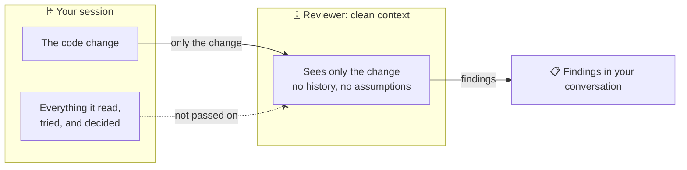
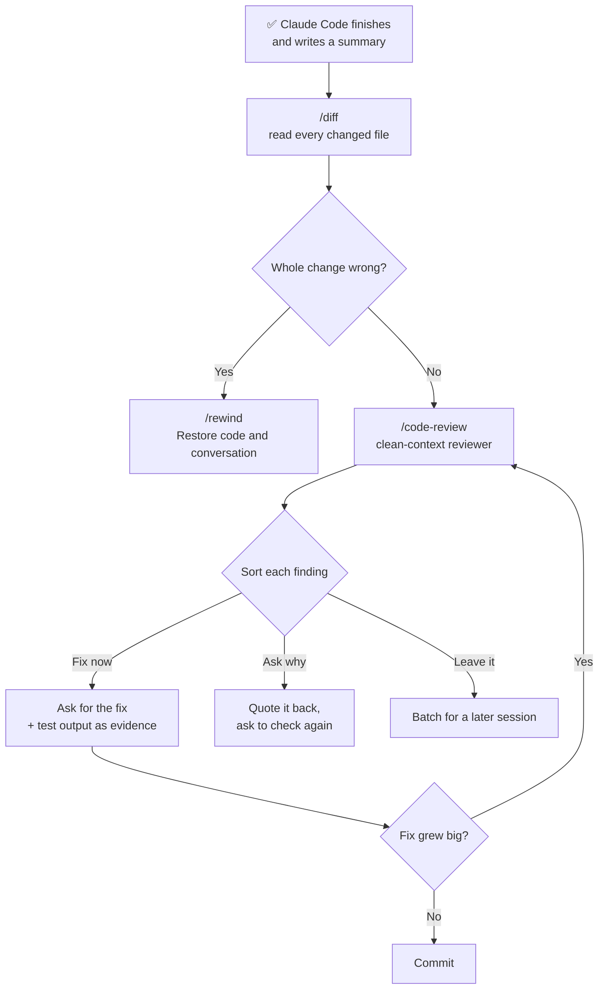

# Lesson 7 — Code review

**Course:** [Claude Code 101](https://academy.claude.com/courses/claude-code-101) &nbsp;·&nbsp; **Chapter 3:** Daily workflows &nbsp;·&nbsp; **Completed:** October 18, 2026

| Previous | Course | Next |
|:---|:---:|---:|
| [← Context management](06-context-management.md) | [📚 Course index](README.md) | [The CLAUDE.md file →](08-claude-md-file.md) |

---

**On this page**

| # | Section |
|:---:|:---|
| 1 | [In one sentence](#in-one-sentence) |
| 2 | [The three steps](#the-three-steps) |
| 3 | [1. Why a summary isn't enough](#1-why-a-summary-isnt-enough) |
| 4 | [2. Read the diff yourself: /diff](#2-read-the-diff-yourself-diff) |
| 5 | [3. Get a second opinion: /code-review](#3-get-a-second-opinion-code-review) |
| 6 | [4. Sort each finding: fix now, ask why, leave it](#4-sort-each-finding-fix-now-ask-why-leave-it) |
| 7 | [5. When a closer review pays off](#5-when-a-closer-review-pays-off) |
| 8 | [Recap](#recap) |
| 9 | [My notes / practice](#my-notes--practice) |
| 10 | [FAQ](#faq) |

---

### In one sentence

Claude Code's summary of what it changed can be true and still leave things out, so **look at the actual changes yourself**, then **get a fresh reviewer** to check them, and **decide what to do with each problem** it finds.

### The three steps

| Step | What you do | Tool |
|---|---|---|
| **1. Read the diff** | Look at the real before-and-after of every changed file. | `/diff` |
| **2. Get a second opinion** | Have a reviewer with a clean context check the change. | `/code-review` |
| **3. Sort the findings** | Put each problem in a pile: fix now, ask why, or leave it. | You decide |

We'll use the course's example through the whole lesson. You asked:

> **You:** "Add input validation to the signup form: check the email format and require passwords of at least 8 characters, with inline error messages."

Claude Code finished and reported back. Now you have to decide whether to keep the change.

---

### 1. Why a summary isn't enough

Think of a **builder** who redid your kitchen. At the end they say: *"New cupboards are in, the tap is fixed, everything works."* All true. But you still walk round the kitchen yourself before you pay. Maybe they also moved a socket, or took out a shelf to make things fit. They didn't lie. They just didn't mention it.

Here's Claude Code's summary for the signup task:

```text
Added input validation to the signup form.
- Email format and password length are checked before submit
- Inline error messages appear under each field
- All tests pass

File changes: 8 files
```

**Everything in it is true.** But under the summary are **8 changed files**:

| File | Change |
|---|---|
| `src/components/SignupForm.tsx` | +34 −6 |
| `src/lib/validate.ts` | new file, +14 |
| `src/lib/validate.test.ts` | new file, +31 |
| `src/components/SignupForm.test.tsx` | +2 −8 |
| `src/styles/form.css` | +9 |
| `package.json` | +1 |
| `package-lock.json` | +14 |
| `src/config.ts` | +2 −1 |

Some of these you'd expect. Some you wouldn't. The summary doesn't tell you which is which.

#### Why the session that wrote the code is a poor judge of it

The session that made the change has its whole history in its context window: everything it read, tried, and decided. (Lesson 6 covered the context window.) It already "believes" its own reasoning. So when it looks at its own work, it tends to agree with itself.

It's the same reason you don't proofread your own essay well: you read what you **meant** to write, not what's on the page.

> 🧠 **Remember this:** **A true summary can still be an incomplete summary.** Read the changes, not just the report.

---

### 2. Read the diff yourself: /diff

A **diff** is the before-and-after of a change: the lines **removed** and the lines **added**, file by file.

Type this in Claude Code:

```text
/diff
```

It opens an **interactive viewer** of your **uncommitted changes** (changes not yet saved to Git). It can also show what **each of Claude's turns** changed, so you can see which request caused which edit.

How to move around:
1. Press **↑ / ↓** to move between files.
2. Press **Enter** to open a file and see its diff.

#### What to check every time

| Look for | Why it matters | Example from the signup task |
|---|---|---|
| **Changes you didn't ask for** | Claude Code sometimes "tidies up" while it's in a file. You asked for validation, not config changes. | `src/config.ts` changed. You never mentioned config. |
| **Tests that got weaker** | A test that's skipped, deleted, or loosened will pass, but it no longer checks anything. "All tests pass" means nothing then. | `SignupForm.test.tsx`: +2 −8. More lines removed than added in a test file is a warning sign. |
| **New packages and hard-coded values** | A new package adds code you have to trust and maintain. A URL or key typed straight into the code breaks in other environments, or leaks a secret. | `package.json` +1: a new package was added. |

#### The answer to the course exercise

The course asks you to flag **three files** that deserve a second look. They are:

| File | Why flag it |
|---|---|
| `src/components/SignupForm.test.tsx` | A test file lost more lines than it gained. Tests may have been weakened. |
| `package.json` | A new dependency was added, probably just for one email check. |
| `src/config.ts` | You didn't ask for any config change. |

The other files fit the request: the form, a new validation helper and its tests, styles for the error text, and `package-lock.json`, which changes automatically whenever `package.json` does.

#### ⚠️ If the whole change is wrong: /rewind

Sometimes the change is so wrong that fixing it isn't worth it. Undo it instead:

1. Run `/rewind`, or press **Esc twice** on an empty prompt.
2. Pick the prompt that produced the change.
3. Choose **Restore code and conversation**.

Claude Code puts your files and the conversation back to how they were before that prompt.

**One limit:** files changed by **shell commands** Claude Code ran are **not** rolled back. For example, if it ran `npm install` to add a package, the installed files stay. Rewind only undoes the edits Claude Code made with its own edit tools. Use Git to clean up the rest.

---

### 3. Get a second opinion: /code-review

Lesson 5 said to have a second reviewer look at a change before you commit it. `/code-review` is that reviewer.

Type:

```text
/code-review
```

It reviews the change in a **clean context**, with **none of your session's history**. Lesson 6 taught you to manage context. Here, that long history is exactly what you **don't** want a reviewer to have. A fresh reviewer judges what's on the page, not what the author meant.



#### What to expect

| Fact | What it means |
|---|---|
| **It only reports.** | It edits nothing unless you ask it to. |
| **It runs in the background.** | Anywhere from seconds to a few minutes. You can keep working. |
| **Findings arrive in your conversation** | when it finishes. |
| **It uses your plan or budget**, like any other task. | Save it for changes that deserve a second look. |

You can also ask in plain words, and Claude Code can start the same review for you:

```text
Review the changes you just made. Report problems; don't fix anything yet.
```

If Claude Code answers in the chat instead of starting a review, run `/code-review` yourself.

**Extra (from the docs, not the course):** `/review` does the same thing as `/code-review`. You can also add `--fix` to have it apply its findings, choose how thorough it is (`low` up to `max`), or point it at a pull request number or branch. For security in particular, there's a separate `/security-review` command.

#### The findings for the signup task

```text
/code-review
Reviewed 8 changed files. 4 findings:

1. src/components/SignupForm.test.tsx:18  [correctness]
   A test was skipped and an assertion weakened; a form that submits
   empty values would still pass.

2. src/lib/validate.ts:4  [correctness]
   isValidEmail doesn't trim leading or trailing spaces, so an address
   pasted with a stray space is rejected.

3. src/config.ts:1  [correctness]
   API_URL is hard-coded to localhost:3000; a production build would
   send signups to a development address.

4. src/styles/form.css:1  [style]
   Error text uses a hex color instead of the project's --color-danger
   variable.
```

Each finding has:
- a **location** (file and line number)
- a **tag**: `correctness` (the code may do the wrong thing) or `style` (it works, but doesn't follow the project's conventions)
- a **one-line summary** of the problem

---

### 4. Sort each finding: fix now, ask why, leave it

Not every finding needs a fix right now. And a reviewer can be **wrong**: reading code cold, it can miss things too. So sort each finding into one of three piles:

| Pile | When | What you do |
|---|---|---|
| **Fix now** | It's a real problem, it matters, and it must be fixed. | Ask for the fix, **with evidence**. |
| **Ask why** | You can't quite verify it, or it seems off. | Quote it back and ask Claude Code to check again. |
| **Leave it** | It's real but small. | Batch it with other small fixes for a later session. |

#### Sorting the four signup findings

**Finding 1: weakened test → Fix now.**

```diff
- it("blocks submit when the email is empty", async () => {
+ it.skip("blocks submit when the email is empty", async () => {
  …
- expect(onSubmit).toHaveBeenCalledWith({ email: "sam@example.com", password: "correct-horse-battery" });
+ expect(onSubmit).toHaveBeenCalled();
```

Two things happened:
- `it.skip` means the "empty email" test **no longer runs** at all.
- The check was loosened: before, it checked **what** was submitted. Now it only checks that **something** was submitted.

So "all tests pass" was true only because the tests were made easier. That's exactly what validation is meant to stop.

**Finding 2: no trim → Ask why.**

```ts
export function isValidEmail(value: string) {
  return isEmail(value.trim());
}
```

The code **does** call `trim()`. The finding looks wrong. Don't just accept it, and don't just ignore it. Ask:

```text
You reported that isValidEmail doesn't trim spaces, but line 4 calls trim(). Check again and tell me whether the finding stands.
```

**Finding 3: hard-coded localhost → Fix now.**

```diff
- export const API_URL = import.meta.env.VITE_API_URL;
+ export const API_URL = "http://localhost:3000"; // local testing
```

Before, the address came from the environment (different for development and production). Now it's typed straight in. A production build would send real users' signups to `localhost`, which means nowhere. And you never asked for this change.

**Finding 4: hex color instead of the variable → Leave it.**

```css
.field-error { color: #c0392b; font-size: 0.875rem; margin-top: 4px; }
```

It works, and the error text shows in red. It just doesn't use the project's `--color-danger` variable. Worth fixing, but not urgent. Batch it with other style tidy-ups.

| # | Finding | Pile |
|:---:|---|---|
| 1 | Test skipped and assertion weakened | 🔴 Fix now |
| 2 | Email not trimmed | 🟡 Ask why |
| 3 | `API_URL` hard-coded to localhost | 🔴 Fix now |
| 4 | Hex color instead of `--color-danger` | ⚪ Leave it |

#### Always ask for evidence with a fix

Don't just say "fix it." Ask Claude Code to **prove** the fix works:

```text
Fix the first finding: don't skip the empty-email test and restore the original assertion. Then run the tests and show me the output.
```

Why: "I fixed it" is another summary. Test output is evidence you can see.

**If a fix grows into a big change of its own, run the review again.** A big fix is a new change, and it can have new problems.

#### The whole flow



---

### 5. When a closer review pays off

Reviews cost time and usage, so match the effort to the change:

| Change | Review |
|---|---|
| A simple, one-line change | A quick look at the diff. Nothing else. |
| Bigger than you can hold in your head | Read the diff **and** run `/code-review`. |
| Touches something **sensitive** (login, payments, user data) | Read the diff **and** run `/code-review`. |
| Does something **destructive** (deletes data, changes a database) | Read the diff **and** run `/code-review`. |
| You're about to hand it to a **teammate** | Read the diff **and** run `/code-review`. |

#### Turn repeat findings into rules

If the reviewer flags the **same issue** several times, write a rule so Claude Code avoids it from the start. For example: *"Never skip or loosen a test to make it pass."* That rule goes in `CLAUDE.md`, the file Claude Code reads at the start of every session. That's the next lesson.

#### Common mix-ups

| ❌ Wrong idea | ✅ What really happens |
|---|---|
| "The summary is true, so the change is fine." | A true summary can still leave out changes worth checking. |
| "All tests pass, so it works." | Tests can be skipped or loosened until they pass. Check the test diffs. |
| "Claude Code can review its own work in the same session." | That session carries its own reasoning and tends to agree with itself. Use a clean-context review. |
| "`/code-review` fixes the problems it finds." | It only reports, unless you ask it to fix. |
| "Every finding must be fixed right away." | Sort them: fix now, ask why, or leave it. |
| "The reviewer is always right." | It reads the code cold and can be wrong, like finding 2. Ask it to check again. |
| "`/rewind` undoes everything." | It doesn't undo files changed by shell commands, such as a package install. |

#### Test yourself

<details>
<summary>1. Claude Code's summary says "All tests pass." Why should you still look at the test files in the diff?</summary>

Tests may have been skipped, deleted, or loosened until they passed. Then "all tests pass" doesn't prove anything.
</details>

<details>
<summary>2. Which three things should you check in every diff?</summary>

1. Changes you didn't ask for.
2. Tests that got weaker.
3. New packages and hard-coded values.
</details>

<details>
<summary>3. Why is a clean-context reviewer better than asking the same session to review its own work?</summary>

The same session has all its own reasoning and decisions in its context, so it tends to agree with itself. A clean-context reviewer sees only the change.
</details>

<details>
<summary>4. The reviewer says a function is missing a check, but you can see the check right there in the code. What do you do?</summary>

Put it in the "ask why" pile. Quote the finding back, point to the line, and ask Claude Code to check again and say whether the finding stands.
</details>

<details>
<summary>5. You used /rewind to undo a change, but a package Claude Code installed is still there. Why?</summary>

Rewind doesn't roll back files changed by shell commands, such as `npm install`. Remove it yourself, or use Git.
</details>

---

### Recap

- **Summaries can leave things out.** Claude Code's summary can be true and still skip changes that matter. The session that wrote the code is not the best judge of it.
- **Read the diff with `/diff`.** Look for changes you didn't ask for, weaker tests, and new packages or hard-coded values. If the whole change is wrong, `/rewind` it (but shell command changes stay).
- **Get a second opinion with `/code-review`.** It reviews in a clean context, runs in the background, and only reports unless you ask it to fix.
- **Sort each finding:** fix now, ask why, or leave it. Ask for evidence (like test output) with every fix. Re-review if a fix grows big.
- **Match the review to the change.** One-liners get a quick glance. Big, sensitive, or destructive changes, or work you hand to a teammate, get both a human and a Claude Code review.

---

## My notes / practice

- [ ] After my next Claude Code task, run `/diff` before reading the summary closely. Did anything change that the summary didn't mention?
- [ ] Use ↑ / ↓ and Enter in `/diff` to go through each file.
- [ ] Run `/code-review` on a change and sort its findings into the three piles.
- [ ] Find one finding I doubt and ask Claude Code to check it again.
- [ ] Ask for a fix "and show me the test output."
- [ ] Try `/rewind` (or Esc twice) on a throwaway change, and choose **Restore code and conversation**.
- [ ] If a finding repeats, note it as a rule for `CLAUDE.md` (next lesson).

---

## FAQ

In these answers, **Claude Code** means the program on your computer. **The model** means the AI on Anthropic's servers.

**Q1. Why should I check Claude Code's work if its summary is accurate?**
Because accurate isn't the same as complete. In the course example, every line of the summary was true, but it didn't mention a skipped test, a new package, or a config change. Only the changed files show everything.

**Q2. Why isn't the session that wrote the code a good judge of the code?**
That session has everything it read, tried, and decided in its context window. It tends to agree with its own reasoning, the same way you read what you *meant* to write when you proofread your own work.

**Q3. What does "diff" mean?**
The before-and-after of a change: the lines removed and the lines added, file by file.

**Q4. What does the `/diff` command do?**
It opens an interactive viewer of your uncommitted changes. It can also show what each of Claude Code's turns changed. Use ↑ / ↓ to move between files and Enter to open one.

**Q5. What should I look for when I read a diff?**
- Changes you didn't ask for, such as an edited config value
- Tests that got weaker: skipped, deleted, or loosened
- New packages and hard-coded values, such as a URL or key typed into the code

**Q6. How can I tell if a test was weakened?**
Look for `skip` (for example, `it.skip`), deleted tests, or checks that became less specific. In the course example, `toHaveBeenCalledWith({ email: …, password: … })` became `toHaveBeenCalled()`, which passes no matter what was submitted.

**Q7. Why is a new package worth a second look?**
It adds someone else's code that you now have to trust, update, and keep secure. If it was added for one small function, you may not need it.

**Q8. How do I undo a change that's completely wrong?**
Run `/rewind`, or press Esc twice on an empty prompt. Pick the prompt that caused the change and choose **Restore code and conversation**.

**Q9. What does `/rewind` not undo?**
Files changed by shell commands that Claude Code ran, such as installing a package. Clean those up yourself, for example with Git.

**Q10. What does the `/code-review` command do?**
It reviews your changes in a clean context, with none of your session's history, and reports what it finds. It doesn't edit anything unless you ask. It runs in the background and the findings appear in your conversation when it's done.

**Q11. Does `/code-review` use my plan or budget?**
Yes, like any other task. Save it for changes that deserve a second look.

**Q12. Can I ask for a review without typing `/code-review`?**
Yes. Ask in plain words, for example: "Review the changes you just made. Report problems; don't fix anything yet." If Claude Code answers in the chat instead of starting a review, run `/code-review` yourself.

**Q13. What are the three piles for review findings?**
- **Fix now:** a real problem that matters.
- **Ask why:** you can't verify it, or it seems wrong.
- **Leave it:** real but small. Batch it for later.

**Q14. Can the reviewer be wrong?**
Yes. It reads the code cold and can miss things. In the course example, it said `isValidEmail` doesn't trim spaces, but the code calls `trim()`. Quote the finding back and ask it to check again.

**Q15. Why should I ask for evidence when I ask for a fix?**
"I fixed it" is just another summary. Asking it to "run the tests and show me the output" gives you something you can check yourself.

**Q16. What should I do if a fix turns into a big change?**
Run the review again. A big fix is a new change and can have its own problems.

**Q17. When is a full review worth the time?**
When a change is bigger than you can hold in your head, touches something sensitive, does something destructive, or is about to go to a teammate. A one-line change usually needs only a quick look at the diff.

**Q18. What should I do if the reviewer keeps finding the same problem?**
Write a rule in `CLAUDE.md`, for example "Never skip or loosen a test to make it pass." Claude Code reads that file at the start of every session, so it avoids the problem from the start.

**Q19. (Exam angle) A team wants Claude Code to write and approve its own changes in one session to save time. What's the risk, and what do you recommend?**
The writing session carries its own reasoning and tends to confirm its own work, so problems like weakened tests or unrequested config changes slip through. Recommend:
- A human reads the diff.
- A separate clean-context review (`/code-review`) before commit.
- Fixes come with evidence, such as test output.

It's the same idea as not letting authors approve their own pull requests. This fits the **Governance, Safety & Risk** exam domain.

**Q20. (Exam angle) A change passes all tests but sends production traffic to localhost. How could the review process have caught it?**
Reading the diff for **changes you didn't ask for** and **hard-coded values** would have shown `API_URL` changed to `"http://localhost:3000"` in `src/config.ts`. A clean-context review also flags it. Tests passing doesn't prove the change is right, especially if no test covers the config. This fits the **Governance, Safety & Risk** exam domain.

**Q21. (Exam angle) An engineering manager asks how to make code review with Claude Code worth the cost. How do you answer?**
Match the effort to the risk:
- One-line changes: a quick look at the diff only.
- Large, sensitive, or destructive changes, and anything handed to a teammate: human diff review plus `/code-review`.
- Turn repeated findings into `CLAUDE.md` rules so they stop happening.
- Batch small "leave it" findings into one later session.

This fits the **Developer Productivity & Operational Enablement** exam domain.

---

| Previous | Course | Next |
|:---|:---:|---:|
| [← Context management](06-context-management.md) | [📚 Course index](README.md) | [The CLAUDE.md file →](08-claude-md-file.md) |
