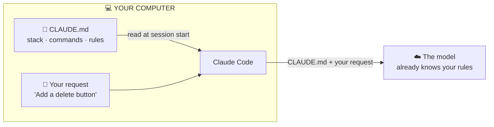
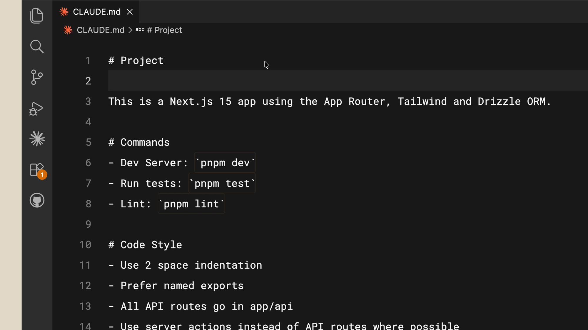
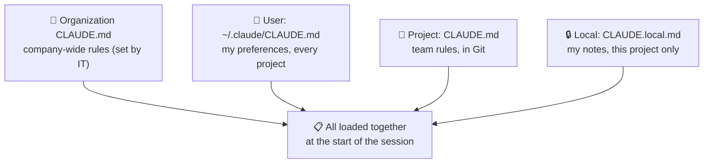
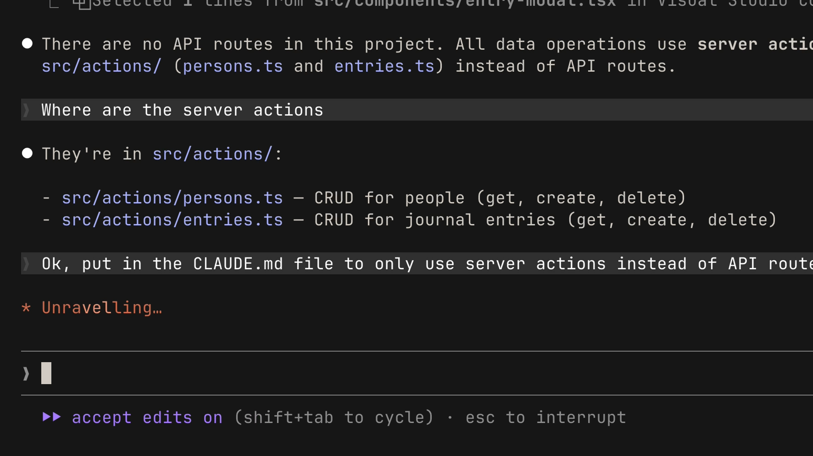

# Lesson 8 — The CLAUDE.md file

**Course:** [Claude Code 101](https://academy.claude.com/courses/claude-code-101) &nbsp;·&nbsp; **Chapter 4:** Customizing Claude Code &nbsp;·&nbsp; **Completed:** October 18, 2026

| Previous | Course | Next |
|:---|:---:|---:|
| [← Code review](07-code-review.md) | [📚 Course index](README.md) | [Subagents →](09-subagents.md) |

---

**On this page**

| # | Section |
|:---:|:---|
| 1 | [In one sentence](#in-one-sentence) |
| 2 | [The big picture](#the-big-picture) |
| 3 | [1. The problem: every session starts from zero](#1-the-problem-every-session-starts-from-zero) |
| 4 | [2. What a CLAUDE.md file is](#2-what-a-claudemd-file-is) |
| 5 | [3. An example CLAUDE.md](#3-an-example-claudemd) |
| 6 | [4. Who it's for: project vs. user](#4-who-its-for-project-vs-user) |
| 7 | [5. Three tips for a good CLAUDE.md](#5-three-tips-for-a-good-claudemd) |
| 8 | [Recap](#recap) |
| 9 | [My notes / practice](#my-notes--practice) |
| 10 | [FAQ](#faq) |

---

### In one sentence

`CLAUDE.md` is a short text file in your project that Claude Code reads **at the start of every session**, so it already knows your tools, commands, and rules instead of working them out again each time.

### The big picture

| Part | What it means in plain words |
|---|---|
| **1. The problem** | Without it, every session starts from zero: Claude Code re-explores and guesses. |
| **2. What it is** | A Markdown file in your project's main folder. Claude Code reads it automatically. |
| **3. What goes in it** | Your tech stack, your commands, and your code style rules. |
| **4. Who it's for** | A **project** file shared with the team, and a **user** file just for you. |
| **5. Tips** | Save corrections to it, point to other docs with `@`, and start without one. |

We'll use the course's project through the whole lesson: a **journal app** built with Next.js 15, Tailwind, and Drizzle ORM. Its data code uses **server actions** (functions that run on the server, called straight from the page), not API routes.

> 💡 **You've already seen one.** This study repo has its own `CLAUDE.md` at the top. It's why Claude Code knows how to format these lesson notes every time.

---

### 1. The problem: every session starts from zero

Think of a **temp worker** who comes to your office every morning, but forgets everything overnight. Each day you'd have to show them where things are, how you like things done, and which mistakes to avoid. Unless you leave them a **note on the desk**.

Claude Code is that temp worker. Each session starts with a **fresh context window** (lesson 6). Without a note, it has to:
- **re-explore** your codebase to find where things are
- **work out** which libraries and tools you use
- **find out** which features already exist
- **make assumptions** when it can't tell, which makes it harder to steer

*Example:* you ask the journal app session to "add a delete button for entries." Without a note, Claude Code might create a new API route in `app/api/`, because that's a common pattern. But this project uses server actions. Now you have to correct it, and you'll have to correct it again tomorrow.

`CLAUDE.md` is the note on the desk.

---

### 2. What a CLAUDE.md file is

`CLAUDE.md` is a **Markdown file** (a plain text file with simple formatting like `#` headings and `-` bullets) that you put in the **root** (main folder) of your project. The course calls it an **onboarding script** for your codebase: what you'd tell a new teammate on day one.

#### How it gets to the model

1. You start `claude` in your project folder.
2. Claude Code finds `CLAUDE.md` and reads it.
3. It adds the contents to the start of the conversation. The course says the contents are *"appended to your prompt."*
4. The model sees your rules **before** your first request, every session.

This is the "project rules" part of the **starter pack** from lesson 2.



**Extra (from the docs):**
- `CLAUDE.md` is sent as a message **after** Anthropic's instructions, not as part of them. So the model **reads and tries to follow** it, but it's guidance, not a hard lock. To **block** an action no matter what, you need a **hook** (lesson 12).
- You can also put the project file at `.claude/CLAUDE.md` instead of the root. Both work.

#### How to make one: `/init`

You don't have to write it from scratch. Run:

```text
/init
```

Claude Code reads your codebase and writes a starting `CLAUDE.md` with the build commands, test commands, and conventions it finds. If you already have one, `/init` suggests improvements instead of overwriting it. Then add the things Claude Code **couldn't** work out by itself.

---

### 3. An example CLAUDE.md

Here's the course's example for the journal app:

```markdown
# Project

This is a Next.js 15 app using the App Router, Tailwind, and Drizzle ORM.

# Commands
- Dev server: `pnpm dev`
- Run tests: `pnpm test`
- Lint: `pnpm lint`

# Code Style
- Use 2-space indentation
- Prefer named exports
- All API routes go in app/api/
- Use server actions instead of API routes where possible
```



What each section does:

| Section | What it tells Claude Code | What it saves |
|---|---|---|
| **Project** | The stack: Next.js 15, App Router, Tailwind, Drizzle ORM | Reading `package.json` and config files to find out |
| **Commands** | Exactly how to run the dev server, tests, and linter | Guessing between `npm`, `yarn`, and `pnpm`, or running the wrong command |
| **Code Style** | Indentation, exports, where routes go, server actions over routes | Writing code you then have to correct |

#### What changes

You ask: *"Create a React component for a journal entry card."*

| Without `CLAUDE.md` | With `CLAUDE.md` |
|---|---|
| Opens files to find out how styling works | Already knows: Tailwind |
| Might use a default export | Uses a named export |
| Might add an API route to save data | Uses a server action |
| You correct it, and correct it again next session | Right the first time |

The course puts it simply: Claude Code *"does a better job right off the bat."*

---

### 4. Who it's for: project vs. user

Yes, you can (and should) **commit** `CLAUDE.md` to version control (Git), so your whole team gets the same rules. But some rules are just **yours**. So there's more than one memory file, depending on who it's for.

The course covers two:

| Level | Where it lives | Who it's for | Shared? | Example |
|---|---|---|---|---|
| **Project** | `CLAUDE.md` in the project's root folder | Everyone on this project | ✅ Yes, committed to Git | "Use server actions instead of API routes." |
| **User** | `~/.claude/CLAUDE.md` (your Claude Code config folder) | Only you, in **every** project | ❌ No | "Write short code comments in plain English." |

`~` means your home folder. On Windows that's usually `C:\Users\<you>\`, so the user file is `C:\Users\<you>\.claude\CLAUDE.md`.

**Extra (from the docs, not the course):** there are two more levels.

| Level | Where it lives | Who it's for |
|---|---|---|
| **Organization** (*managed policy*) | Set up by IT, e.g. `C:\Program Files\ClaudeCode\CLAUDE.md` on Windows | Everyone in the company. Can't be switched off. |
| **Local** | `CLAUDE.local.md` in the project root | Only you, only this project. Add it to `.gitignore` so it isn't committed. |



Things to notice:
- The files **add up**. They don't replace each other. Claude Code reads all of them.
- If two rules **contradict** each other, the model may pick either one. Keep them consistent.
- Claude Code also loads `CLAUDE.md` files from **parent folders** above where you started it, and from **subfolders** when it works on files in them.

#### What goes where

| Put it in… | If it's… |
|---|---|
| **Project** `CLAUDE.md` | True for anyone working on this project: stack, commands, conventions |
| **User** `~/.claude/CLAUDE.md` | Your personal style, true in every project: how you like comments or commit messages |
| **Local** `CLAUDE.local.md` | Personal and only for this project: your test account, your local URLs |

> 🧠 **Remember this:** **Team rules → project file. My habits → user file.**

---

### 5. Three tips for a good CLAUDE.md

#### Tip 1: Save corrections to memory

If you correct Claude Code on the **same thing twice**, ask it to save the rule. Then it's fixed for every future session.

*Example from the course:* Claude Code keeps reaching for API routes. You say:

```text
Ok, put in the CLAUDE.md file to only use server actions instead of API routes
```



Claude Code edits `CLAUDE.md` for you. Next time you open the project, the rule is already there.

This is the same idea as lesson 7: when the reviewer flags the same issue again and again, turn it into a `CLAUDE.md` rule.

**Extra (from the docs):** Claude Code also has **auto memory**: notes it writes for **itself** when you correct it, saved in a `MEMORY.md` file on your computer (not in your project). `CLAUDE.md` is what **you** write and share. Run `/memory` to see and open all your memory files, and to turn auto memory on or off.

#### Tip 2: Point to your docs with `@`

If your project has documentation Claude Code should know about, link it with `@` and the file path:

```markdown
## README.md

Please read if you need more info: @README.md
```

The `@README.md` tells Claude Code to load that file too. You don't have to copy its contents into `CLAUDE.md`.

**Extra (from the docs):**
- A path like `@docs/api.md` is read **from the folder the `CLAUDE.md` is in**, not from where you started Claude Code.
- An imported file can import others, up to **four levels** deep.
- ⚠️ Imported files load at the start too, so they **still use context space**. `@` keeps `CLAUDE.md` tidy. It doesn't make it smaller.

#### Tip 3: Start without one

This sounds odd, but the course recommends it: **start a new project without a `CLAUDE.md`.**

Why: you'll see **where you keep having to correct** Claude Code. Those corrections are exactly what belongs in the file. Everything else is noise.

1. Work for a while with no `CLAUDE.md`.
2. Notice what you keep repeating ("use pnpm", "server actions, not routes").
3. When you're ready, run `/init` to make a starting file.
4. Add your repeated corrections. Keep it short.

Why short matters: `CLAUDE.md` loads into **every** session's context window (lesson 6). Every line costs space every time. The docs suggest keeping each file **under 200 lines**. Long files also get followed **less** reliably.

#### Do / Why / Example

| Do this | Why | Example |
|---|---|---|
| **Be specific** | Vague rules are hard to follow. | "Use 2-space indentation", not "format code nicely." |
| **Write commands exactly** | Claude Code can run them without guessing. | "Run tests: `pnpm test`" |
| **Only add what Claude Code gets wrong** | Every line uses context in every session. | Add "server actions, not API routes" only after it's needed. |
| **Commit the project file** | The whole team gets the same rules. | `git add CLAUDE.md` |
| **Keep personal things out of it** | Teammates don't need your habits. | Comment style → `~/.claude/CLAUDE.md` |

#### Common mix-ups

| ❌ Wrong idea | ✅ What really happens |
|---|---|
| "Claude Code remembers my project between sessions by itself." | Each session starts fresh. `CLAUDE.md` is how you carry knowledge over. |
| "I need to tell Claude Code to read `CLAUDE.md`." | It reads it automatically at the start of every session. |
| "`CLAUDE.md` is private to me." | The **project** file is meant to be committed and shared. Personal rules go in `~/.claude/CLAUDE.md`. |
| "The user file replaces the project file." | They **add up**. Claude Code reads both. |
| "A longer `CLAUDE.md` is better." | Every line uses context in every session. Short and specific works better. |
| "`@` imports save context space." | Imported files load at the start too. They only keep the main file tidy. |
| "`CLAUDE.md` rules are always obeyed." | They're guidance the model tries to follow. To **block** something for sure, use a hook (lesson 12). |
| "`/init` overwrites my existing `CLAUDE.md`." | If one exists, it suggests improvements instead. |

#### Test yourself

<details>
<summary>1. Why does Claude Code do better on the first try when a project has a CLAUDE.md?</summary>

It already knows the stack, commands, and rules before your first request, so it doesn't have to explore or guess.
</details>

<details>
<summary>2. You like short, plain-English code comments in every project. Which file should that rule go in?</summary>

The user file, `~/.claude/CLAUDE.md`. It's personal and applies to all your projects.
</details>

<details>
<summary>3. You've told Claude Code "use pnpm, not npm" three sessions in a row. What should you do?</summary>

Ask it to save that rule to `CLAUDE.md`. Then it knows from the start of every future session.
</details>

<details>
<summary>4. Why does the course recommend starting a project without a CLAUDE.md?</summary>

So you can see what you actually keep correcting. Those are the rules worth adding. It keeps the file short and focused.
</details>

<details>
<summary>5. How do you get Claude Code to use your README.md without copying it into CLAUDE.md?</summary>

Add `@README.md` in `CLAUDE.md`. Claude Code loads that file too.
</details>

---

### Recap

- **The problem:** every session starts fresh. Without notes, Claude Code re-explores, guesses, and needs the same corrections again.
- **What it is:** `CLAUDE.md` is a Markdown file in your project's root. Claude Code reads it automatically at the start of every session, like an onboarding script. Run `/init` to generate one.
- **What goes in it:** your stack, your commands, and your code style rules. Short and specific.
- **Who it's for:** the **project** file is shared with the team through Git. The **user** file (`~/.claude/CLAUDE.md`) is just for you, in every project.
- **Tips:** save repeated corrections to it, link other docs with `@`, and start without one so you only add what you actually need.

---

## My notes / practice

- [ ] Open this repo's `CLAUDE.md` and notice which parts are stack, commands, and rules.
- [ ] Run `/memory` and see which memory files exist for me.
- [ ] Create `~/.claude/CLAUDE.md` with one personal preference.
- [ ] In a test project, run `/init` and read what it generates. Delete anything I don't need.
- [ ] Next time I correct Claude Code twice on the same thing, ask it to save the rule to `CLAUDE.md`.
- [ ] Add an `@README.md` line and check with `/context` that it loaded (under **Memory files**).

---

## FAQ

In these answers, **Claude Code** means the program on your computer. **The model** means the AI on Anthropic's servers.

**Q1. What is a CLAUDE.md file?**
A Markdown file in your project's root folder that Claude Code reads automatically at the start of every session. It tells Claude Code about your project: the tools you use, the commands to run, and your rules. Think of it as an onboarding script for a new teammate.

**Q2. What problem does CLAUDE.md solve?**
Every Claude Code session starts fresh. Without `CLAUDE.md`, it has to re-explore your code, work out your dependencies, and guess your conventions each time. Guesses are often wrong, so you end up correcting the same things again and again.

**Q3. How does the model see what's in CLAUDE.md?**
Claude Code reads the file when the session starts and adds its contents to the conversation, before your first request. The course says the contents are "appended to your prompt." So the model sees your rules every session without you typing them.

**Q4. Does Claude Code always follow what's in CLAUDE.md?**
It tries to, but it's guidance, not a hard lock. Vague or conflicting rules are followed less reliably. To block an action for sure, use a hook (lesson 12).

**Q5. How do I create a CLAUDE.md file?**
Run `/init`. Claude Code reads your codebase and writes a starting file with the commands and conventions it finds. You can also write one by hand. If a `CLAUDE.md` already exists, `/init` suggests improvements instead of overwriting it.

**Q6. What should go in a CLAUDE.md file?**
Start with three things:
- **Your stack:** "Next.js 15 app using the App Router, Tailwind, and Drizzle ORM."
- **Your commands:** "Run tests: `pnpm test`."
- **Your rules:** "Use server actions instead of API routes where possible."

Then add to it as you go.

**Q7. Should I commit CLAUDE.md to Git?**
Yes, the project file. Then everyone on the team gets the same rules, and Claude Code behaves the same way for all of them.

**Q8. What's the difference between the project CLAUDE.md and the user CLAUDE.md?**
- **Project** (`CLAUDE.md` in the project root): shared with the team, applies only to this project.
- **User** (`~/.claude/CLAUDE.md`): only for you, applies to all your projects. Put personal preferences here, like how you write code comments.

**Q9. Where is the user CLAUDE.md file on Windows?**
Usually `C:\Users\<you>\.claude\CLAUDE.md`. The `~` in `~/.claude/CLAUDE.md` means your home folder.

**Q10. If I have both a project and a user CLAUDE.md, which one wins?**
Neither. Claude Code reads both, and their rules add up. If two rules contradict each other, the model may follow either one, so keep them consistent.

**Q11. Are there other kinds of CLAUDE.md files?**
Yes (from the docs, not the course):
- **Organization:** set up by IT for the whole company. Can't be switched off.
- **Local:** `CLAUDE.local.md` in the project root, just for you and just this project. Add it to `.gitignore`.

**Q12. How do I get Claude Code to remember a correction?**
Ask it directly, for example: "Put in the CLAUDE.md file to only use server actions instead of API routes." It edits `CLAUDE.md`, so the rule is there next session.

**Q13. What does "auto memory" mean?**
Notes Claude Code writes for itself when you correct it, saved in a `MEMORY.md` file on your computer, outside your project. It's separate from `CLAUDE.md`, which you write and share. Run `/memory` to see your memory files and turn auto memory on or off.

**Q14. How do I make Claude Code read my other docs, like README.md?**
Add `@` and the file path in `CLAUDE.md`, for example: `Please read if you need more info: @README.md`. Claude Code loads that file too.

**Q15. Do files linked with @ use up context space?**
Yes. They load at the start of the session like `CLAUDE.md` itself. `@` keeps your `CLAUDE.md` organized, but doesn't make the total smaller.

**Q16. Why does the course say to start a project without a CLAUDE.md?**
So you can see where you actually keep correcting Claude Code. Those repeated corrections are what belongs in the file. It keeps `CLAUDE.md` short and focused, instead of filling it with things Claude Code would get right anyway.

**Q17. How long should a CLAUDE.md file be?**
As short as you can make it. It loads into every session's context window, so every line costs space every time. The docs suggest under 200 lines per file. Long files are also followed less reliably.

**Q18. (Exam angle) A team says Claude Code keeps making the same mistakes for different developers on the same project. What do you recommend?**
Put the shared rules in a project `CLAUDE.md` and commit it to Git, so every developer's session starts with the same stack, commands, and conventions. Turn repeated review findings into rules. Keep it short and specific. Personal preferences go in each developer's own `~/.claude/CLAUDE.md`. This fits the **Developer Productivity & Operational Enablement** exam domain.

**Q19. (Exam angle) A security lead wants to forbid Claude Code from ever touching production config, and asks if a CLAUDE.md rule is enough. How do you answer?**
No. `CLAUDE.md` is guidance the model tries to follow, not a guarantee. For a hard rule, use enforced controls: permission settings that deny the action, or a hook that blocks it. For company-wide rules, IT can deploy an organization-level (managed) `CLAUDE.md` that developers can't switch off, alongside managed settings. Use `CLAUDE.md` to explain the rule; use settings and hooks to enforce it. This fits the **Governance, Safety & Risk** exam domain.

**Q20. (Exam angle) An architect asks how to roll out shared Claude Code conventions across 20 repositories without each file growing huge. How do you answer?**
- Put company-wide standards in one organization-level (managed) `CLAUDE.md`.
- Keep each repo's project `CLAUDE.md` to what's specific to that repo: stack, commands, local conventions.
- Link longer docs with `@` only where needed, remembering they still load.
- Move rarely-needed, detailed workflows into skills (lesson 10), which load only when used.

This fits the **Solution Design & Architecture** exam domain.

---

| Previous | Course | Next |
|:---|:---:|---:|
| [← Code review](07-code-review.md) | [📚 Course index](README.md) | [Subagents →](09-subagents.md) |
