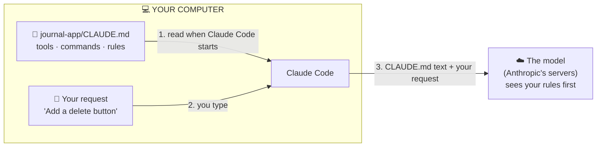
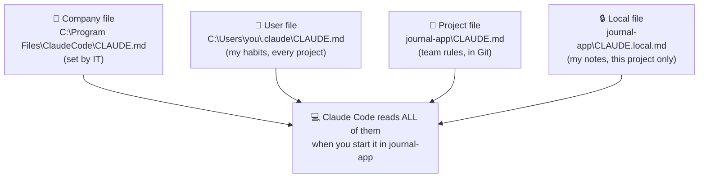

# Lesson 8 — The CLAUDE.md file

**Course:** [Claude Code 101](https://academy.claude.com/courses/claude-code-101) &nbsp;·&nbsp; **Chapter 4:** Customizing Claude Code &nbsp;·&nbsp; **Completed:** October 18, 2026

| Previous | Course | Next |
|:---|:---:|---:|
| [← Code review](07-code-review.md) | [📚 Course index](README.md) | [Subagents →](09-subagents.md) |

---

**On this page**

| # | Section |
|:---:|:---|
| 1 | [In one sentence](#in-one-sentence) |
| 2 | [The big picture](#the-big-picture) |
| 3 | [Who's who](#whos-who) |
| 4 | [1. The problem: Claude Code forgets everything between sessions](#1-the-problem-claude-code-forgets-everything-between-sessions) |
| 5 | [2. What a CLAUDE.md file is, and how Claude Code uses it](#2-what-a-claudemd-file-is-and-how-claude-code-uses-it) |
| 6 | [3. What to write in it: the course's example](#3-what-to-write-in-it-the-courses-example) |
| 7 | [4. Two CLAUDE.md files: one for the team, one just for you](#4-two-claudemd-files-one-for-the-team-one-just-for-you) |
| 8 | [5. Three tips for a good CLAUDE.md](#5-three-tips-for-a-good-claudemd) |
| 9 | [Recap](#recap) |
| 10 | [My notes / practice](#my-notes--practice) |
| 11 | [FAQ](#faq) |

---

### In one sentence

`CLAUDE.md` is a plain text file of notes **you** write about your project, and Claude Code **reads it automatically every time you start it**, so you don't have to explain the same things again and again.

---

### The big picture

| Part | What it means in plain words |
|---|---|
| **1. The problem** | Every time you start Claude Code, it has forgotten everything about your project. It has to look around and guess again. |
| **2. What `CLAUDE.md` is** | A text file of notes in your project folder. Claude Code reads it by itself at the start, before you type anything. |
| **3. What goes in it** | Which tools your project uses, which commands to run, and your rules for writing code. |
| **4. Two files** | One `CLAUDE.md` **inside your project folder**, shared with your team. One `CLAUDE.md` **in your own home folder**, just for you, used in all your projects. |
| **5. Tips** | Add a rule when you correct Claude Code twice. Point to other files with `@`. Start a new project without one. |

#### The example we'll use the whole way through

The course uses a **journal app**: a small website where you write diary entries. Here's its project folder:

```text
journal-app/                 ← the project folder (also called the "root")
├── CLAUDE.md                ← the notes file this lesson is about
├── README.md                ← a description of the project, for humans
├── package.json             ← list of the outside code packages the app uses
├── app/
│   ├── page.tsx             ← the home page
│   ├── entries/page.tsx     ← the page that lists journal entries
│   └── actions.ts           ← code that saves and deletes entries
└── db/
    └── schema.ts            ← what the database tables look like
```

The app is built with these tools. You don't need to know them; just know they're the project's "toolbox":

| Tool | What it is, in plain words |
|---|---|
| **Next.js 15** | The framework the website is built with. (A **framework** is a ready-made structure you build an app inside.) |
| **Tailwind** | A way of styling pages: colors, sizes, spacing. |
| **Drizzle ORM** | A tool for reading and writing the database from code. |
| **pnpm** | The tool that installs packages and runs commands like `pnpm test`. Other projects use `npm` or `yarn` instead. |

One more thing about this project, because it comes up a lot. There are two common ways for a page to save data:
- **API routes:** separate files under `app/api/` that act like a little web address the page calls.
- **Server actions:** functions (like the ones in `app/actions.ts`) that the page calls directly.

**This project uses server actions.** Claude Code can't know that unless someone tells it. That's what `CLAUDE.md` is for.

> 💡 **You've already seen one.** This study repo has a `CLAUDE.md` in its main folder: `ClaudeArchitectStudyGuide/CLAUDE.md`. It tells Claude Code how to format these lesson notes. That's why every lesson follows the same layout without me explaining it each time.

---

### Who's who

| Player | Where it lives | What it does with `CLAUDE.md` | Example |
|---|---|---|---|
| 🧑 **You** | At your computer | **Write** the notes (or ask Claude Code to write them). | You add the line "Use server actions instead of API routes." |
| 👥 **Your teammates** | At their own computers | Get the **same** project `CLAUDE.md` through Git, so their Claude Code follows the same rules. | A teammate downloads the project and their Claude Code also uses server actions. |
| 💻 **Claude Code** | The program on your computer | **Finds and reads** the `CLAUDE.md` files when it starts. Sends their text to the model. Can also **edit** the file when you ask. | It opens `journal-app/CLAUDE.md` before you type anything. |
| ☁️ **The model** | Anthropic's servers | **Reads** the notes as part of the conversation and tries to follow them. Never opens the file itself. | When you ask for a save button, it writes a server action, because the notes said so. |
| 🏢 **Your company's IT team** (optional) | — | Can put a company-wide `CLAUDE.md` on everyone's computer. Not in the course; see section 4. | "Never put passwords in code." |

---

### 1. The problem: Claude Code forgets everything between sessions

#### An everyday comparison: the temp worker

Imagine a **temp worker** who comes to your office every morning but forgets everything overnight. Each morning you'd have to show them where the printer is, how you like reports done, and which mistakes to avoid. Unless you leave them a **note on the desk** that they read first thing.

Claude Code is that temp worker. A **session** is one run of Claude Code, from when you type `claude` until you close it (or type `/clear`). Each new session starts with an **empty context window** (lesson 6: the context window is everything the model can see right now). Nothing from yesterday's session is in it.

`CLAUDE.md` is the note on the desk.

#### What happens without CLAUDE.md

You start Claude Code in `journal-app/` and type:

> **You:** "Add a delete button for journal entries."

Claude Code knows nothing about this project yet. So it:

1. **Looks around.** It opens `package.json` to find out which tools the project uses.
2. **Works out the commands.** Is it `npm test`, `yarn test`, or `pnpm test`? It has to check.
3. **Searches for similar code**, to see how saving already works.
4. **Guesses when it can't tell.** Many Next.js projects use API routes, so it creates a new file `app/api/entries/delete/route.ts`.

Step 4 is wrong for this project, because this project uses server actions. You correct it: "Don't use an API route, use a server action." It fixes it.

**Tomorrow, in a new session, the same thing happens again.** It has forgotten your correction. Steps 1–3 also cost time and context space every single session.

#### What happens with CLAUDE.md

Same request. But this time, before you even type, Claude Code has read `journal-app/CLAUDE.md`. That note says "pnpm", "Next.js 15, Tailwind, Drizzle", and "use server actions". So it skips the guessing and adds a `deleteEntry` function to `app/actions.ts` the first time.

---

### 2. What a CLAUDE.md file is, and how Claude Code uses it

#### What it is

- It's a **text file** named exactly `CLAUDE.md`.
- The `.md` means **Markdown**: plain text with a little formatting, like `#` for a heading and `-` for a bullet point. You can open it in any text editor.
- It sits in the **root** of your project. The **root** is the project's main folder: the top folder, where `package.json` is. For the journal app, that's `journal-app/CLAUDE.md`.
- The course calls it an **onboarding script**: what you'd tell a new teammate on their first day.

#### How it gets to the model, step by step

1. **You** open a terminal in `journal-app/` and type `claude`.
2. **Claude Code** looks for `CLAUDE.md` files and finds `journal-app/CLAUDE.md`. Nobody has to tell it to; it always looks.
3. **Claude Code** reads the file's text.
4. **You** type your first request: "Add a delete button for journal entries."
5. **Claude Code** sends the model the text of `CLAUDE.md` **plus** your request. The course says the file's contents are *"appended to your prompt."*

Simplified, the model receives something like this:

```text
[Claude Code's built-in instructions, from Anthropic]

[Text of journal-app/CLAUDE.md]
  # Project
  This is a Next.js 15 app using the App Router, Tailwind, and Drizzle ORM.
  ...
  - Use server actions instead of API routes where possible

You: Add a delete button for journal entries.
```

6. **The model** reads your rules **before** it reads your request, so it plans with them in mind.

This happens at the start of **every** session.



Things to notice:
- The **model never opens the file**. Claude Code reads it and sends the text.
- Your request and the notes travel **together**.

#### ⚠️ It's advice, not a lock

**Extra (from the docs, not the course):** the model reads `CLAUDE.md` and **tries** to follow it, but nothing forces it. Vague or contradictory rules get followed less often. If you need something blocked for sure (for example, "never delete the database"), `CLAUDE.md` isn't enough. You need a **hook**: a small script that Claude Code runs automatically and that can block an action (lesson 12).

#### How to create one: /init

You don't have to write the file from scratch.

1. Start Claude Code in your project folder.
2. Type:

   ```text
   /init
   ```

3. Claude Code reads through your project and writes a starting `CLAUDE.md` in the root, with the build commands, test commands, and habits it finds.
4. Read what it wrote. Delete what you don't need. Add the things Claude Code **couldn't** work out by itself, like "use server actions."

If a `CLAUDE.md` already exists, `/init` **suggests improvements** instead of replacing it.

**Extra (from the docs):** the project file can also live at `journal-app/.claude/CLAUDE.md` (inside a folder called `.claude`) instead of the root. Both work. To check which `CLAUDE.md` files were loaded, type `/context` and look under **Memory files**.

---

### 3. What to write in it: the course's example

Here's the course's `CLAUDE.md` for the journal app. It's saved as `journal-app/CLAUDE.md`:

```markdown
# Project

This is a Next.js 15 app using the App Router, Tailwind, and Drizzle ORM.

# Commands
- Dev server: `pnpm dev`
- Run tests: `pnpm test`
- Lint: `pnpm lint`

# Code Style
- Use 2-space indentation
- Prefer named exports
- All API routes go in app/api/
- Use server actions instead of API routes where possible
```


#### Line by line

| Line | What it means | What it saves Claude Code from |
|---|---|---|
| `Next.js 15 app using the App Router, Tailwind, and Drizzle ORM` | The project's toolbox. (The **App Router** is the way Next.js 15 organizes pages into folders under `app/`.) | Opening `package.json` and other files to find out. |
| `Dev server: pnpm dev` | The command that starts the app on your own computer, so you can try it in a browser. | Guessing between `npm`, `yarn`, and `pnpm`. |
| `Run tests: pnpm test` | The command that runs the tests. | Running the wrong command and getting an error. |
| `Lint: pnpm lint` | The command that runs the **linter**: a tool that checks code for mistakes and messy style. | Same as above. |
| `Use 2-space indentation` | Indent code with 2 spaces, not 4 or a tab. | Writing code in a different style that you then fix. |
| `Prefer named exports` | Write `export function EntryCard()`, not `export default function EntryCard()`. A small coding habit the team agreed on. | Same as above. |
| `All API routes go in app/api/` | **If** an API route is needed, put it in that folder. | Putting files in random places. |
| `Use server actions instead of API routes where possible` | The rule from our example: save data with server actions. | The wrong guess in section 1. |

So the file has three parts: **the toolbox**, **the commands**, and **the rules**.

#### Before and after

You ask: *"Create a component for a journal entry card."* (A **component** is one reusable piece of a web page, like a card that shows one entry.)

| Without `CLAUDE.md` | With `CLAUDE.md` |
|---|---|
| Opens files to find out how styling works | Already knows: Tailwind |
| Might write `export default` | Writes a named export |
| Might add an API route to save data | Uses a server action |
| You correct it, and correct it again next session | Right the first time |

The course says Claude Code *"does a better job right off the bat."*

---

### 4. Two CLAUDE.md files: one for the team, one just for you

So far we've talked about **one** file: `journal-app/CLAUDE.md`. But some rules are about the **project** ("use server actions"), and some are about **you** ("I like short code comments"). Those belong in different places.

The course covers two `CLAUDE.md` files. The course calls them the **project** file and the **user** file. Here, **"user" means you**, the person using Claude Code. It has nothing to do with the users of your app.

#### Where each file is on your computer

```text
C:\Users\you\                          ← your home folder (on Mac: /Users/you/)
├── .claude\
│   └── CLAUDE.md                      ← ① USER file: just for you, used in EVERY project
│
└── Projects\
    ├── journal-app\
    │   ├── CLAUDE.md                  ← ② PROJECT file: for journal-app only, shared with the team
    │   ├── package.json
    │   └── app\ ...
    │
    └── shopping-app\
        ├── CLAUDE.md                  ← another PROJECT file: for shopping-app only
        └── ...
```

Things to notice:
- The **user file** ① sits in a hidden folder called `.claude` inside your **home folder**. It is **not** inside any project. (The course writes it as `~/.claude/CLAUDE.md`. The `~` is short for "my home folder.")
- Each **project file** ② sits **inside its own project folder**.
- When you start Claude Code in `journal-app`, it reads **both** ① and ②. When you start it in `shopping-app`, it reads ① and the `shopping-app` file. Your user file comes with you everywhere.

#### The two files side by side

| | ① User file | ② Project file |
|---|---|---|
| **Full path (Windows)** | `C:\Users\you\.claude\CLAUDE.md` | `C:\Users\you\Projects\journal-app\CLAUDE.md` |
| **Full path (Mac)** | `/Users/you/.claude/CLAUDE.md` | `/Users/you/Projects/journal-app/CLAUDE.md` |
| **Who writes it** | You | You and your teammates |
| **Who it applies to** | Only you | Everyone working on this project |
| **Which projects** | **All** your projects | **Only** this project |
| **Shared with the team?** | ❌ No, it stays on your computer | ✅ Yes, saved in Git with the project's code |
| **Example line** | "Write short code comments in plain English." | "Use server actions instead of API routes." |

#### What's actually in each file

`C:\Users\you\.claude\CLAUDE.md` (the user file, your personal habits):

```markdown
# My preferences
- Write short code comments in plain English.
- Explain your plan in 3 bullets before you change more than one file.
```

`C:\Users\you\Projects\journal-app\CLAUDE.md` (the project file, the team's rules):

```markdown
# Project
This is a Next.js 15 app using the App Router, Tailwind, and Drizzle ORM.

# Code Style
- Use server actions instead of API routes where possible
```

When you start Claude Code in `journal-app`, the model gets **both** sets of rules.

#### How the project file gets to your teammates

**Git** is the tool that saves your project's history and shares it with your team. Saving a change to Git is called a **commit**. When you commit `journal-app/CLAUDE.md`:

1. You run `git add CLAUDE.md` and `git commit`, then push it to the shared copy (for example, on GitHub).
2. Your teammate downloads the latest code. `CLAUDE.md` comes with it, like any other file.
3. Their Claude Code reads it, so it follows the same rules as yours.

The user file is **not** in any project folder, so it's never committed and teammates never see it.

#### Which file should a rule go in?

Ask yourself one question: **"Would this be true for anyone working on this project?"**

| Rule | True for anyone on the project? | Put it in |
|---|---|---|
| "Run tests with `pnpm test`." | ✅ Yes | Project file: `journal-app/CLAUDE.md` |
| "Use server actions, not API routes." | ✅ Yes | Project file |
| "Write short code comments in plain English." | ❌ No, that's my taste, in every project | User file: `~/.claude/CLAUDE.md` |
| "My test login is sam@example.com." | ❌ No, and it's only for this project | Local file (see the extras below) |

> 🧠 **Remember this:** **Team rules → the project folder. My habits → my home folder.**

#### Extra (from the docs, not the course): two more files

| File | Full path | Who it's for |
|---|---|---|
| **Local file** | `journal-app/CLAUDE.local.md` (in the project folder, next to `CLAUDE.md`) | Only you, only this project. Add its name to the project's `.gitignore` file (the list of files Git should ignore), so it's never committed. Good for your own test account or local web addresses. |
| **Company file** (the docs call it *managed policy*) | Windows: `C:\Program Files\ClaudeCode\CLAUDE.md`. Mac: `/Library/Application Support/ClaudeCode/CLAUDE.md`. Put there by your IT team. | Everyone in the company. You can't switch it off. |



Things to notice:
- The files **add up**. None of them replaces another. The model gets all their text.
- If two files **disagree** (one says "use tabs," another says "use spaces"), the model may follow either one. Keep them consistent.
- Claude Code also reads `CLAUDE.md` files in **folders above** the one you started in. And it reads a `CLAUDE.md` inside a **subfolder** (like `journal-app/app/CLAUDE.md`) once it starts working on files in that subfolder.

---

### 5. Three tips for a good CLAUDE.md

#### Tip 1: When you correct Claude Code twice, save the rule

If you find yourself correcting Claude Code on the **same thing** more than once, ask it to write the rule into `CLAUDE.md`. Then every future session starts with it.

*Example from the course:* Claude Code keeps making API routes. You type this in Claude Code:

```text
Ok, put in the CLAUDE.md file to only use server actions instead of API routes
```


What happens:
1. Claude Code opens `journal-app/CLAUDE.md` (the project file).
2. It adds a line like `- Only use server actions instead of API routes`.
3. Next time anyone starts Claude Code in this project, the rule is there from the start.

This is the same idea as lesson 7: when the reviewer finds the same problem again and again, turn it into a `CLAUDE.md` rule.

**Extra (from the docs): "add to CLAUDE.md" vs. "remember".** The words you use matter:

| You type… | Where it's saved | Who sees it |
|---|---|---|
| "Add this to CLAUDE.md: use pnpm, not npm." | `journal-app/CLAUDE.md`, the file you control | You and, once committed, your team |
| "Remember: use pnpm, not npm." | Claude Code's own notes, called **auto memory**: a file named `MEMORY.md` in `C:\Users\you\.claude\projects\<project>\memory\` | Only you, only on this computer |

**Auto memory** is notes Claude Code writes **for itself** as it works, for example after you correct it. It's separate from `CLAUDE.md`, which **you** write. Type `/memory` to see all these files, open them, and turn auto memory on or off.

#### Tip 2: Point to other files with @ instead of copying them

Your project may already have files that explain things, like `README.md`. Instead of copying their text into `CLAUDE.md`, add a line with `@` and the file name:

```markdown
## README.md

Please read if you need more info: @README.md
```

When Claude Code reads `journal-app/CLAUDE.md` and sees `@README.md`, it also reads `journal-app/README.md` and sends that text to the model too. You keep one copy of the information, in one place.

**Extra (from the docs):**
- The path after `@` starts from **the folder the `CLAUDE.md` is in**. So `@docs/api.md` in `journal-app/CLAUDE.md` means `journal-app/docs/api.md`.
- A linked file can link to other files, up to **four levels** deep.
- If the path points **outside** your project, Claude Code asks you to approve it the first time.
- ⚠️ Linked files are read at the start too, so they **still take up context space**. `@` keeps `CLAUDE.md` tidy; it doesn't make the total smaller.

#### Tip 3: Start a new project without a CLAUDE.md

This sounds odd, but the course recommends it.

Why: if you write a long `CLAUDE.md` on day one, you'll fill it with things Claude Code would have got right anyway. If you start without one, you'll see **where it actually goes wrong**. Only those things belong in the file.

1. Work on the new project for a while with no `CLAUDE.md`.
2. Notice what you keep repeating ("use pnpm," "server actions, not routes").
3. Run `/init` to make a starting file.
4. Add your repeated corrections. Keep it short.

Why short matters: `CLAUDE.md` is sent to the model in **every** session, so every line takes up context space every time (lesson 6). The docs suggest keeping each `CLAUDE.md` **under 200 lines**. Long files also get followed **less** reliably.

#### Do / Why / Example

| Do this | Why | Example |
|---|---|---|
| **Be specific** | The model can't follow a vague rule. | "Use 2-space indentation," not "format code nicely." |
| **Write commands exactly** | Claude Code can run them without guessing. | "Run tests: `pnpm test`" |
| **Only add what Claude Code gets wrong** | Every line uses context space in every session. | Add "server actions, not API routes" only after it was needed. |
| **Commit the project file** | The whole team gets the same rules. | `git add CLAUDE.md` |
| **Keep personal habits out of the project file** | Teammates don't need your preferences. | Comment style → `~/.claude/CLAUDE.md` |

#### Common mix-ups

| ❌ Wrong idea | ✅ What really happens |
|---|---|
| "Claude Code remembers my project between sessions by itself." | Each session starts empty. `CLAUDE.md` is how you carry your rules over. |
| "I have to tell Claude Code to read `CLAUDE.md`." | It reads it automatically every time it starts. |
| "The 'user file' is about the users of my app." | "User" means **you**. The user file holds your personal habits. |
| "The user file is somewhere in my project." | It's in your **home folder**: `~/.claude/CLAUDE.md`. It's not in any project. |
| "`CLAUDE.md` is private to me." | The **project** file is meant to be committed and shared. Personal rules go in the user file. |
| "The user file replaces the project file." | They **add up**. Claude Code reads both. |
| "A longer `CLAUDE.md` is better." | Every line uses context space every session. Short and specific works better. |
| "`@` links save context space." | Linked files are read at the start too. They only keep the main file tidy. |
| "`CLAUDE.md` rules are always obeyed." | They're advice the model tries to follow. To block something for sure, use a hook (lesson 12). |
| "`/init` overwrites my `CLAUDE.md`." | If one exists, it suggests improvements instead. |

#### Test yourself

<details>
<summary>1. Why does Claude Code do better on the first try when a project has a CLAUDE.md?</summary>

It already knows the project's tools, commands, and rules before your first request, so it doesn't have to look around or guess.
</details>

<details>
<summary>2. You like short, plain-English code comments in every project. Which file should that rule go in, and where is that file?</summary>

The user file: `~/.claude/CLAUDE.md`, which on Windows is `C:\Users\you\.claude\CLAUDE.md`. It's personal and applies to all your projects.
</details>

<details>
<summary>3. Your teammate downloads the journal app. Which of your CLAUDE.md files do they get?</summary>

Only the project file, `journal-app/CLAUDE.md`, because it's committed to Git with the code. Your user file stays on your computer.
</details>

<details>
<summary>4. You've told Claude Code "use pnpm, not npm" three sessions in a row. What should you do?</summary>

Ask it to add that rule to `CLAUDE.md`, for example: "Add to CLAUDE.md: use pnpm, not npm." Then every future session starts with it.
</details>

<details>
<summary>5. Why does the course recommend starting a project without a CLAUDE.md?</summary>

So you see what you actually keep correcting. Those are the only rules worth adding. It keeps the file short.
</details>

<details>
<summary>6. How do you get Claude Code to use your README.md without copying its text into CLAUDE.md?</summary>

Add `@README.md` to `CLAUDE.md`. Claude Code reads that file too.
</details>

---

### Recap

- **The problem:** every Claude Code session starts empty. Without notes, it looks around, guesses, and needs the same corrections again.
- **What it is:** `CLAUDE.md` is a text file of notes in your project's main folder. Claude Code reads it automatically every time it starts and sends its text to the model with your request. Type `/init` to create a first version.
- **What goes in it:** the project's tools, the exact commands, and your rules. Short and specific.
- **Two files:** the **project file** (`journal-app/CLAUDE.md`) is shared with the team through Git. The **user file** (`~/.claude/CLAUDE.md`, in your home folder) is just for you, in every project. Claude Code reads both.
- **Tips:** when you correct Claude Code twice, add the rule. Link other files with `@`. Start a new project without one, so you only add what's needed.

---

## My notes / practice

- [ ] Open this repo's `CLAUDE.md` (`ClaudeArchitectStudyGuide/CLAUDE.md`) and find the parts that are tools, commands, and rules.
- [ ] Type `/memory` in Claude Code and see which memory files exist for me.
- [ ] Create my user file, `C:\Users\<me>\.claude\CLAUDE.md`, with one personal preference.
- [ ] In a test project, type `/init` and read what it creates. Delete anything I don't need.
- [ ] Next time I correct Claude Code twice on the same thing, ask it to add the rule to `CLAUDE.md`.
- [ ] Add an `@README.md` line and check with `/context` that it loaded (under **Memory files**).

---

## FAQ

In these answers, **Claude Code** means the program on your computer. **The model** means the AI on Anthropic's servers.

**Q1. What is a CLAUDE.md file?**
A text file of notes about your project, saved in the project's main folder (for example, `journal-app/CLAUDE.md`). Claude Code reads it automatically every time it starts. It tells Claude Code which tools the project uses, which commands to run, and the rules to follow, like an onboarding note for a new teammate.

**Q2. What problem does CLAUDE.md solve?**
Every Claude Code session starts with no memory of earlier sessions. Without `CLAUDE.md`, it has to look around your code and guess your habits each time. Guesses are often wrong, so you end up giving the same corrections again and again.

**Q3. What does "session" mean?**
One run of Claude Code, from when you start it (type `claude`) until you close it or clear it with `/clear`. Each new session starts empty.

**Q4. Does the model open the CLAUDE.md file?**
No. Claude Code, on your computer, reads the file and sends its text to the model together with your request. The model only ever sees the text.

**Q5. Does Claude Code always follow what's in CLAUDE.md?**
It tries to, but nothing forces it. Vague or contradictory rules get followed less often. To block an action for sure, use a hook (lesson 12).

**Q6. How do I create a CLAUDE.md file?**
Type `/init` in Claude Code. It reads your project and writes a starting `CLAUDE.md` with the commands and habits it finds. You can also write one by hand in any text editor. If a `CLAUDE.md` already exists, `/init` suggests improvements instead of replacing it.

**Q7. What should go in a CLAUDE.md file?**
Three things to start:
- **The tools:** "Next.js 15 app using the App Router, Tailwind, and Drizzle ORM."
- **The commands:** "Run tests: `pnpm test`."
- **The rules:** "Use server actions instead of API routes where possible."

Then add rules when you notice Claude Code getting something wrong.

**Q8. What's the difference between the "project file" and the "user file"?**
- **Project file:** `CLAUDE.md` inside the project folder, such as `journal-app/CLAUDE.md`. Shared with the team through Git. Only used for that project.
- **User file:** `CLAUDE.md` inside the `.claude` folder in your home folder, `~/.claude/CLAUDE.md`. Only for you. Used in every project on your computer.

**Q9. Does "user" in "user file" mean the users of my app?**
No. It means **you**, the person using Claude Code. The user file holds your personal habits, like how you like code comments written.

**Q10. Where exactly is the user CLAUDE.md file?**
In a hidden folder called `.claude` in your home folder:
- Windows: `C:\Users\<you>\.claude\CLAUDE.md`
- Mac: `/Users/<you>/.claude/CLAUDE.md`

The `~` in `~/.claude/CLAUDE.md` is short for your home folder. Type `/memory` in Claude Code to open it; if it doesn't exist yet, `/memory` creates it.

**Q11. Should I commit the project CLAUDE.md to Git?**
Yes. Then everyone on the team gets the same file with the code, and their Claude Code follows the same rules as yours.

**Q12. If I have both a project file and a user file, which one wins?**
Neither. Claude Code reads both and sends both to the model, so the rules add up. If two rules disagree, the model may follow either one, so keep them consistent.

**Q13. Are there other kinds of CLAUDE.md files?**
Yes (from the docs, not the course):
- **Local file:** `CLAUDE.local.md` in the project folder. Just for you, just this project. Add it to `.gitignore` so it isn't committed.
- **Company file:** put on your computer by your IT team (on Windows, `C:\Program Files\ClaudeCode\CLAUDE.md`). Applies to everyone in the company and can't be switched off.

**Q14. How do I get Claude Code to save a correction for next time?**
Ask it to add the rule to the file, for example: "Put in the CLAUDE.md file to only use server actions instead of API routes." Claude Code edits `CLAUDE.md`, so the rule is there in every future session.

**Q15. What does "auto memory" mean?**
Notes Claude Code writes for itself as it works, for example after you correct it. They're saved in a `MEMORY.md` file under `~/.claude/projects/<project>/memory/` on your computer, not in your project. If you say "remember X," it goes to auto memory. If you say "add X to CLAUDE.md," it goes to `CLAUDE.md`. Type `/memory` to see these files and turn auto memory on or off.

**Q16. How do I make Claude Code read other files, like README.md?**
Add `@` and the file name in `CLAUDE.md`, for example: `Please read if you need more info: @README.md`. Claude Code reads that file too. The path starts from the folder the `CLAUDE.md` is in.

**Q17. Do files linked with @ use up context space?**
Yes. They're read at the start of the session, just like `CLAUDE.md`. `@` keeps your `CLAUDE.md` tidy, but doesn't make the total smaller.

**Q18. Why does the course say to start a project without a CLAUDE.md?**
So you see where you actually keep correcting Claude Code. Those repeated corrections are what belongs in the file. That keeps `CLAUDE.md` short, instead of full of things Claude Code would get right anyway.

**Q19. How long should a CLAUDE.md file be?**
As short as you can make it. Its text is sent to the model in every session, so every line takes context space every time. The docs suggest under 200 lines per file. Long files are also followed less reliably.

**Q20. How do I check which CLAUDE.md files Claude Code loaded?**
Type `/context` and look at the list under **Memory files**.

**Q21. (Exam angle) A team says Claude Code keeps making the same mistakes for different developers on the same project. What do you recommend?**
Put the shared rules in the project's `CLAUDE.md` and commit it to Git, so every developer's Claude Code starts with the same tools, commands, and rules. Turn repeated review findings into rules. Keep it short and specific. Personal preferences go in each developer's own `~/.claude/CLAUDE.md`. This fits the **Developer Productivity & Operational Enablement** exam domain.

**Q22. (Exam angle) A security lead wants to stop Claude Code from ever touching production settings, and asks if a CLAUDE.md rule is enough. How do you answer?**
No. `CLAUDE.md` is advice the model tries to follow, not a guarantee. For a hard rule, use something Claude Code enforces: permission settings that deny the action, or a hook that blocks it. For company-wide rules, IT can install a company (managed) `CLAUDE.md` that developers can't switch off, alongside managed settings. Use `CLAUDE.md` to explain the rule; use settings and hooks to enforce it. This fits the **Governance, Safety & Risk** exam domain.

**Q23. (Exam angle) An architect asks how to share Claude Code rules across 20 repositories without every CLAUDE.md growing huge. How do you answer?**
- Put company-wide standards in one company (managed) `CLAUDE.md`.
- Keep each repository's project `CLAUDE.md` to what's specific to it: tools, commands, local rules.
- Link longer docs with `@` only where needed, remembering they still load.
- Move detailed, rarely needed instructions into skills (lesson 10), which load only when used.

This fits the **Solution Design & Architecture** exam domain.

---

| Previous | Course | Next |
|:---|:---:|---:|
| [← Code review](07-code-review.md) | [📚 Course index](README.md) | [Subagents →](09-subagents.md) |
